# POSCOMP: questões de Computação Gráfica e Processamento de Imagens

Voltar: [[Computação Gráfica]] · [[Colinha]] · [[Quiz de treino - banco do professor]]

105 questões do POSCOMP de 2002 a 2026: 51 de Computação Gráfica, 8 de matemática que cai em CG (vetor normal, produto vetorial, rotação, reflexão; ficam nas seções de Matemática da prova) e 46 de Processamento de Imagens (o banco do professor também usa as de imagens). Gabarito oficial de cada ano; "anulada" quando a SBC anulou a questão. As de Computação Gráfica e de matemática têm explicação; as de Processamento de Imagens têm só o gabarito. Fonte: cadernos e gabaritos do repositório amimaro/Provas-POSCOMP (cópias dos arquivos da SBC).

Versão interativa: `poscomp-cg.html`; com respostas marcadas: `poscomp-cg-respostas.html` e `.pdf` (nesta pasta).

## Computação Gráfica

### P01 · POSCOMP 2002, questão 53

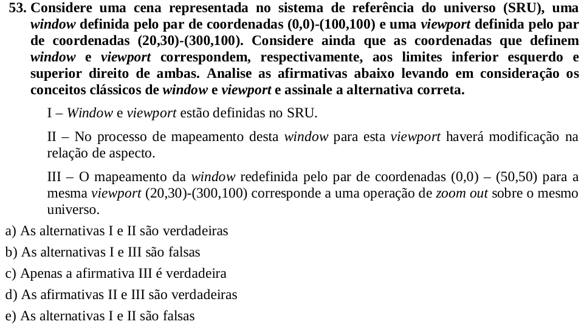

> [!success]- Resposta
> **B**
>
> I é falsa: a window está no mundo (SRU) e a viewport no dispositivo. II é verdadeira: window 100×100 (1:1) e viewport 280×70 (4:1), muda a relação de aspecto. III é falsa: window menor (50×50) na mesma viewport é zoom in. Logo I e III falsas.

> [!quote]- Texto extraído (para busca)
> 53. Considere uma cena representada no sistema de referência do universo (SRU), uma window definida pelo par de coordenadas (0,0)-(100,100) e uma viewport definida pelo par de coordenadas (20,30)-(300,100). Considere ainda que as coordenadas que definem window e viewport correspondem, respectivamente, aos limites inferior esquerdo e superior direito de ambas. Analise as afirmativas abaixo levando em consideração os conceitos clássicos de window e viewport e assinale a alternativa correta. I – Window e viewport estão definidas no SRU. II – No processo de mapeamento desta window para esta viewport haverá modificação na relação de aspecto. III – O mapeamento da window redefinida pelo par de coordenadas (0,0) – (50,50) para a mesma viewport (20,30)-(300,100) corresponde a uma operação de zoom out sobre o mesmo universo. a) As alternativas I e II são verdadeiras b) As alternativas I e III são falsas c) Apenas a afirmativa III é verdadeira d) As afirmativas II e III são verdadeiras e) As alternativas I e II são falsas

### P02 · POSCOMP 2003, questão 49

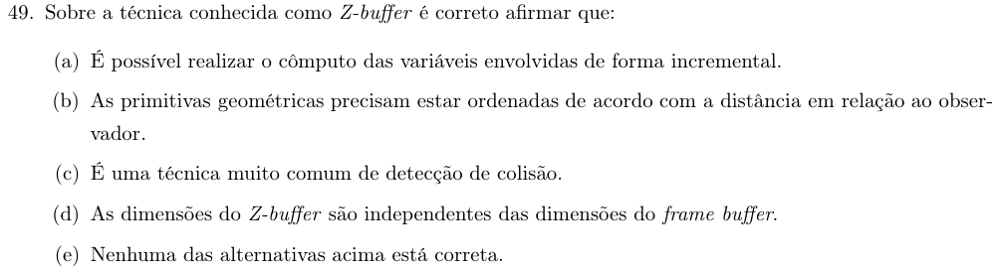

> [!success]- Resposta
> **A**
>
> O z de cada pixel sai incrementalmente durante a varredura. O z-buffer não exige ordenar primitivas, não é detecção de colisão e tem o tamanho do frame buffer.

> [!quote]- Texto extraído (para busca)
> 49. Sobre a técnica conhecida como Z-buffer é correto afirmar que: (a) É possível realizar o cômputo das variáveis envolvidas de forma incremental. (b) As primitivas geométricas precisam estar ordenadas de acordo com a distância em relação ao obser- vador. (c) É uma técnica muito comum de detecção de colisão. (d) As dimensões do Z-buffer são independentes das dimensões do frame buffer. (e) Nenhuma das alternativas acima está correta.

### P03 · POSCOMP 2003, questão 50

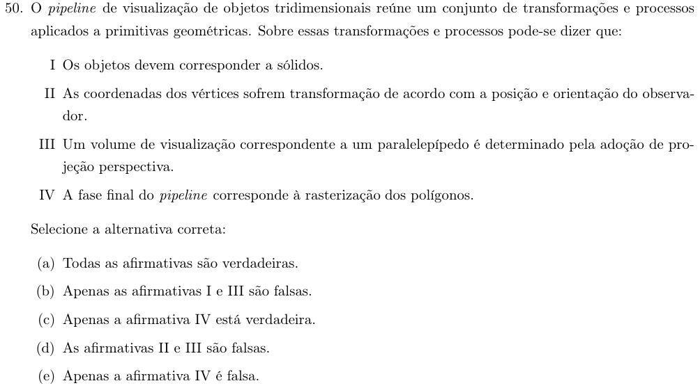

> [!success]- Resposta
> **B**
>
> I falsa (o pipeline trabalha com primitivas, não exige sólidos). II verdadeira (transformação de câmera). III falsa (paralelepípedo é o volume da projeção paralela; a perspectiva dá tronco de pirâmide). IV verdadeira (rasterização no fim).

> [!quote]- Texto extraído (para busca)
> 50. O pipeline de visualização de objetos tridimensionais reúne um conjunto de transformações e processos aplicados a primitivas geométricas. Sobre essas transformações e processos pode-se dizer que: I Os objetos devem corresponder a sólidos. II As coordenadas dos vértices sofrem transformação de acordo com a posição e orientação do observa- dor. III Um volume de visualização correspondente a um paralelepípedo é determinado pela adoção de pro- jeção perspectiva. IV A fase final do pipeline corresponde à rasterização dos polígonos. Selecione a alternativa correta: (a) Todas as afirmativas são verdadeiras. (b) Apenas as afirmativas I e III são falsas. (c) Apenas a afirmativa IV está verdadeira. (d) As afirmativas II e III são falsas. (e) Apenas a afirmativa IV é falsa.

### P04 · POSCOMP 2003, questão 51

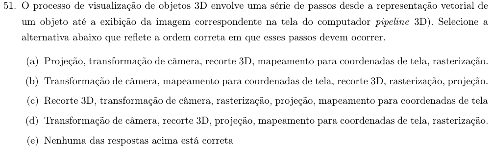

> [!success]- Resposta
> **D**
>
> Câmera → recorte 3D → projeção → mapeamento para a tela → rasterização.

> [!quote]- Texto extraído (para busca)
> 51. O processo de visualização de objetos 3D envolve uma série de passos desde a representação vetorial de um objeto até a exibição da imagem correspondente na tela do computador pipeline 3D). Selecione a alternativa abaixo que reflete a ordem correta em que esses passos devem ocorrer. (a) Projeção, transformação de câmera, recorte 3D, mapeamento para coordenadas de tela, rasterização. (b) Transformação de câmera, mapeamento para coordenadas de tela, recorte 3D, rasterização, projeção. (c) Recorte 3D, transformação de câmera, rasterização, projeção, mapeamento para coordenadas de tela (d) Transformação de câmera, recorte 3D, projeção, mapeamento para coordenadas de tela, rasterização. (e) Nenhuma das respostas acima está correta

### P05 · POSCOMP 2004, questão 57

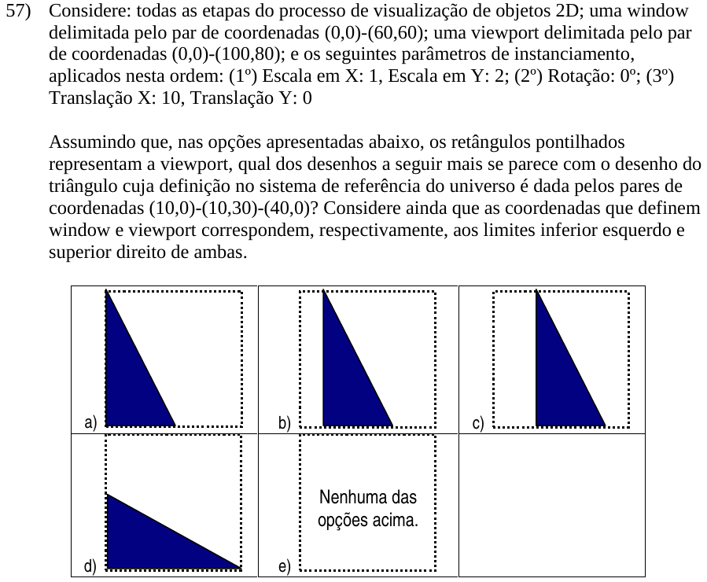

> [!success]- Resposta
> **C**
>
> Escala (1,2) e translação (10,0): o triângulo (10,0)-(10,30)-(40,0) vira (20,0)-(20,60)-(50,0). Na window 0..60 o lado vertical fica a 1/3 da largura, do chão ao topo; o outro vértice a 5/6, embaixo: desenho c.

> [!quote]- Texto extraído (para busca)
> 57) Considere: todas as etapas do processo de visualização de objetos 2D; uma window delimitada pelo par de coordenadas (0,0)-(60,60); uma viewport delimitada pelo par de coordenadas (0,0)-(100,80); e os seguintes parâmetros de instanciamento, aplicados nesta ordem: (1º) Escala em X: 1, Escala em Y: 2; (2º) Rotação: 0º; (3º) Translação X: 10, Translação Y: 0 Assumindo que, nas opções apresentadas abaixo, os retângulos pontilhados representam a viewport, qual dos desenhos a seguir mais se parece com o desenho do triângulo cuja definição no sistema de referência do universo é dada pelos pares de coordenadas (10,0)-(10,30)-(40,0)? Considere ainda que as coordenadas que definem window e viewport correspondem, respectivamente, aos limites inferior esquerdo e superior direito de ambas. a) b) c) Nenhuma das opções acima. d) e)

### P06 · POSCOMP 2004, questão 59

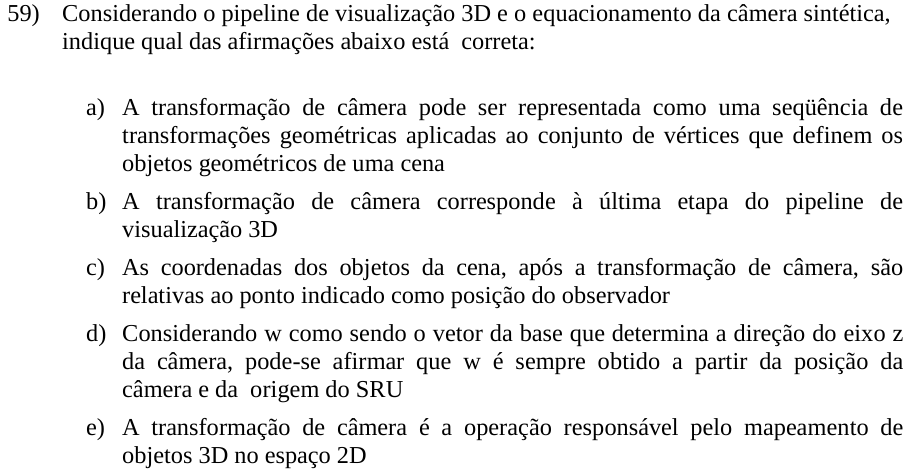

> [!success]- Resposta
> **A**
>
> A transformação de câmera é uma sequência de transformações geométricas (translações e rotações) aplicada aos vértices. Ela não leva para 2D, não é a última etapa, e o eixo w da câmera vem da direção de visada.

> [!quote]- Texto extraído (para busca)
> 59) Considerando o pipeline de visualização 3D e o equacionamento da câmera sintética, indique qual das afirmações abaixo está correta: a) A transformação de câmera pode ser representada como uma seqüência de transformações geométricas aplicadas ao conjunto de vértices que definem os objetos geométricos de uma cena b) A transformação de câmera corresponde à última etapa do pipeline de visualização 3D c) As coordenadas dos objetos da cena, após a transformação de câmera, são relativas ao ponto indicado como posição do observador d) Considerando w como sendo o vetor da base que determina a direção do eixo z da câmera, pode-se afirmar que w é sempre obtido a partir da posição da câmera e da origem do SRU e) A transformação de câmera é a operação responsável pelo mapeamento de objetos 3D no espaço 2D

### P07 · POSCOMP 2004, questão 60

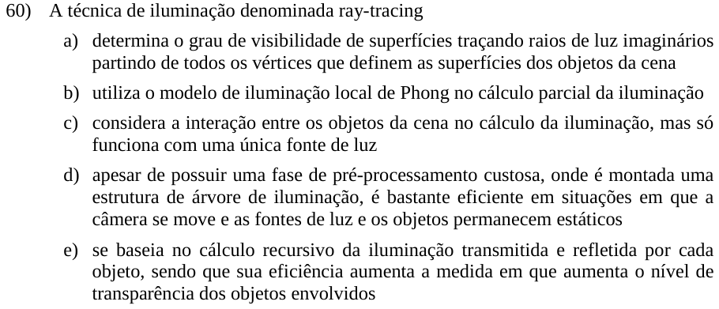

> [!success]- Resposta
> **B**
>
> Ray tracing usa um modelo local (Phong) para a luz direta em cada ponto atingido e soma reflexão e refração recursivamente. Não tem árvore de iluminação pré-calculada, os raios saem do observador, fica mais lento com transparência e aceita várias luzes.

> [!quote]- Texto extraído (para busca)
> 60) A técnica de iluminação denominada ray-tracing a) determina o grau de visibilidade de superfícies traçando raios de luz imaginários partindo de todos os vértices que definem as superfícies dos objetos da cena b) utiliza o modelo de iluminação local de Phong no cálculo parcial da iluminação c) considera a interação entre os objetos da cena no cálculo da iluminação, mas só funciona com uma única fonte de luz d) apesar de possuir uma fase de pré-processamento custosa, onde é montada uma estrutura de árvore de iluminação, é bastante eficiente em situações em que a câmera se move e as fontes de luz e os objetos permanecem estáticos e) se baseia no cálculo recursivo da iluminação transmitida e refletida por cada objeto, sendo que sua eficiência aumenta a medida em que aumenta o nível de transparência dos objetos envolvidos

### P08 · POSCOMP 2005, questão 46

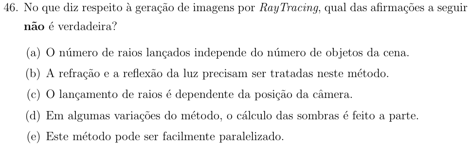

> [!success]- Resposta
> **A**
>
> Falsa: o número de raios depende sim da cena (objetos refletores/transparentes e luzes geram raios secundários e de sombra). O resto é verdade: depende da câmera, trata reflexão e refração, a sombra pode ser à parte, e paraleliza fácil.

> [!quote]- Texto extraído (para busca)
> 46. No que diz respeito à geração de imagens por RayTracing, qual das afirmações a seguir não é verdadeira? (a) O número de raios lançados independe do número de objetos da cena. (b) A refração e a reflexão da luz precisam ser tratadas neste método. (c) O lançamento de raios é dependente da posição da câmera. (d) Em algumas variações do método, o cálculo das sombras é feito a parte. (e) Este método pode ser facilmente paralelizado.

### P09 · POSCOMP 2005, questão 56

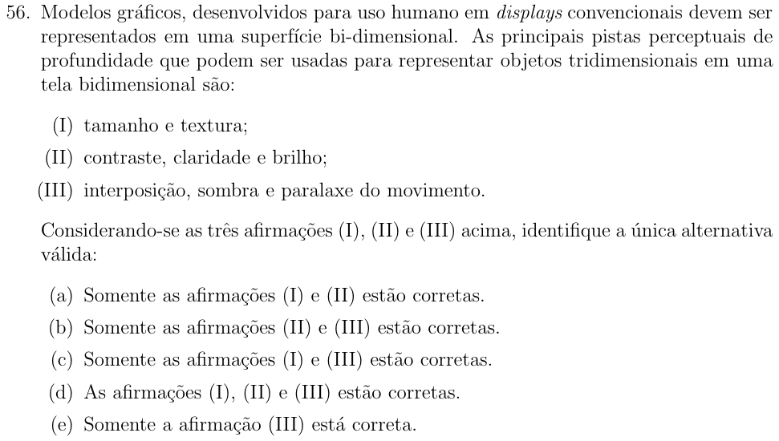

> [!success]- Resposta
> **D**
>
> Gabarito: as três estão corretas. Tamanho e textura (gradiente de textura), contraste/claridade/brilho (perspectiva atmosférica) e interposição, sombra e paralaxe de movimento são todas pistas de profundidade.

> [!quote]- Texto extraído (para busca)
> 56. Modelos gráficos, desenvolvidos para uso humano em displays convencionais devem ser representados em uma superfı́cie bi-dimensional. As principais pistas perceptuais de profundidade que podem ser usadas para representar objetos tridimensionais em uma tela bidimensional são: (I) tamanho e textura; (II) contraste, claridade e brilho; (III) interposição, sombra e paralaxe do movimento. Considerando-se as três afirmações (I), (II) e (III) acima, identifique a única alternativa válida: (a) Somente as afirmações (I) e (II) estão corretas. (b) Somente as afirmações (II) e (III) estão corretas. (c) Somente as afirmações (I) e (III) estão corretas. (d) As afirmações (I), (II) e (III) estão corretas. (e) Somente a afirmação (III) está correta.

### P10 · POSCOMP 2006, questão 49

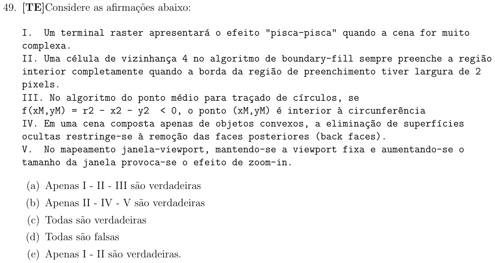

> [!success]- Resposta
> **D**
>
> I: pisca-pisca com cena complexa é do display vetorial, não do raster. II: vizinhança 4 não passa por ligações diagonais. III: f = r² − x² − y² < 0 quer dizer ponto FORA. IV: vários convexos ainda se escondem, backface não basta. V: aumentar a janela é zoom out. Todas falsas.

> [!quote]- Texto extraído (para busca)
> 49. [TE]Considere as afirmações abaixo: I. Um terminal raster apresentará o efeito "pisca-pisca" quando a cena for muito complexa. II. Uma célula de vizinhança 4 no algoritmo de boundary-fill sempre preenche a regi~ ao interior completamente quando a borda da regi~ ao de preenchimento tiver largura de 2 pixels. III. No algoritmo do ponto médio para traçado de cı́rculos, se f(xM,yM) = r2 - x2 - y2 < 0, o ponto (xM,yM) é interior à circunfer^ encia IV. Em uma cena composta apenas de objetos convexos, a eliminaç~ ao de superfı́cies ocultas restringe-se à remoç~ ao das faces posteriores (back faces). V. No mapeamento janela-viewport, mantendo-se a viewport fixa e aumentando-se o tamanho da janela provoca-se o efeito de zoom-in. (a) Apenas I - II - III são verdadeiras (b) Apenas II - IV - V são verdadeiras (c) Todas são verdadeiras (d) Todas são falsas (e) Apenas I - II são verdadeiras.

### P11 · POSCOMP 2006, questão 50

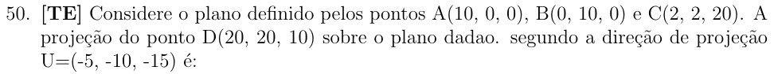

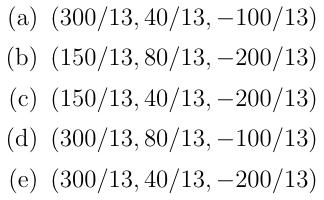

> [!success]- Resposta
> **C**
>
> Normal do plano: (B − A) × (C − A) ∝ (10,10,3), plano 10x + 10y + 3z = 100. D + tU = (20 − 5t, 20 − 10t, 10 − 15t) cai no plano em t = 22/13 → (150/13, 40/13, −200/13).

> [!quote]- Texto extraído (para busca)
> 50. [TE] Considere o plano definido pelos pontos A(10, 0, 0), B(0, 10, 0) e C(2, 2, 20). A projeção do ponto D(20, 20, 10) sobre o plano dadao. segundo a direção de projeção U=(-5, -10, -15) é: (a) (300/13, 40/13, −100/13) (b) (150/13, 80/13, −200/13) (c) (150/13, 40/13, −200/13) (d) (300/13, 80/13, −100/13) (e) (300/13, 40/13, −200/13)

### P12 · POSCOMP 2007, questão 49

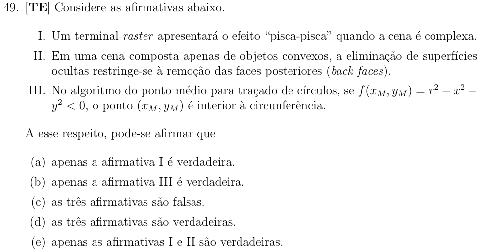

> [!success]- Resposta
> **C**
>
> Mesmas afirmações do POSCOMP 2006: I é falsa (pisca-pisca é do vetorial), II é falsa (vários objetos convexos ainda se escondem), III é falsa (com f = r² − x² − y², f < 0 é fora). As três são falsas.

> [!quote]- Texto extraído (para busca)
> 49. [TE] Considere as afirmativas abaixo. I. Um terminal raster apresentará o efeito “pisca-pisca” quando a cena é complexa. II. Em uma cena composta apenas de objetos convexos, a eliminação de superfı́cies ocultas restringe-se à remoção das faces posteriores (back faces). III. No algoritmo do ponto médio para traçado de cı́rculos, se f (x M , y M ) = r 2 − x 2 − y 2 < 0, o ponto (x M , y M ) é interior à circunferência. A esse respeito, pode-se afirmar que (a) apenas a afirmativa I é verdadeira. (b) apenas a afirmativa III é verdadeira. (c) as três afirmativas são falsas. (d) as três afirmativas são verdadeiras. (e) apenas as afirmativas I e II são verdadeiras.

### P13 · POSCOMP 2007, questão 50

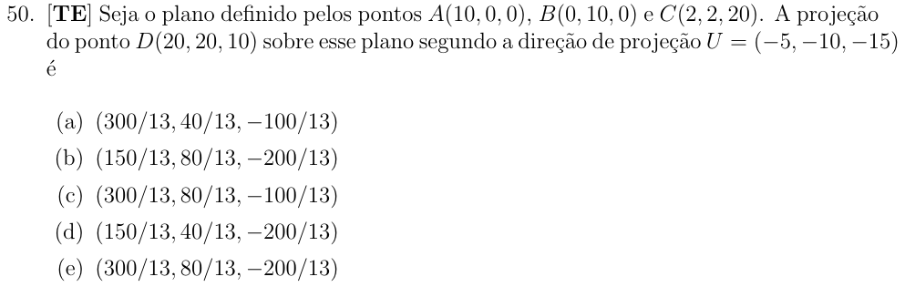

> [!success]- Resposta
> **D**
>
> Mesma conta do POSCOMP 2006: plano 10x + 10y + 3z = 100, t = 22/13, ponto (150/13, 40/13, −200/13).

> [!quote]- Texto extraído (para busca)
> 50. [TE] Seja o plano definido pelos pontos A(10, 0, 0), B(0, 10, 0) e C(2, 2, 20). A projeção do ponto D(20, 20, 10) sobre esse plano segundo a direção de projeção U = (−5, −10, −15) é (a) (300/13, 40/13, −100/13) (b) (150/13, 80/13, −200/13) (c) (300/13, 80/13, −100/13) (d) (150/13, 40/13, −200/13) (e) (300/13, 80/13, −200/13)

### P14 · POSCOMP 2007, questão 51

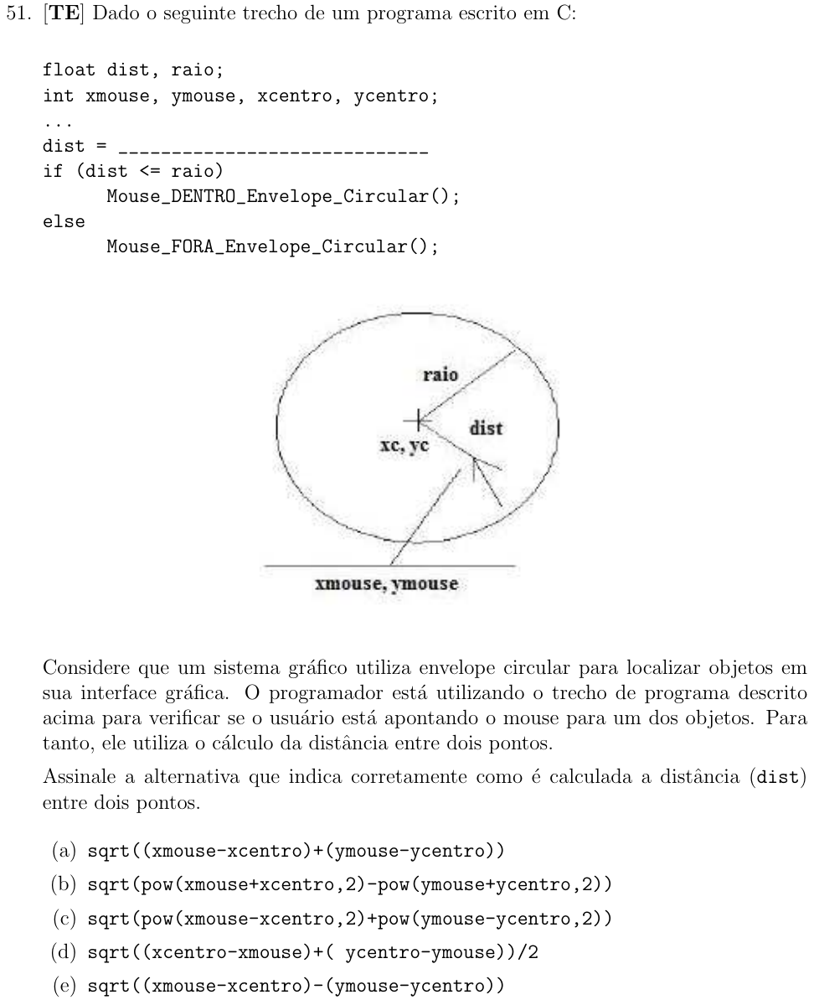

> [!success]- Resposta
> **C**
>
> Distância euclidiana: sqrt((xm − xc)² + (ym − yc)²). Se for ≤ raio, o mouse está dentro do envelope circular.

> [!quote]- Texto extraído (para busca)
> 51. [TE] Dado o seguinte trecho de um programa escrito em C: float dist, raio; int xmouse, ymouse, xcentro, ycentro; ... dist = _____________________________ if (dist <= raio) Mouse_DENTRO_Envelope_Circular(); else Mouse_FORA_Envelope_Circular(); Considere que um sistema gráfico utiliza envelope circular para localizar objetos em sua interface gráfica. O programador está utilizando o trecho de programa descrito acima para verificar se o usuário está apontando o mouse para um dos objetos. Para tanto, ele utiliza o cálculo da distância entre dois pontos. Assinale a alternativa que indica corretamente como é calculada a distância (dist) entre dois pontos. (a) sqrt((xmouse-xcentro)+(ymouse-ycentro)) (b) sqrt(pow(xmouse+xcentro,2)-pow(ymouse+ycentro,2)) (c) sqrt(pow(xmouse-xcentro,2)+pow(ymouse-ycentro,2)) (d) sqrt((xcentro-xmouse)+( ycentro-ymouse))/2 (e) sqrt((xmouse-xcentro)-(ymouse-ycentro))

### P15 · POSCOMP 2008, questão 15

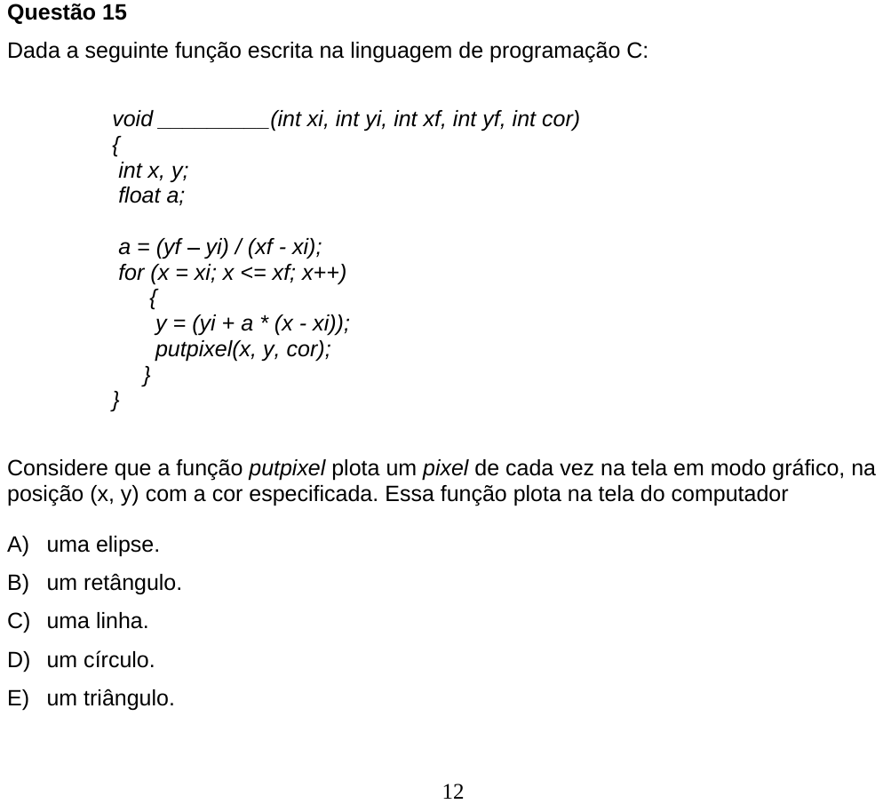

> [!success]- Resposta
> **C**
>
> y = yi + a·(x − xi) com a = (yf − yi)/(xf − xi) é a equação da reta: para cada x acende um pixel, desenha uma linha.

> [!quote]- Texto extraído (para busca)
> Questão 15 Dada a seguinte função escrita na linguagem de programação C: void _________(int xi, int yi, int xf, int yf, int cor) { int x, y; float a; a = (yf yi) / (xf - xi); for (x = xi; x <= xf; x++) { y = (yi + a * (x - xi)); putpixel(x, y, cor); } } Considere que a função putpixel plota um pixel de cada vez na tela em modo gráfico, na posição (x, y) com a cor especificada. Essa função plota na tela do computador A) uma elipse. B) um retângulo. C) uma linha. D) um círculo. E) um triângulo. 12

### P16 · POSCOMP 2009, questão 58

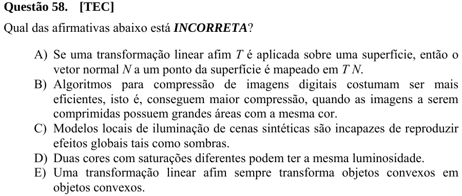

> [!success]- Resposta
> **A**
>
> A incorreta é a A: normais não se transformam por T, e sim pela inversa transposta (T⁻¹)ᵀ (com escala não uniforme, T·N deixa de ser perpendicular à superfície). B, C, D e E são verdadeiras (transformação afim preserva convexidade).

> [!quote]- Texto extraído (para busca)
> Questão 58. [TEC] Qual das afirmativas abaixo está INCORRETA? A) Se uma transformação linear afim T é aplicada sobre uma superfície, então o vetor normal N a um ponto da superfície é mapeado em T N. B) Algoritmos para compressão de imagens digitais costumam ser mais eficientes, isto é, conseguem maior compressão, quando as imagens a serem comprimidas possuem grandes áreas com a mesma cor. C) Modelos locais de iluminação de cenas sintéticas são incapazes de reproduzir efeitos globais tais como sombras. D) Duas cores com saturações diferentes podem ter a mesma luminosidade. E) Uma transformação linear afim sempre transforma objetos convexos em objetos convexos.

### P17 · POSCOMP 2009, questão 60

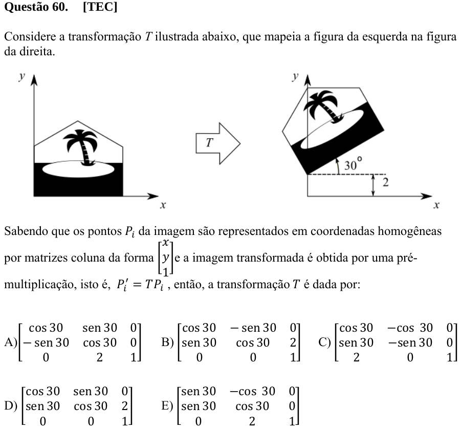

> [!success]- Resposta
> **B**
>
> A figura gira 30° anti-horário e sobe 2. Com vetor-coluna e pré-multiplicação: T = T(0,2)·R(30°) = [[cos30, −sen30, 0], [sen30, cos30, 2], [0, 0, 1]] = B.

> [!quote]- Texto extraído (para busca)
> Questão 60. [TEC] Considere a transformação T ilustrada abaixo, que mapeia a figura da esquerda na figura da direita. Sabendo que os pontos da imagem são representados em coordenadas homogêneas por matrizes coluna da forma multiplicação, isto é, e a imagem transformada é obtida por uma pré- 1 , então, a transformação cos 30 sen 30 0 sen 30 0 cos 30 0 2 1 cos 30 B) sen 30 0 sen 30 0 cos 30 2 0 1 cos 30 D) sen 30 0 sen 30 0 cos 30 2 0 1 sen 30 E) sen 30 0 cos 30 0 cos 30 0 2 1 A) é dada por: cos 30 C) sen 30 2 cos 30 0 sen 30 0 0 1

### P18 · POSCOMP 2010, questão 51

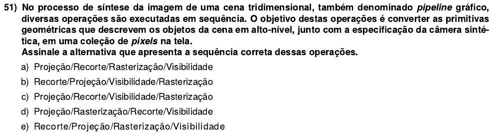

> [!success]- Resposta
> **E**
>
> Recorte, projeção, rasterização e por último visibilidade (z-buffer pixel a pixel).

> [!quote]- Texto extraído (para busca)
> 51) No processo de síntese da imagem de uma cena tridimensional, também denominado pipeline gráÆco, diversas operações são executadas em sequência. O objetivo destas operações é converter as primitivas geométricas que descrevem os objetos da cena em alto-nível, junto com a especiÆcação da câmera sinté- tica, em uma coleção de pixels na tela. Assinale a alternativa que apresenta a sequência correta dessas operações. a) Projeção/Recorte/Rasterização/Visibilidade b) Recorte/Projeção/Visibilidade/Rasterização c) Projeção/Recorte/Visibilidade/Rasterização d) Projeção/Rasterização/Recorte/Visibilidade e) Rec o r t e/Pro j eç ão /Ras t er i zaç ão /Vi s i b i l i d ad e

### P19 · POSCOMP 2010, questão 52

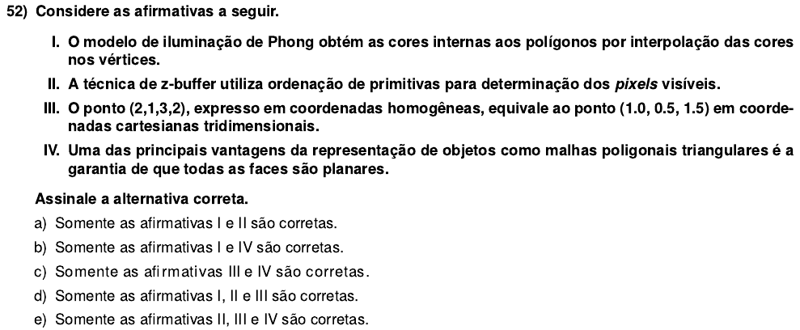

> [!success]- Resposta
> **C**
>
> I falsa (Phong interpola normais; quem interpola cor é Gouraud). II falsa (z-buffer não ordena). III verdadeira ((2,1,3,2)/2 = (1; 0,5; 1,5)). IV verdadeira (triângulo é sempre planar).

> [!quote]- Texto extraído (para busca)
> 52) Considere as aÆrmativas a seguir. I. O modelo de iluminação de Phong obtém as cores internas aos polígonos por interpolação das cores nos vértices. II. A técnica de z-buffer utiliza ordenação de primitivas para determinação dos pixels visíveis. III. O ponto (2,1,3,2), expresso em coordenadas homogêneas, equivale ao ponto (1.0, 0.5, 1.5) em coorde- nadas cartesianas tridimensionais. IV. Uma das principais vantagens da representação de objetos como malhas poligonais triangulares é a garantia de que todas as faces são planares. Assinale a alternativa correta. a) Somente as aÆrmativas I e II são corretas. b) Somente as aÆrmativas I e IV são corretas. c) So m en t e as aÆ r m at i vas III e IV s ão c o r r et as . d) Somente as aÆrmativas I, II e III são corretas. e) Somente as aÆrmativas II, III e IV são corretas.

### P20 · POSCOMP 2010, questão 53

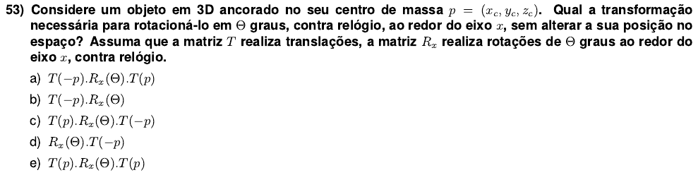

> [!success]- Resposta
> **C**
>
> Leva p à origem, gira e devolve. Com vetor-coluna a primeira transformação fica à direita: T(p)·Rx(Θ)·T(−p).

> [!quote]- Texto extraído (para busca)
> 53) Considere um objeto em 3D ancorado no seu centro de massa p = ( x , y , z ) . Qual a transformação necessária para rotacioná-lo em Θ graus, contra relógio, ao redor do eixo x , sem alterar a sua posição no espaço? Assuma que a matriz T realiza translações, a matriz R realiza rotações de Θ graus ao redor do eixo x , contra relógio. c c c x a) b) c) d) e) T (− p ) .R x (Θ) .T ( p ) T (− p ) .R x (Θ) T ( p ) .R x (Θ) .T (− p ) R x (Θ) .T (− p ) T ( p ) .R x (Θ) .T ( p )

### P21 · POSCOMP 2010, questão 55

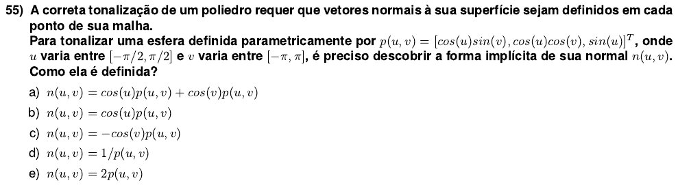

> [!success]- Resposta
> **B**
>
> Na esfera unitária centrada na origem a normal tem a direção do próprio ponto. ∂p/∂u × ∂p/∂v = cos(u)·p(u,v).

> [!quote]- Texto extraído (para busca)
> 55) A correta tonalização de um poliedro requer que vetores normais à sua superfície sejam deÆnidos em cada ponto de sua malha. Para tonalizar uma esfera deÆnida parametricamente por p ( u, v ) = [ cos ( u ) sin ( v ) , cos ( u ) cos ( v ) , sin ( u )] , onde u varia entre [− π/ 2 , π/ 2] e v varia entre [− π, π ] , é preciso descobrir a forma implícita de sua normal n ( u, v ) . Como ela é deÆnida? T a) b) c) d) e) n ( u, v ) = cos ( u ) p ( u, v ) + cos ( v ) p ( u, v ) n ( u, v ) = cos ( u ) p ( u, v ) n ( u, v ) = − cos ( v ) p ( u, v ) n ( u, v ) = 1 /p ( u, v ) n ( u, v ) = 2 p ( u, v )

### P22 · POSCOMP 2011, questão 55

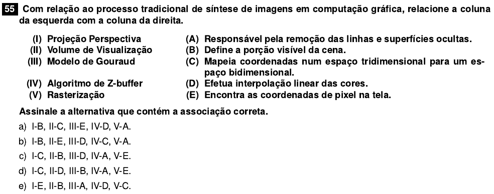

> [!success]- Resposta
> **C**
>
> Projeção perspectiva leva 3D para 2D (I-C), volume de visualização define o visível (II-B), Gouraud interpola cores (III-D), z-buffer remove ocultas (IV-A), rasterização acha os pixels (V-E).

> [!quote]- Texto extraído (para busca)
> 55 Com relação ao processo tradicional de síntese de imagens em computação gráfica, relacione a coluna da esquerda com a coluna da direita. (I) Projeção Perspectiva (A) Responsável pela remoção das linhas e superfícies ocultas. (II) Volume de Visualização (B) Define a porção visível da cena. (III) Modelo de Gouraud (C) Mapeia coordenadas num espaço tridimensional para um es- paço bidimensional. (IV) Algoritmo de Z-buffer (D) Efetua interpolação linear das cores. (V) Rasterização (E) Encontra as coordenadas de pixel na tela. Assinale a alternativa que contém a associação correta. a) I-B, II-C, III-E, IV-D, V-A. b) I-B, II-E, III-D, IV-C, V-A. c) I-C, II-B, III-D, IV-A, V-E. d) I-C, II-D, III-B, IV-A, V-E. e) I-E, II-B, III-A, IV-D, V-C.

### P23 · POSCOMP 2011, questão 58

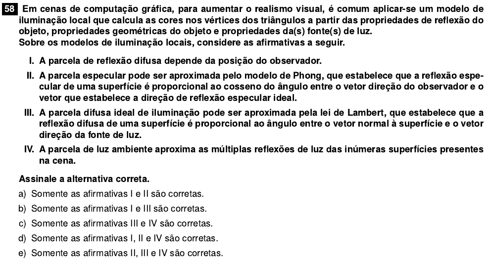

> [!success]- Resposta
> **E**
>
> I falsa: a difusa não depende do observador. II verdadeira: especular de Phong com o cosseno entre observador e reflexão. III aceita como verdadeira (Lambert, ∝ cosseno entre N e L). IV verdadeira: ambiente aproxima as reflexões múltiplas.

> [!quote]- Texto extraído (para busca)
> 58 Em cenas de computação gráfica, para aumentar o realismo visual, é comum aplicar-se um modelo de iluminação local que calcula as cores nos vértices dos triângulos a partir das propriedades de reflexão do objeto, propriedades geométricas do objeto e propriedades da(s) fonte(s) de luz. Sobre os modelos de iluminação locais, considere as afirmativas a seguir. I. A parcela de reflexão difusa depende da posição do observador. II. A parcela especular pode ser aproximada pelo modelo de Phong, que estabelece que a reflexão espe- cular de uma superfície é proporcional ao cosseno do ângulo entre o vetor direção do observador e o vetor que estabelece a direção de reflexão especular ideal. III. A parcela difusa ideal de iluminação pode ser aproximada pela lei de Lambert, que estabelece que a reflexão difusa de uma superfície é proporcional ao ângulo entre o vetor normal à superfície e o vetor direção da fonte de luz. IV. A parcela de luz ambiente aproxima as múltiplas reflexões de luz das inúmeras superfícies presentes na cena. Assinale a alternativa correta. a) Somente as afirmativas I e II são corretas. b) Somente as afirmativas I e III são corretas. c) Somente as afirmativas III e IV são corretas. d) Somente as afirmativas I, II e IV são corretas. e) Somente as afirmativas II, III e IV são corretas.

### P24 · POSCOMP 2012, questão 55

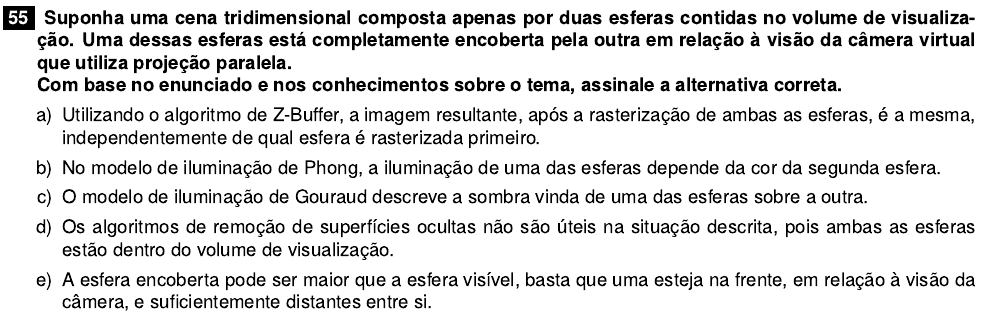

> [!success]- Resposta
> **A**
>
> Z-buffer compara profundidade pixel a pixel, a ordem não importa. Na paralela a esfera escondida não pode ser maior; Gouraud e Phong são locais (sem sombra, sem depender da cor do outro objeto).

> [!quote]- Texto extraído (para busca)
> 55 Suponha uma cena tridimensional composta apenas por duas esferas contidas no volume de visualiza- ção. Uma dessas esferas está completamente encoberta pela outra em relação à visão da câmera virtual que utiliza projeção paralela. Com base no enunciado e nos conhecimentos sobre o tema, assinale a alternativa correta. a) Utilizando o algoritmo de Z-Buffer, a imagem resultante, após a rasterização de ambas as esferas, é a mesma, independentemente de qual esfera é rasterizada primeiro. b) No modelo de iluminação de Phong, a iluminação de uma das esferas depende da cor da segunda esfera. c) O modelo de iluminação de Gouraud descreve a sombra vinda de uma das esferas sobre a outra. d) Os algoritmos de remoção de superfícies ocultas não são úteis na situação descrita, pois ambas as esferas estão dentro do volume de visualização. e) A esfera encoberta pode ser maior que a esfera visível, basta que uma esteja na frente, em relação à visão da câmera, e suficientemente distantes entre si.

### P25 · POSCOMP 2012, questão 58

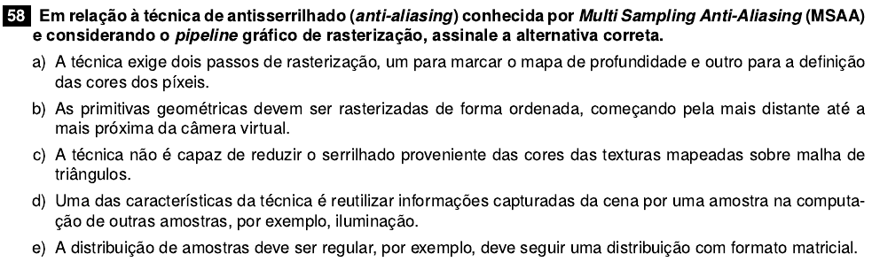

> [!success]- Resposta
> **D**
>
> MSAA calcula o shading uma vez por pixel e reaproveita nas várias amostras de cobertura/profundidade. Rasteriza uma vez, não exige ordem nem grade regular.

> [!quote]- Texto extraído (para busca)
> 58 Em relação à técnica de antisserrilhado (anti-aliasing) conhecida por Multi Sampling Anti-Aliasing (MSAA) e considerando o pipeline gráfico de rasterização, assinale a alternativa correta. a) A técnica exige dois passos de rasterização, um para marcar o mapa de profundidade e outro para a definição das cores dos píxeis. b) As primitivas geométricas devem ser rasterizadas de forma ordenada, começando pela mais distante até a mais próxima da câmera virtual. c) A técnica não é capaz de reduzir o serrilhado proveniente das cores das texturas mapeadas sobre malha de triângulos. d) Uma das características da técnica é reutilizar informações capturadas da cena por uma amostra na computa- ção de outras amostras, por exemplo, iluminação. e) A distribuição de amostras deve ser regular, por exemplo, deve seguir uma distribuição com formato matricial.

### P26 · POSCOMP 2013, questão 56

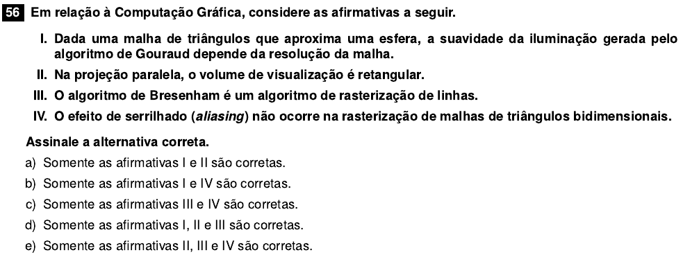

> [!success]- Resposta
> **D**
>
> I verdadeira (Gouraud interpola cor dos vértices, malha mais fina = mais suave). II verdadeira (volume da paralela é retangular). III verdadeira (Bresenham rasteriza linhas). IV falsa (serrilhado aparece em qualquer rasterização).

> [!quote]- Texto extraído (para busca)
> 56 Em relação à Computação Gráfica, considere as afirmativas a seguir. I. Dada uma malha de triângulos que aproxima uma esfera, a suavidade da iluminação gerada pelo algoritmo de Gouraud depende da resolução da malha. II. Na projeção paralela, o volume de visualização é retangular. III. O algoritmo de Bresenham é um algoritmo de rasterização de linhas. IV. O efeito de serrilhado (aliasing) não ocorre na rasterização de malhas de triângulos bidimensionais. Assinale a alternativa correta. a) Somente as afirmativas I e II são corretas. b) Somente as afirmativas I e IV são corretas. c) Somente as afirmativas III e IV são corretas. d) Somente as afirmativas I, II e III são corretas. e) Somente as afirmativas II, III e IV são corretas.

### P27 · POSCOMP 2013, questão 58

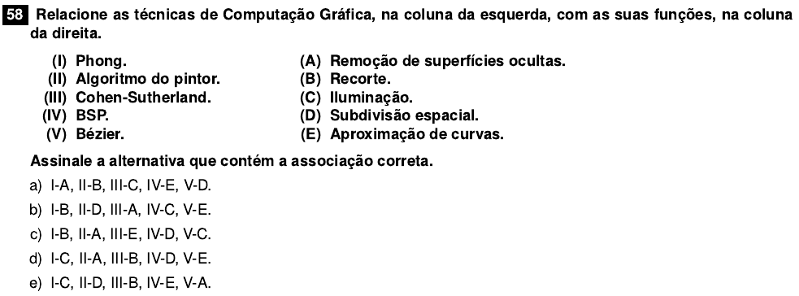

> [!success]- Resposta
> **D**
>
> Phong → iluminação, pintor → superfícies ocultas, Cohen-Sutherland → recorte, BSP → subdivisão espacial, Bézier → aproximação de curvas: I-C, II-A, III-B, IV-D, V-E.

> [!quote]- Texto extraído (para busca)
> 58 Relacione as técnicas de Computação Gráfica, na coluna da esquerda, com as suas funções, na coluna da direita. (I) Phong. (A) Remoção de superfícies ocultas. (II) Algoritmo do pintor. (B) Recorte. (III) Cohen-Sutherland. (C) Iluminação. (IV) BSP. (D) Subdivisão espacial. (V) Bézier. (E) Aproximação de curvas. Assinale a alternativa que contém a associação correta. a) I-A, II-B, III-C, IV-E, V-D. b) I-B, II-D, III-A, IV-C, V-E. c) I-B, II-A, III-E, IV-D, V-C. d) I-C, II-A, III-B, IV-D, V-E. e) I-C, II-D, III-B, IV-E, V-A.

### P28 · POSCOMP 2013, questão 60

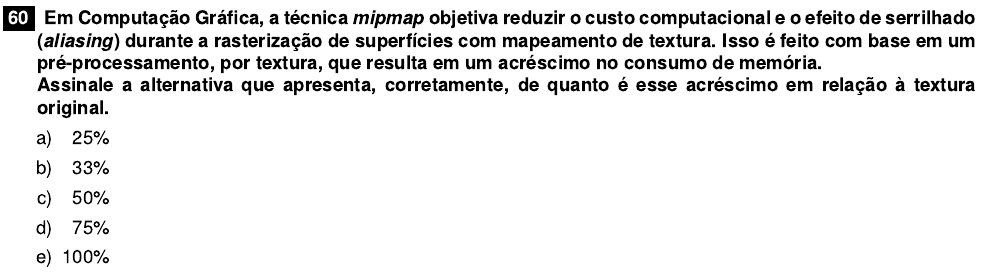

> [!success]- Resposta
> **B**
>
> Cada nível do mipmap tem 1/4 dos pixels do anterior: 1/4 + 1/16 + ... = 1/3, cerca de 33% a mais.

> [!quote]- Texto extraído (para busca)
> 60 Em Computação Gráfica, a técnica mipmap objetiva reduzir o custo computacional e o efeito de serrilhado (aliasing) durante a rasterização de superfícies com mapeamento de textura. Isso é feito com base em um pré-processamento, por textura, que resulta em um acréscimo no consumo de memória. Assinale a alternativa que apresenta, corretamente, de quanto é esse acréscimo em relação à textura original. a) 025% b) 033% c) 050% d) 075% e) 100%

### P29 · POSCOMP 2014, questão 57

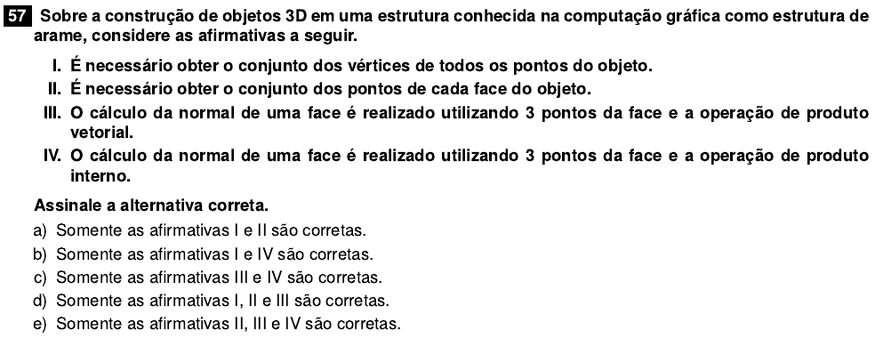

> [!success]- Resposta
> **D**
>
> Arame: vértices (I) e pontos de cada face (II); normal por produto vetorial de duas arestas (III). Produto interno dá número, não vetor (IV falsa).

> [!quote]- Texto extraído (para busca)
> 57 Sobre a construção de objetos 3D em uma estrutura conhecida na computação gráfica como estrutura de arame, considere as afirmativas a seguir. I. É necessário obter o conjunto dos vértices de todos os pontos do objeto. II. É necessário obter o conjunto dos pontos de cada face do objeto. III. O cálculo da normal de uma face é realizado utilizando 3 pontos da face e a operação de produto vetorial. IV. O cálculo da normal de uma face é realizado utilizando 3 pontos da face e a operação de produto interno. Assinale a alternativa correta. a) Somente as afirmativas I e II são corretas. b) Somente as afirmativas I e IV são corretas. c) Somente as afirmativas III e IV são corretas. d) Somente as afirmativas I, II e III são corretas. e) Somente as afirmativas II, III e IV são corretas.

### P30 · POSCOMP 2014, questão 58

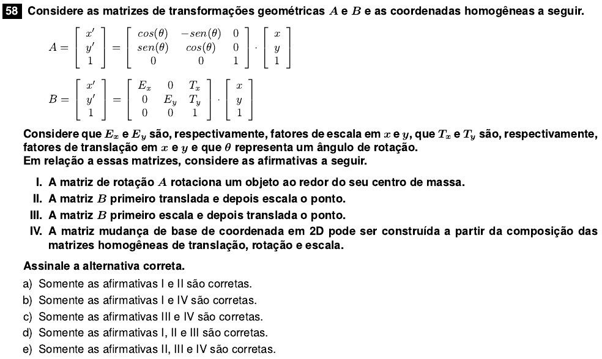

> [!success]- Resposta
> **C**
>
> A gira em torno da origem (I falsa). B com vetor-coluna dá x' = Ex·x + Tx: escala e depois translada (III verdadeira, II falsa). IV verdadeira: mudança de base 2D é composição de translação, rotação e escala.

> [!quote]- Texto extraído (para busca)
> 58 Considere as matrizes de transformações geométricas A e B e as coordenadas homogêneas a seguir.     ′   cos θ sen θ x x ′   y  A  y   sen θ cos θ ( ) = = 1 − ( ) 0 ( ) ( ) 0 0 0 1      ′   E x 0 T x x x B =  y ′  =  0 E y T y    y  1 0 0 1 1 1 Considere que E x e E y são, respectivamente, fatores de escala em x e y , que T x e T y são, respectivamente, fatores de translação em x e y e que θ representa um ângulo de rotação. Em relação a essas matrizes, considere as afirmativas a seguir. I. A matriz de rotação A rotaciona um objeto ao redor do seu centro de massa. II. A matriz B primeiro translada e depois escala o ponto. III. A matriz B primeiro escala e depois translada o ponto. IV. A matriz mudança de base de coordenada em 2D pode ser construída a partir da composição das matrizes homogêneas de translação, rotação e escala. Assinale a alternativa correta. a) Somente as afirmativas I e II são corretas. b) Somente as afirmativas I e IV são corretas. c) Somente as afirmativas III e IV são corretas. d) Somente as afirmativas I, II e III são corretas. e) Somente as afirmativas II, III e IV são corretas.

### P31 · POSCOMP 2015, questão 57

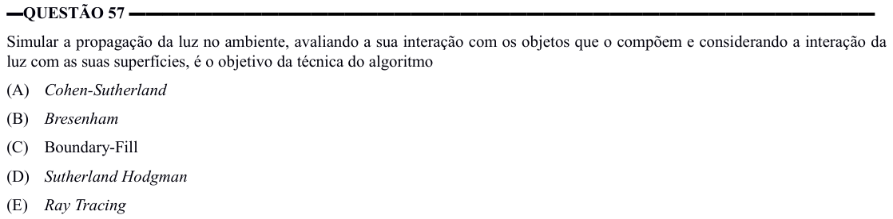

> [!success]- Resposta
> **E**
>
> Simular a propagação da luz e sua interação com as superfícies é ray tracing. Bresenham traça retas, Cohen-Sutherland e Sutherland-Hodgman recortam, boundary-fill preenche.

> [!quote]- Texto extraído (para busca)
> QUESTÃO 57 ▬▬▬▬▬▬▬▬▬▬▬▬▬▬▬▬▬▬▬▬▬▬▬▬▬▬▬▬▬▬▬▬▬▬▬▬▬▬▬▬▬▬▬▬▬ Simular a propagação da luz no ambiente, avaliando a sua interação com os objetos que o compõem e considerando a interação da luz com as suas superfícies, é o objetivo da técnica do algoritmo (A) Cohen-Sutherland (B) Bresenham (C) Boundary-Fill (D) Sutherland Hodgman (E) Ray Tracing

### P32 · POSCOMP 2015, questão 58

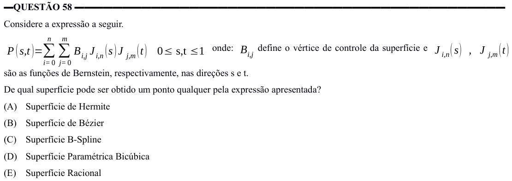

> [!success]- Resposta
> **B**
>
> Soma dupla de pontos de controle pesados por funções de Bernstein em s e t é a superfície de Bézier.

> [!quote]- Texto extraído (para busca)
> QUESTÃO 58 ▬▬▬▬▬▬▬▬▬▬▬▬▬▬▬▬▬▬▬▬▬▬▬▬▬▬▬▬▬▬▬▬▬▬▬▬▬▬▬▬▬▬▬▬▬ Considere a expressão a seguir. n m P ( s,t ) = ∑ ∑ B i,j J i,n ( s ) J j,m ( t ) 0≤ s,t ≤1 onde: B i,j define o vértice de controle da superfície e J i,n ( s ) , J j,m ( t ) i= 0 j= 0 são as funções de Bernstein, respectivamente, nas direções s e t. De qual superfície pode ser obtido um ponto qualquer pela expressão apresentada? (A) Superfície de Hermite (B) Superfície de Bézier (C) Superfície B-Spline (D) Superfície Paramétrica Bicúbica (E) Superfície Racional

### P33 · POSCOMP 2015, questão 70

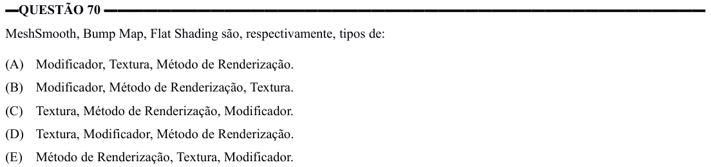

> [!success]- Resposta
> **A**
>
> MeshSmooth é um modificador (de malha), bump map é um tipo de textura, flat shading é um método de renderização.

> [!quote]- Texto extraído (para busca)
> QUESTÃO 70 ▬▬▬▬▬▬▬▬▬▬▬▬▬▬▬▬▬▬▬▬▬▬▬▬▬▬▬▬▬▬▬▬▬▬▬▬▬▬▬▬▬▬▬▬▬ MeshSmooth, Bump Map, Flat Shading são, respectivamente, tipos de: (A) Modificador, Textura, Método de Renderização. (B) Modificador, Método de Renderização, Textura. (C) Textura, Método de Renderização, Modificador. (D) Textura, Modificador, Método de Renderização. (E) Método de Renderização, Textura, Modificador.

### P34 · POSCOMP 2016, questão 57

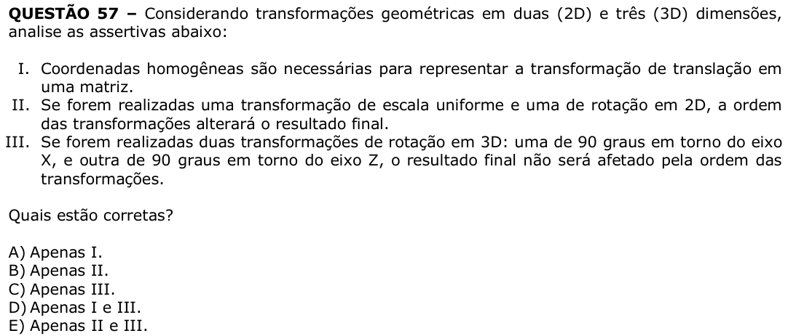

> [!success]- Resposta
> **A**
>
> I verdadeira (translação só vira matriz em homogêneas). II falsa (escala uniforme comuta com rotação). III falsa (rotações em eixos diferentes não comutam).

> [!quote]- Texto extraído (para busca)
> QUESTÃO 57 – Considerando transformações geométricas em duas (2D) e três (3D) dimensões, analise as assertivas abaixo: I. Coordenadas homogêneas são necessárias para representar a transformação de translação em uma matriz. II. Se forem realizadas uma transformação de escala uniforme e uma de rotação em 2D, a ordem das transformações alterará o resultado final. III. Se forem realizadas duas transformações de rotação em 3D: uma de 90 graus em torno do eixo X, e outra de 90 graus em torno do eixo Z, o resultado final não será afetado pela ordem das transformações. Quais estão corretas? A) Apenas I. B) Apenas II. C) Apenas III. D) Apenas I e III. E) Apenas II e III.

### P35 · POSCOMP 2016, questão 58

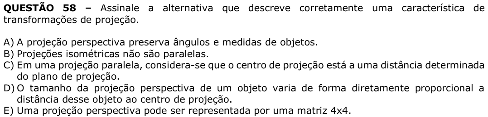

> [!success]- Resposta
> **E**
>
> Perspectiva em homogêneas é uma 4×4. Ela não preserva ângulos e medidas, isométricas são paralelas, na paralela o centro de projeção está no infinito, e o tamanho projetado é inversamente proporcional à distância.

> [!quote]- Texto extraído (para busca)
> QUESTÃO 58 – Assinale a alternativa que descreve corretamente uma característica de transformações de projeção. A) A projeção perspectiva preserva ângulos e medidas de objetos. B) Projeções isométricas não são paralelas. C) Em uma projeção paralela, considera-se que o centro de projeção está a uma distância determinada do plano de projeção. D) O tamanho da projeção perspectiva de um objeto varia de forma diretamente proporcional a distância desse objeto ao centro de projeção. E) Uma projeção perspectiva pode ser representada por uma matriz 4x4.

### P36 · POSCOMP 2017, questão 57

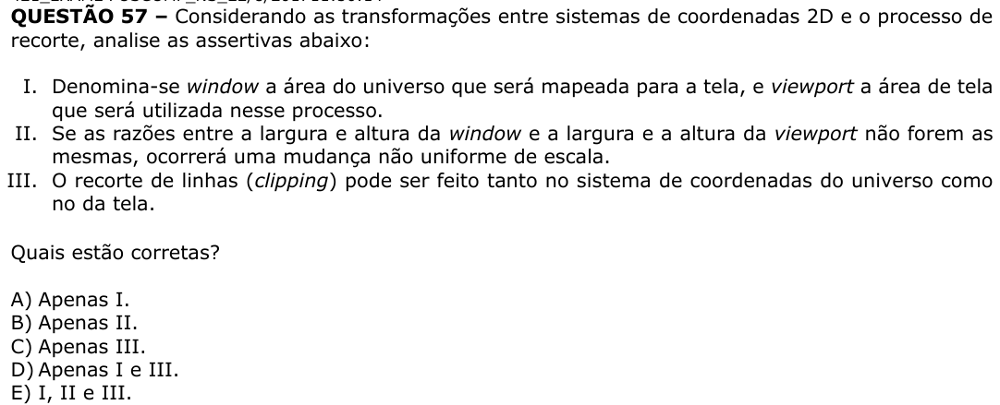

> [!success]- Resposta
> **E**
>
> I é a definição de window e viewport. II: proporções diferentes dão escala não uniforme. III: o recorte pode ser feito no mundo ou na tela. Todas corretas.

> [!quote]- Texto extraído (para busca)
> QUESTÃO 57 – Considerando as transformações entre sistemas de coordenadas 2D e o processo de recorte, analise as assertivas abaixo: I. Denomina-se window a área do universo que será mapeada para a tela, e viewport a área de tela que será utilizada nesse processo. II. Se as razões entre a largura e altura da window e a largura e a altura da viewport não forem as mesmas, ocorrerá uma mudança não uniforme de escala. III. O recorte de linhas (clipping) pode ser feito tanto no sistema de coordenadas do universo como no da tela. Quais estão corretas? A) Apenas I. B) Apenas II. C) Apenas III. D) Apenas I e III. E) I, II e III.

### P37 · POSCOMP 2017, questão 58

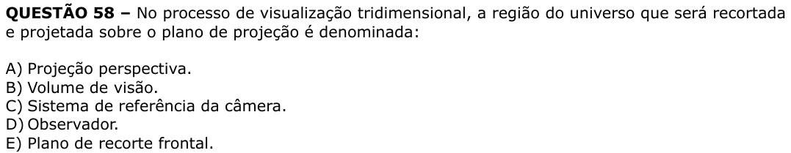

> [!success]- Resposta
> **B**
>
> A região do mundo que será recortada e projetada é o volume de visão (frustum na perspectiva, paralelepípedo na paralela).

> [!quote]- Texto extraído (para busca)
> QUESTÃO 58 – No processo de visualização tridimensional, a região do universo que será recortada e projetada sobre o plano de projeção é denominada: A) Projeção perspectiva. B) Volume de visão. C) Sistema de referência da câmera. D) Observador. E) Plano de recorte frontal.

### P38 · POSCOMP 2018, questão 57

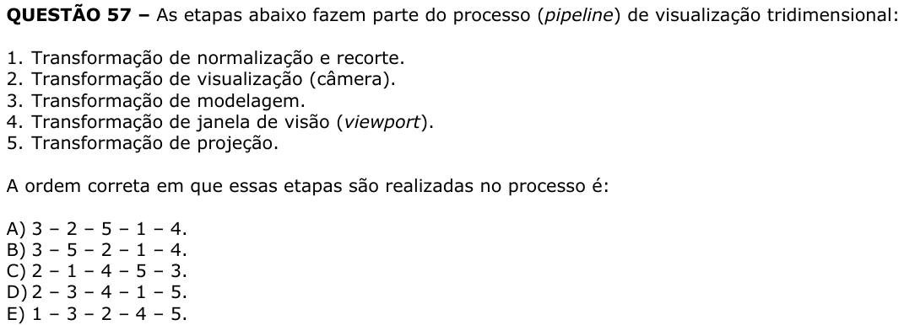

> [!success]- Resposta
> **A**
>
> Modelagem (3), câmera (2), projeção (5), normalização e recorte (1), viewport (4): 3-2-5-1-4.

> [!quote]- Texto extraído (para busca)
> QUESTÃO 57 – As etapas abaixo fazem parte do processo (pipeline) de visualização tridimensional: 1. Transformação de normalização e recorte. 2. Transformação de visualização (câmera). 3. Transformação de modelagem. 4. Transformação de janela de visão (viewport). 5. Transformação de projeção. A ordem correta em que essas etapas são realizadas no processo é: A) 3 – 2 – 5 – 1 – 4. B) 3 – 5 – 2 – 1 – 4. C) 2 – 1 – 4 – 5 – 3. D) 2 – 3 – 4 – 1 – 5. E) 1 – 3 – 2 – 4 – 5.

### P39 · POSCOMP 2018, questão 58

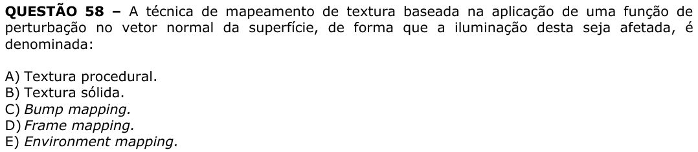

> [!success]- Resposta
> **C**
>
> Perturbar a normal para afetar só a iluminação, sem mudar a geometria, é bump mapping.

> [!quote]- Texto extraído (para busca)
> QUESTÃO 58 – A técnica de mapeamento de textura baseada na aplicação de uma função de perturbação no vetor normal da superfície, de forma que a iluminação desta seja afetada, é denominada: A) Textura procedural. B) Textura sólida. C) Bump mapping. D) Frame mapping. E) Environment mapping.

### P40 · POSCOMP 2019, questão 57

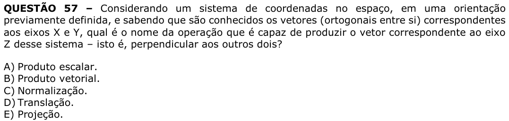

> [!success]- Resposta
> **B**
>
> O produto vetorial X × Y dá o vetor perpendicular aos dois, o eixo Z.

> [!quote]- Texto extraído (para busca)
> QUESTÃO 57 – Considerando um sistema de coordenadas no espaço, em uma orientação previamente definida, e sabendo que são conhecidos os vetores (ortogonais entre si) correspondentes aos eixos X e Y, qual é o nome da operação que é capaz de produzir o vetor correspondente ao eixo Z desse sistema – isto é, perpendicular aos outros dois? A) Produto escalar. B) Produto vetorial. C) Normalização. D) Translação. E) Projeção.

### P41 · POSCOMP 2019, questão 58

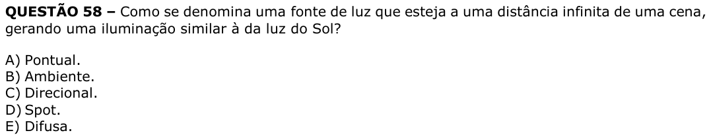

> [!success]- Resposta
> **C**
>
> Luz no infinito, raios paralelos e mesma direção na cena toda, como o Sol: fonte direcional.

> [!quote]- Texto extraído (para busca)
> QUESTÃO 58 – Como se denomina uma fonte de luz que esteja a uma distância infinita de uma cena, gerando uma iluminação similar à da luz do Sol? A) Pontual. B) Ambiente. C) Direcional. D) Spot. E) Difusa.

### P42 · POSCOMP 2022, questão 57

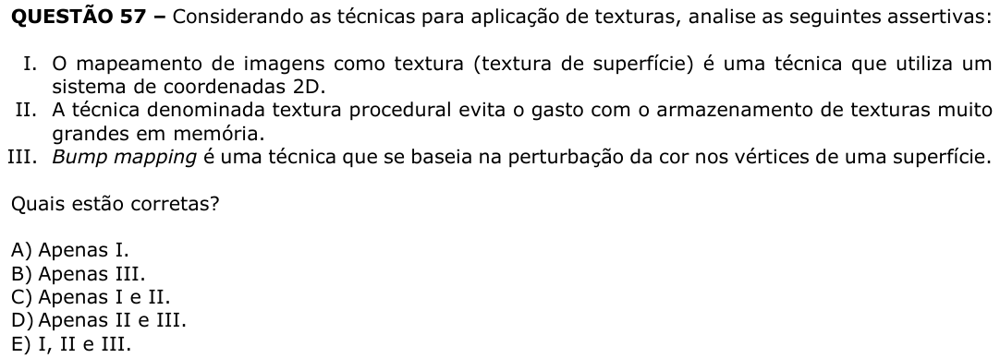

> [!success]- Resposta
> **C**
>
> I verdadeira (textura de imagem usa coordenadas 2D (u,v)). II verdadeira (procedural gera a textura por função, sem guardar imagem grande). III falsa: bump mapping perturba a NORMAL, não a cor dos vértices.

> [!quote]- Texto extraído (para busca)
> QUESTÃO 57 – Considerando as técnicas para aplicação de texturas, analise as seguintes assertivas: I. O mapeamento de imagens como textura (textura de superfície) é uma técnica que utiliza um sistema de coordenadas 2D. II. A técnica denominada textura procedural evita o gasto com o armazenamento de texturas muito grandes em memória. III. Bump mapping é uma técnica que se baseia na perturbação da cor nos vértices de uma superfície. Quais estão corretas? A) Apenas I. B) Apenas III. C) Apenas I e II. D) Apenas II e III. E) I, II e III.

### P43 · POSCOMP 2022, questão 58

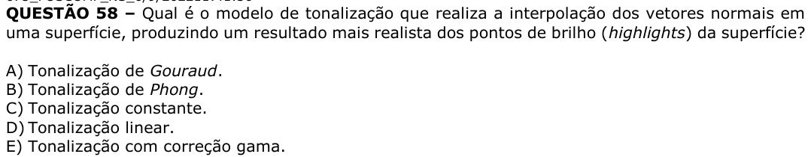

> [!success]- Resposta
> **B**
>
> Interpolar as normais na superfície e calcular a iluminação por pixel é o Phong shading (tonalização de Phong); Gouraud interpola cores.

> [!quote]- Texto extraído (para busca)
> QUESTÃO 58 – Qual é o modelo de tonalização que realiza a interpolação dos vetores normais em uma superfície, produzindo um resultado mais realista dos pontos de brilho (highlights) da superfície? A) Tonalização de Gouraud. B) Tonalização de Phong. C) Tonalização constante. D) Tonalização linear. E) Tonalização com correção gama.

### P44 · POSCOMP 2023, questão 56

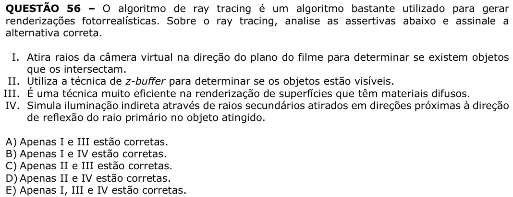

> [!success]- Resposta
> **B**
>
> I verdadeira (raios saem da câmera). II falsa (ray tracing resolve visibilidade pela interseção mais próxima, sem z-buffer). III falsa (é ineficiente para materiais difusos, precisaria de muitos raios). IV verdadeira (raios secundários na direção de reflexão).

> [!quote]- Texto extraído (para busca)
> QUESTÃO 56 – O algoritmo de ray tracing é um algoritmo bastante utilizado para gerar renderizações fotorrealísticas. Sobre o ray tracing, analise as assertivas abaixo e assinale a alternativa correta. I. Atira raios da câmera virtual na direção do plano do filme para determinar se existem objetos que os intersectam. II. Utiliza a técnica de z-buffer para determinar se os objetos estão visíveis. III. É uma técnica muito eficiente na renderização de superfícies que têm materiais difusos. IV. Simula iluminação indireta através de raios secundários atirados em direções próximas à direção de reflexão do raio primário no objeto atingido. A) Apenas I e III estão corretas. B) Apenas I e IV estão corretas. C) Apenas II e III estão corretas. D) Apenas II e IV estão corretas. E) Apenas I, III e IV estão corretas.

### P45 · POSCOMP 2023, questão 57

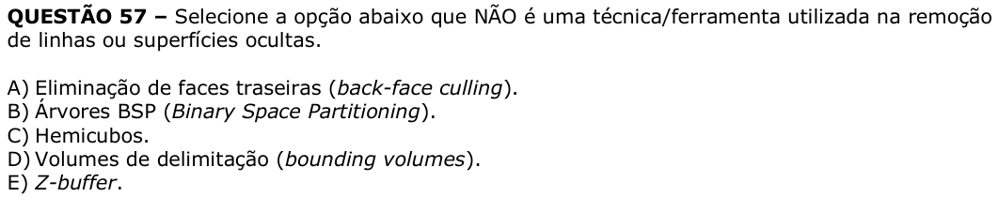

> [!success]- Resposta
> **C**
>
> Backface culling, BSP, volumes de delimitação e z-buffer servem para remover/acelerar superfícies ocultas. Hemicubo é da radiosidade (fator de forma), não de remoção de ocultas.

> [!quote]- Texto extraído (para busca)
> QUESTÃO 57 – Selecione a opção abaixo que NÃO é uma técnica/ferramenta utilizada na remoção de linhas ou superfícies ocultas. A) Eliminação de faces traseiras (back-face culling). B) Árvores BSP (Binary Space Partitioning). C) Hemicubos. D) Volumes de delimitação (bounding volumes). E) Z-buffer.

### P46 · POSCOMP 2024, questão 56

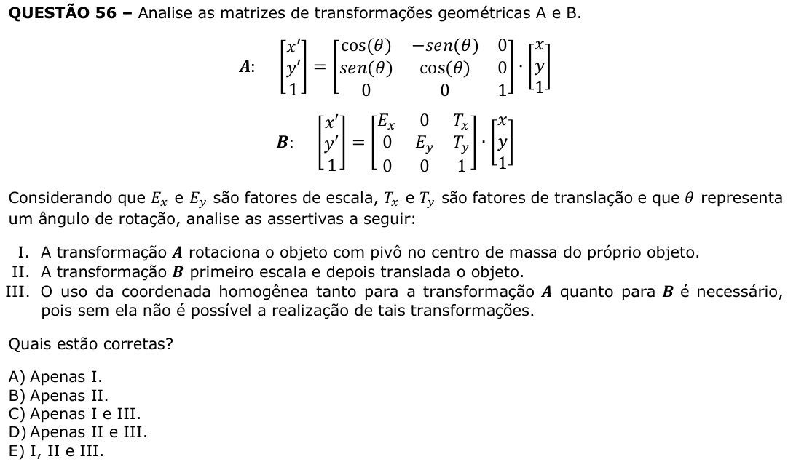

> [!success]- Resposta
> **B**
>
> I falsa: A gira em torno da origem, não do centro de massa. II verdadeira: com vetor-coluna B faz x' = Ex·x + Tx (escala, depois translada). III falsa: para a rotação A (linear) homogêneas não são necessárias; só a translação de B precisa.

> [!quote]- Texto extraído (para busca)
> QUESTÃO 56 – Analise as matrizes de transformações geométricas A e B. 𝑨: cos (𝜃) −𝑠𝑒𝑛(𝜃) 0 𝑥 𝑥′ [ 𝑦′ ] = [ 𝑠𝑒𝑛(𝜃) cos (𝜃) 0 ] ∙ [ 𝑦 ] 1 0 0 1 1 𝑩: 𝐸 𝑥 𝑥′ [ 𝑦′ ] = [ 0 1 0 0 𝐸 𝑦 0 𝑥 𝑇 𝑥 𝑇 𝑦 ] ∙ [ 𝑦 ] 1 1 Considerando que 𝐸 𝑥 e 𝐸 𝑦 são fatores de escala, 𝑇 𝑥 e 𝑇 𝑦 são fatores de translação e que 𝜃 representa um ângulo de rotação, analise as assertivas a seguir: I. A transformação 𝑨 rotaciona o objeto com pivô no centro de massa do próprio objeto. II. A transformação 𝑩 primeiro escala e depois translada o objeto. III. O uso da coordenada homogênea tanto para a transformação 𝑨 quanto para 𝑩 é necessário, pois sem ela não é possível a realização de tais transformações. Quais estão corretas? A) Apenas I. B) Apenas II. C) Apenas I e III. D) Apenas II e III. E) I, II e III.

### P47 · POSCOMP 2024, questão 57

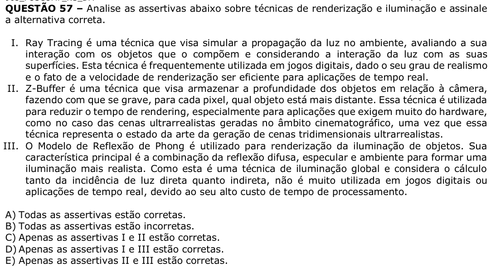

> [!success]- Resposta
> **B**
>
> Todas incorretas: I (ray tracing é caro, não é o padrão de tempo real em jogos), II (z-buffer guarda o mais PRÓXIMO, e é técnica de rasterização em tempo real, não o estado da arte cinematográfico), III (Phong é modelo local, não iluminação global).

> [!quote]- Texto extraído (para busca)
> QUESTÃO 57 – Analise as assertivas abaixo sobre técnicas de renderização e iluminação e assinale a alternativa correta. I. Ray Tracing é uma técnica que visa simular a propagação da luz no ambiente, avaliando a sua interação com os objetos que o compõem e considerando a interação da luz com as suas superfícies. Esta técnica é frequentemente utilizada em jogos digitais, dado o seu grau de realismo e o fato de a velocidade de renderização ser eficiente para aplicações de tempo real. II. Z-Buffer é uma técnica que visa armazenar a profundidade dos objetos em relação à câmera, fazendo com que se grave, para cada pixel, qual objeto está mais distante. Essa técnica é utilizada para reduzir o tempo de rendering, especialmente para aplicações que exigem muito do hardware, como no caso das cenas ultrarrealistas geradas no âmbito cinematográfico, uma vez que essa técnica representa o estado da arte da geração de cenas tridimensionais ultrarrealistas. III. O Modelo de Reflexão de Phong é utilizado para renderização da iluminação de objetos. Sua característica principal é a combinação da reflexão difusa, especular e ambiente para formar uma iluminação mais realista. Como esta é uma técnica de iluminação global e considera o cálculo tanto da incidência de luz direta quanto indireta, não é muito utilizada em jogos digitais ou aplicações de tempo real, devido ao seu alto custo de tempo de processamento. A) Todas as assertivas estão corretas. B) Todas as assertivas estão incorretas. C) Apenas as assertivas I e II estão corretas. D) Apenas as assertivas I e III estão corretas. E) Apenas as assertivas II e III estão corretas.

### P48 · POSCOMP 2025, questão 56

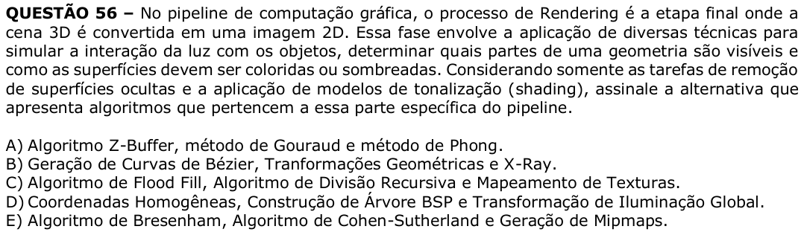

> [!success]- Resposta
> **A**
>
> Remoção de superfícies ocultas (z-buffer) e tonalização (Gouraud, Phong) estão na A. As outras misturam curvas, transformações, preenchimento, recorte e mipmaps.

> [!quote]- Texto extraído (para busca)
> QUESTÃO 56 – No pipeline de computação gráfica, o processo de Rendering é a etapa final onde a cena 3D é convertida em uma imagem 2D. Essa fase envolve a aplicação de diversas técnicas para simular a interação da luz com os objetos, determinar quais partes de uma geometria são visíveis e como as superfícies devem ser coloridas ou sombreadas. Considerando somente as tarefas de remoção de superfícies ocultas e a aplicação de modelos de tonalização (shading), assinale a alternativa que apresenta algoritmos que pertencem a essa parte específica do pipeline. A) Algoritmo Z-Buffer, método de Gouraud e método de Phong. B) Geração de Curvas de Bézier, Tranformações Geométricas e X-Ray. C) Algoritmo de Flood Fill, Algoritmo de Divisão Recursiva e Mapeamento de Texturas. D) Coordenadas Homogêneas, Construção de Árvore BSP e Transformação de Iluminação Global. E) Algoritmo de Bresenham, Algoritmo de Cohen-Sutherland e Geração de Mipmaps.

### P49 · POSCOMP 2025, questão 57

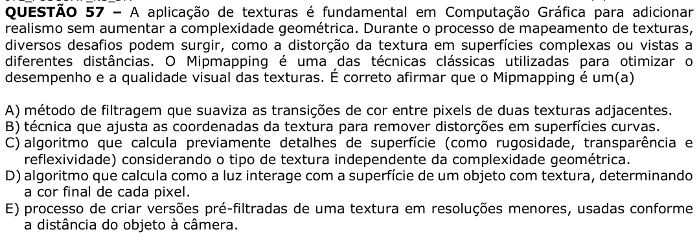

> [!success]- Resposta
> **E**
>
> Mipmap = versões pré-filtradas da textura em resoluções menores, escolhidas conforme a distância à câmera.

> [!quote]- Texto extraído (para busca)
> QUESTÃO 57 – A aplicação de texturas é fundamental em Computação Gráfica para adicionar realismo sem aumentar a complexidade geométrica. Durante o processo de mapeamento de texturas, diversos desafios podem surgir, como a distorção da textura em superfícies complexas ou vistas a diferentes distâncias. O Mipmapping é uma das técnicas clássicas utilizadas para otimizar o desempenho e a qualidade visual das texturas. É correto afirmar que o Mipmapping é um(a) A) método de filtragem que suaviza as transições de cor entre pixels de duas texturas adjacentes. B) técnica que ajusta as coordenadas da textura para remover distorções em superfícies curvas. C) algoritmo que calcula previamente detalhes de superfície (como rugosidade, transparência e reflexividade) considerando o tipo de textura independente da complexidade geométrica. D) algoritmo que calcula como a luz interage com a superfície de um objeto com textura, determinando a cor final de cada pixel. E) processo de criar versões pré-filtradas de uma textura em resoluções menores, usadas conforme a distância do objeto à câmera.

### P50 · POSCOMP 2026, questão 56

> [!success]- Resposta
> **A**
>
> Rotação de 30° anti-horária em torno de P = (2,2), vetor-coluna: T(P)·R(30°)·T(−P). O bloco é [[0,87, −0,5], [0,5, 0,87]] e a translação é P − R·P = (2 − 0,74; 2 − 2,74) = (1,26; −0,74): alternativa A.

> [!quote]- Texto extraído (para busca)
> QUESTÃO 56 – Em um software de edição vetorial, um triângulo original (A) sofreu uma transformação geométrica, resultando no triângulo transformado (A’), conforme a figura abaixo: Sabe-se que a transformação aplicada foi uma rotação de 30° no sentido anti-horário ao redor do vértice P = (2, 2). O software permite a visualização da matriz de transformação composta aplicada para realizar a transformação. Considere que o software está usando os seguintes valores aproximados para cos(30°) = 0.87 e sen(30°) = 0.50. Considere também que o software representa transformações homogêneas por multiplicação à esquerda de vetores-coluna, ou seja, cada ponto é representado por um vetor-coluna na matriz de pontos. Assinale a alternativa que apresenta a matriz de transformação composta correta apresentada pelo software para realizar a transformação ilustrada nas condições apresentadas. A) [0,87 [0,5 [0 -0,5 0,87 0 1,26] -0,74] 1] B) [0,87 [0,5 [0 -0,5 0,87 0 -1,26] 0,74] 1] C) [0,87 [-0,5 [-1,26 0,5 0,87 0,74 0] 0] 1] D) [0,87 [-0,5 [1,26 0,5 0] 0,87 0] -0,74 1]

### P51 · POSCOMP 2026, questão 57

> [!success]- Resposta
> **B**
>
> I falsa (inverte: o flat fica facetado em malha pouco tesselada). II falsa (Gouraud interpola CORES/intensidades, não normais). III verdadeira (Phong interpola normais e calcula a iluminação por pixel, melhor brilho especular e mais caro).

> [!quote]- Texto extraído (para busca)
> QUESTÃO 57 – Um game designer está trabalhando em um novo jogo 3D e considerou escolher entre três métodos clássicos de tonalização (shading) para a renderização das malhas poligonais. Para tomar sua decisão, ele realizou uma análise das características dos algoritmos Flat, Gouraud e Phong, pesando a eficiência computacional contra o grau de realismo visual. Sobre esses métodos, analise as assertivas abaixo: I. O método Flat resolve a equação de iluminação apenas uma vez por polígono, preenchendo toda a face com uma cor constante. Trata-se do método computacionalmente mais eficiente e que mantém a aparência curva apenas em malhas mais simples, como esferas com baixa tesselação, mas que em malhas com alta tesselação resulta em uma aparência mais facetada. II. No método de Gouraud, o algoritmo calcula a iluminação nos vértices da malha poligonal e, a partir desses cálculos, realiza a interpolação dos vetores normais ao longo de toda a superfície do polígono para determinar a cor de cada pixel interno. III. O método de Phong realiza a interpolação dos vetores normais ao longo do polígono para, então, calcular a equação de iluminação pixel a pixel. Isso garante o maior grau de realismo entre os três, especialmente na nitidez dos reflexos especulares, em troca da menor eficiência computacional. Quais estão corretas? A) Apenas I. B) Apenas III. C) Apenas I e II. D) Apenas II e III.

## Matemática usada em CG (vetores, transformações)

### P52 · POSCOMP 2004, questão 4

> [!success]- Resposta
> **A**
>
> A matriz é (1/5)·[[−4, 3], [3, 4]]: colunas unitárias e ortogonais, simétrica e com determinante −1, então é uma reflexão. A reta fixa sai de (A − I)v = 0: −9x + 3y = 0, ou seja y = 3x. Não é translação (T(0,0) = (0,0)) nem escala.

> [!quote]- Texto extraído (para busca)
> 4. A transformação T (x, y) = 5 1 (−4x + 3y, 3x + 4y) do plano no plano é (a) uma reflexão através da reta y = 3x (b) uma expansão uniforme (c) uma contração uniforme (d) uma translação (e) um cisalhamento horizontal

### P53 · POSCOMP 2005, questão 4

> [!success]- Resposta
> **C**
>
> Com vetor-coluna, A·(0,1,0) é a 2ª coluna de A = (3,1,2). As outras não batem: A·(1,0,0) = (1,2,3), A·(0,0,1) = (2,1,3), A·(1,1,0) = (4,3,5), A·(1,0,1) = (3,3,6).

> [!quote]- Texto extraído (para busca)
> 4. Dada a matriz de transformação linear   1 3 2 A =  2 1 1  3 2 3 PSfrag replacements pode-se afirmar que: Máquina Cliente (a) o vetor (1, 0, 0) é mapeado Media para (1, 3, 2). Player (b) o vetor (1, 0, 1) é mapeado para (3, 0, 2). Buffer (c) o vetor (0, 1, 0) é mapeado para (3, 1, 2). Marcador Baixo para (3, 2, 3). (d) o vetor (0, 0, 1) de ́ Água mapeado (MAB) (e) o vetor (1, 1, 0) é mapeado para (3, 2, 3). Marcador de Água Alto (MAA)

### P54 · POSCOMP 2011, questão 6

> [!success]- Resposta
> **A**
>
> Normal = produto vetorial de duas arestas: AB = (2, 0, −2), AC = (0, −1, −2), AB × AC = (0·(−2) − (−2)(−1), (−2)·0 − 2·(−2), 2·(−1) − 0·0) = (−2, 4, −2).

> [!quote]- Texto extraído (para busca)
> 6 O problema de determinar um vetor normal a um triângulo ou polígono é muito comum em computação gráfica. Dado o triângulo formado pelos pontos A (1 , 2 , 3) , B (3 , 2 , 1) e C (1 , 1 , 1) , um vetor normal, n , a esse triângulo é dado por: a) n = [ − 2 , 4 , − 2] T b) n = [0 , 0 , 4] T c) n = [2 , − 1 , − 4] T d) n = [3 , 4 , 5] T e) n = [5 , 5 , 5] T

### P55 · POSCOMP 2012, questão 5

> [!success]- Resposta
> **D**
>
> (4,2) foi para (−2,4): (x, y) → (−y, x) é a rotação de 90° anti-horária, ou seja α = π/2. Confere: o produto escalar (4,2)·(−2,4) = 0 e os módulos são iguais.

> [!quote]- Texto extraído (para busca)
> 5 Uma rotação que gira cada vetor em R 2 por um ângulo fixado, no sentido anti-horário, é uma transformação linear, conforme ilustra a figura a seguir. Seja T : R 2 → R 2 uma rotação. Se T (4 , 2) = (−2 , 4) , assinale a alternativa que apresenta, corretamente, o valor do ângulo α . a) π 6 π b) 4 c) π 3 π d) 2 e) π

### P56 · POSCOMP 2013, questão 6

> [!success]- Resposta
> **D**
>
> O produto vetorial é distributivo em relação à soma. Não é comutativo (u × v = −v × u), não é associativo, não vale cancelamento, e é nulo também para vetores paralelos não nulos.

> [!quote]- Texto extraído (para busca)
> 6 Com relação ao produto vetorial no espaço R 3 , assinale a alternativa correta. a) Vale a lei do cancelamento para produtos vetoriais. b) Vale a propriedade associativa. c) Vale a propriedade comutativa. d) Vale a propriedade distributiva em relação à adição de vetores. e) Se o produto vetorial entre dois vetores é nulo, então esses vetores são nulos.

### P57 · POSCOMP 2014, questão 8

> [!success]- Resposta
> **E**
>
> Os vetores do plano são (0,3,0) e (4,0,1). I falsa: o produto vetorial deles é (3, 0, −12), não zero. II verdadeira (não são paralelos). III aceita pelo gabarito (é a equação vetorial/paramétrica do plano). IV verdadeira: (3, 0, −12) é justamente o produto vetorial, logo normal ao plano.

> [!quote]- Texto extraído (para busca)
> 8 Em relação ao plano π 1 dado pelos pontos (1 , 0 , 0) , (1 , 3 , 0) e (5 , 0 , 1) , considere as afirmativas a seguir. I. O produto vetorial de (0 , 3 , 0) por (4 , 0 , 1) é zero. II. Os vetores (0 , 3 , 0) e (4 , 0 , 1) são linearmente independentes. III. Uma equação geral do plano π 1 é dada por X = (1 , 0 , 0) + a (0 , 3 , 0) + b (4 , 0 , 1) , onde a e b são nú- meros reais. IV. (3 , 0 , − 12) é um vetor normal a π 1 . Assinale a alternativa correta. a) Somente as afirmativas I e II são corretas. b) Somente as afirmativas I e IV são corretas. c) Somente as afirmativas III e IV são corretas. d) Somente as afirmativas I, II e III são corretas. e) Somente as afirmativas II, III e IV são corretas.

### P58 · POSCOMP 2018, questão 4

> [!success]- Resposta
> **E**
>
> u·v = 5·(−3) + 4·2 = −7. cos θ = −7/(√41·√13) ≈ −0,303, então θ ≈ 107,6°.

> [!quote]- Texto extraído (para busca)
> QUESTÃO 04 – Dados os vetores ⃗ 𝑢 ⃗ = (5,4) e 𝑣⃗ = (−3,2) , calcule o produto escalar e o ângulo que elas formam entre si: A) 7; 107° B) 7; -107° C) -7; 72° D) 7; 72° E) -7; 107°

### P59 · POSCOMP 2022, questão 3

> [!success]- Resposta
> **A**
>
> u·v = 3 + 2 − 2 = 3. u × v = ((−1)(−1) − 2(−2), 2·1 − 3(−1), 3(−2) − (−1)·1) = (5, 5, −5).

> [!quote]- Texto extraído (para busca)
> QUESTÃO 03 – Assinale a alternativa que indica o produto escalar e o produto vetorial dos vetores ⃗ 𝑢 =(3,-1,2) e 𝑣 =(1,-2,-1), respectivamente. A) 3 e (5,5,-5). B) 3 e (3,2,-2). C) 3 e (2,1,3). D) -1 e (3,2,-2). E) 7 e (3,-2,2).

## Processamento de Imagens

### P60 · POSCOMP 2002, questão 51

> [!success]- Resposta
> **C**

> [!quote]- Texto extraído (para busca)
> 51. Histograma de uma imagem com K tons de cinza é : a) Contagem dos pixels da imagem. b) Contagem do número de tons de cinza que ocorreram na imagem. c) Contagem do número de vezes que cada um dos K tons de cinza ocorreu na imagem. d) Contagem do número de objetos encontrados na imagem. e) Nenhuma alternativa acima.

### P61 · POSCOMP 2002, questão 52

> [!success]- Resposta
> **B**

> [!quote]- Texto extraído (para busca)
> 52. filtro da mediana é : a) Indicado para detectar bordas em imagens. b) Indicado para atenuar ruído com preservação de bordas (i.é rápidas transições de nível em imagens). c) Indicado para detectar formas específicas em imagens. d) Indicado para detectar tonalidades específicas em uma imagem. e) Nenhuma das respostas acima.

### P62 · POSCOMP 2003, questão 61

> [!success]- Resposta
> **anulada**

> [!quote]- Texto extraído (para busca)
> 61. Qual das opções abaixo você não poderia usar para representar texturas em imagens monocromáticas? (a) matrizes de co-ocorrência; (b) medida da densidade local de bordas; (c) medidas das sub-bandas espectrais detectadas por filtros de Gabor; (d) nenhuma alternativa acima; (e) as alternativas corretas são a), b) e c).

### P63 · POSCOMP 2004, questão 56

> [!success]- Resposta
> **D**

> [!quote]- Texto extraído (para busca)
> 56) Considerando as declarações abaixo, é incorreto afirmar: a) Filtros passa-altas são utilizados para detecção de bordas em imagens b) A transformada discreta de Fourier nos permite obter uma representação de uma imagem no domínio freqüência c) Filtragem no domínio espacial é realizada por meio de uma operação chamada “ convolução” d) Os filtros Gaussiano e Laplaciano são exemplos de filtro passa-baixas e) O filtro da mediana pode ser utilizado para redução de ruído em uma imagem

### P64 · POSCOMP 2004, questão 58

> [!success]- Resposta
> **E**

> [!quote]- Texto extraído (para busca)
> 58) Identifique a declaração incorreta: a) As operações de ajuste de brilho e contraste são operações lineares b) A equalização de histograma é uma transformação não-linear e específica para cada imagem c) A transformação necessária para calcular o negativo de uma imagem pode ser aplicada simultaneamente (i.e., em paralelo) a todos pixels da imagem original d) A equalização de histograma pode ser obtida a partir de um histograma cumulativo da imagem original e) O objetivo da equalização de histograma é reduzir o constrastre nas regiões da imagem que correspondem à porção do histograma com maior concentração de pixels

### P65 · POSCOMP 2005, questão 59

> [!success]- Resposta
> **B**

> [!quote]- Texto extraído (para busca)
> 59. O processo de análise de imagens é uma seqüência de etapas que são iniciadas a partir da definição do problema. A seqüência correta destas etapas é: (a) pré-processamento, aquisição, segmentação, representação, reconhecimento. (b) aquisição, pré-processamento, segmentação, representação, reconhecimento. (c) aquisição, pré-processamento, representação, segmentação, reconhecimento. (d) aquisição, representação, pré-processamento, segmentação, reconhecimento. (e) pré-processamento, aquisição, representação, segmentação, reconhecimento.

### P66 · POSCOMP 2005, questão 60

> [!success]- Resposta
> **D**

> [!quote]- Texto extraído (para busca)
> 60. O termo imagem se refere a uma função bidimensional de intensidade de luz, denotada por f (x, y), onde o valor ou amplitude de f nas coordenadas espaciais (x, y) repre- senta a intensidade (brilho) da imagem neste ponto. Para que uma imagem possa ser processada num computador, a função f (x, y) deve ser discretizada tanto espacial- mente quanto em amplitude. Estes dois processos recebem as seguintes denominações, respectivamente: (a) translação e escala. (b) resolução e escala. (c) resolução e ampliação. (d) amostragem e quantização. (e) resolução e quantização.

### P67 · POSCOMP 2006, questão 47

> [!success]- Resposta
> **E**

> [!quote]- Texto extraído (para busca)
> 47. [TE] Considere os filtros espaciais da média (m) e Mediana (M) aplicados em imagens em nı́veis de cinza f e g. Qual par de termos ou expressões a seguir não está associado, respectivamente, a caracterı́sticas gerais de m e M? (a) m(f + g) = m(f ) + m(g); M(f + g) 6 = M(f ) + M(g) (b) ruı́do gaussiano; ruı́do impulsivo (c) convolução; filtro estatı́stico da ordem (d) preservação de pequenos componentes; não preservação de pequenos componentes (e) filtragem com preservação de contornos; filtragem sem preservação de contornos

### P68 · POSCOMP 2006, questão 48

> [!success]- Resposta
> **B**

> [!quote]- Texto extraído (para busca)
> 48. [TE] A convolução da máscara [−1 2 − 1] com uma linha de uma imagem contendo uma seqüência de pixels do tipo [. . . 3 4 5 6 7 8 9 10 . . .] resulta na transformação (sem considerar efeitos de borda): (a) [. . . 3 4 5 6 7 8 9 10 . . .] e representa o filtro da média com 2-vizinhos mais próximos (b) [. . . 0 0 0 0 0 0 0 0 . . .] e representa o laplaciano no espaço discreto (c) [. . . 0 0 0 0 0 0 0 0 . . .] e representa uma erosão morfológica (d) [. . . 1 1 1 1 1 1 1 1 . . .] e é equivalente a um filtro passa-baixas (e) [. . . 7 9 11 13 15 17 19 . . .] e é equivalente a um filtro passa-altas

### P69 · POSCOMP 2006, questão 51

> [!success]- Resposta
> **C**

> [!quote]- Texto extraído (para busca)
> 51. [TE] Quando se aplica um filtro passa-baixas (low-pass filter) a uma imagem com dimensões 100x100 em tons de cinza (grayscale) com todos os pixels na cor preta, a imagem resultante (a) Fica reduzida à metade das dimensões da imagem original (b) Fica ampliada ao dobro das dimensões da imagem original (c) Tem as mesmas dimensões da imagem original, com todos os pixels na cor preta (d) Tem as mesmas dimensões da imagem original, com todos os pixels na cor branca (e) Nenhuma das afirmações acima é correta

### P70 · POSCOMP 2007, questão 61

> [!success]- Resposta
> **D**

> [!quote]- Texto extraído (para busca)
> 61. [TE] O realce de imagem tem como objetivo destacar detalhes finos procurando obter uma representação mais adequada do que a imagem original para uma determinada aplicação. Dessa forma, sobre as técnicas utilizadas no realce de imagens, é CORRETO afirmar que (a) o melhor resultado obtido depende do filtro aplicado na imagem. Normalmente, o mais aplicado é o filtro da mediana. (b) o melhor resultado é obtido com a aplicação de filtros passa-baixas, cujos parâmetros dependem do resultado desejado. (c) a aplicação de filtros da média sempre oferece resultado adequado no realce de imagens. (d) o resultado mais adequado no realce de imagens está associado à aplicação de filtro passa-altas e da interpretação subjetiva do observador que deverá ter con- hecimento a priori da imagem original. (e) o resultado mais adequado no realce de imagens está associado à aplicação de filtro passa-baixas e da interpretação subjetiva do observador que deverá ter con- hecimento a priori da imagem original.

### P71 · POSCOMP 2007, questão 62

> [!success]- Resposta
> **C**

> [!quote]- Texto extraído (para busca)
> 62. [TE] Um sistema de codificação e compressão de imagens consiste de dois blocos, que são: o codificador e o decodificador. Entre as diversas técnicas de codificação, a mais popular é o código de Huffman. Considere a tabela abaixo, em que é apresentado o código resultante num processo de codificação. probabilidade 0,35 0,25 0,2 0,1 0,05 0,03 0,01 0,01 código 1 01 010 0101 01011 010110 0101100 0101101 Nesse caso, o comprimento médio do código obtido foi de: (a) 3,15 bits/sı́mbolo (b) 1,14 bits/sı́mbolo (c) 2,42 bits/sı́mbolo (d) 4,38 bits/sı́mbolo (e) 3,00 bits/sı́mbolo

### P72 · POSCOMP 2007, questão 63

> [!success]- Resposta
> **A**

> [!quote]- Texto extraído (para busca)
> 63. [TE] Constitui(em) método(s) para alterar o contraste de uma imagem em cores sem alterar sua tonalidade. I. Transformar RGB em IHS, aumentar o contraste de I e fazer a transformação inversa IHS para RGB. II. Aumentar o contraste de I, transformar IHS em RGB e fazer a transformação inversa RGB para IHS. III. Aumentar o contraste em R, transformar RGB em IHS. A esse respeito, pode-se afirmar que (a) apenas o item I é verdadeiro. (b) apenas o item II é verdadeiro. (c) são verdadeiros apenas os itens I e II. (d) são verdadeiros apenas os itens I e III. (e) são verdadeiros apenas os itens II e III.

### P73 · POSCOMP 2008, questão 3

> [!success]- Resposta
> **B**

> [!quote]- Texto extraído (para busca)
> Questão 3 Considere as imagens I 1 , dada por I 1 (i,j)=9((i+j)mod 2), e I 2 , dada por I 2 (i,j)=9((i+j)mod 3), representadas nas tabelas abaixo para dimensões 5 0 9 0 9 0 9 0 9 0 9 0 9 0 9 0 (I 1 ) 9 0 9 0 9 0 9 0 9 0 0 9 18 0 9 5: 9 18 0 9 18 18 0 0 9 9 18 18 0 0 9 (I 2 ) 9 18 0 9 18 Dada a janela V(i,j) de dimensões 3x3 centrada no pixel (i,j) de uma imagem I, considere os filtros que atribuem a (i,j) o valor dado pela média e pela mediana dos valores de I em V(i,j). Desconsiderando os pixels nas bordas das imagens, pode-se afirmar que, A) aplicando-se o filtro da média a I 1 , toda a imagem assume um mesmo valor. B) aplicando-se o filtro da mediana a I 2 , toda a imagem assume o mesmo valor. C) aplicando-se os filtros da média e da mediana à imagem I1, obtém-se o mesmo resultado. D) aplicando-se os filtros da média e da mediana à imagem I2, não se obtém o mesmo resultado. E) nenhuma das alternativas anteriores é correta. 4

### P74 · POSCOMP 2008, questão 4

> [!success]- Resposta
> **B**

> [!quote]- Texto extraído (para busca)
> Questão 4 Considere o filtro F definido por: F ( I )( i , j ) | {( I ( i 1, j 1) I ( i , j 1) I ( i 1, j )} {( I ( i 3 1, j 1) I ( i , j As figuras abaixo representam imagens binárias de dimensões n pixel (0,0) é o do canto superior esquerdo. Assinale em qual figura n 1 n 1 { F ( I )( i , j )} é maior. i 0 j 0 A) B) C) D) E) 5 1) I ( i 1, j )} | n, com n grande. O

### P75 · POSCOMP 2009, questão 59

> [!success]- Resposta
> **A**

> [!quote]- Texto extraído (para busca)
> Questão 59. [TEC] Sobre o conceito de segmentação de imagens, é CORRETO afirmar: A) Processo que agrupa partes de uma imagem em regiões homogêneas com respeito a uma ou mais características (brilho, tons de cinza, cor, textura). B) Operação que objetiva particionar uma imagem em um conjunto de regiões de mesmo tamanho. C) Processo que objetiva identificar objetos na imagem de acordo com uma descrição prévia com base em uma ou mais características (brilho, tons de cinza, cor, textura). D) É a mesma coisa que detecção de bordas de imagens. E) Nenhuma das opções acima.

### P76 · POSCOMP 2010, questão 54

> [!success]- Resposta
> **A**

> [!quote]- Texto extraído (para busca)
> 54) Assinale a alternativa que indica a função de transformação T ( r ) utilizada para se obter a imagem negativa de uma imagem monocromática, em que os pixels podem assumir valores no intervalo entre 0 e L-1 e em que r representa o valor do pixel na imagem original. a) b) c) d) e) T ( r ) = ( L − 1) − r T ( r ) = − r T ( r ) = c log (1 + | r |) T ( r ) = 1 − r T ( r ) = ( L − 1) /r , onde c é uma constante de escala

### P77 · POSCOMP 2011, questão 62

> [!success]- Resposta
> **anulada**

> [!quote]- Texto extraído (para busca)
> 62 No que tange à área de segmentação de imagens, considere as afirmativas a seguir. I. A técnica de componentes conexos é considerada um tipo de segmentação, pois realiza o agrupa- mento de pixels adjacentes. II. A segmentação de imagens identifica as cores que se encontram fora do espectro de cores RGB, adequando a sua intensidade conforme os limites deste espectro. III. A segmentação de imagens consiste em produzir regiões na imagem com base em algum critério de similaridade, homogeneidade e continuidade. IV. A segmentação é uma forma de compactação de imagem, ocasionando, no entanto, perda na quali- dade. Assinale a alternativa correta. a) Somente as afirmativas I e II são corretas. b) Somente as afirmativas I e IV são corretas. c) Somente as afirmativas III e IV são corretas. d) Somente as afirmativas I, II e III são corretas. e) Somente as afirmativas II, III e IV são corretas.

### P78 · POSCOMP 2011, questão 66

> [!success]- Resposta
> **A**

> [!quote]- Texto extraído (para busca)
> 66 A conversão de imagens de RGB para tons de cinza pode ser realizada através da média dos componentes de cores. No entanto, esta conversão produz uma escala de brilho na qual a percepção não é equivalente ao brilho na imagem colorida. A forma adequada de calcular a luminância Y é dada pela equação: a) Y = 0 . 299 ∗ R + 0 . 587 ∗ G + 0 . 114 ∗ B b) Y = 0 . 587 ∗ R + 0 . 114 ∗ G + 0 . 299 ∗ B c) Y = R + G + B √ d) Y = R 2 + G 2 + B 2 R + G + B e) Y = 3

### P79 · POSCOMP 2012, questão 57

> [!success]- Resposta
> **B**

> [!quote]- Texto extraído (para busca)
> 57 Sobre o classificador de distância mínima, utilizado em reconhecimento de padrões em processamento digital de imagens, considere as afirmativas a seguir. I. É necessário análise e escolha dos descritores contidos no vetor de características dos objetos conhecidos para o reconhecimento do objeto. II. O classificador de distância mínima é considerado um classificador estatístico. III. O classificador de distância mínima produz bons resultados quando existe pouca distância entre os vetores dos descritores dos objetos conhecidos em relação à dispersão dos dados do vetor de características dos objetos desconhecidos. IV. É uma técnica que reconhece o objeto pela escolha da menor diferença entre o vetor de características do objeto desconhecido em relação aos vetores de características dos objetos conhecidos. Assinale a alternativa correta. a) Somente as afirmativas I e II são corretas. b) Somente as afirmativas I e IV são corretas. c) Somente as afirmativas III e IV são corretas. d) Somente as afirmativas I, II e III são corretas. e) Somente as afirmativas II, III e IV são corretas.

### P80 · POSCOMP 2012, questão 59

> [!success]- Resposta
> **A**

> [!quote]- Texto extraído (para busca)
> 59 Com relação às transformadas utilizadas em processamento digital de imagens, considere as afirmativas a seguir. I. De Haar possui núcleo simétrico e separável. II. Discreta do cosseno possui núcleo simétrico e separável. III. De Walsh possui núcleo assimétrico e inseparável. IV. De Slant possui núcleo assimétrico e inseparável. Assinale a alternativa correta. a) Somente as afirmativas I e II são corretas. b) Somente as afirmativas I e IV são corretas. c) Somente as afirmativas III e IV são corretas. d) Somente as afirmativas I, II e III são corretas. e) Somente as afirmativas II, III e IV são corretas.

### P81 · POSCOMP 2013, questão 57

> [!success]- Resposta
> **B**

> [!quote]- Texto extraído (para busca)
> 57 Considere a imagem a seguir. Com base na imagem e nos conceitos utilizados em processamento digital de imagens, assinale a alter- nativa que apresenta, corretamente, o filtro adequado para eliminar os pontos localizados no lado direito da imagem de forma que preserve ao máximo o triângulo. a) Média. b) Mediana. c) Prewitt. d) Roberts. e) Sobel.

### P82 · POSCOMP 2013, questão 59

> [!success]- Resposta
> **E**

> [!quote]- Texto extraído (para busca)
> 59 Leia as definições a seguir. • Seja A uma imagem em níveis de cinza. • Seja B a imagem resultante da Equalização do Histograma da imagem A. • Seja C a imagem resultante da Equalização do Histograma da imagem B. Com base nessas definições e nos conceitos utilizados em processamento digital de imagens, considere as afirmativas a seguir. I. A comparação do histograma de duas imagens é uma medida de similaridade que indica se as duas imagens são impressões visuais de uma mesma cena. II. A imagem B é igual à imagem C. III. O histograma da imagem é uma função discreta que representa a probabilidade de se encontrar uma determinada cor na imagem. IV. O histograma de duas imagens, em níveis de cinza, fornece a informação se uma das imagens está mais clara ou mais escura ou possui a mesma luminosidade. Assinale a alternativa correta. a) Somente as afirmativas I e II são corretas. b) Somente as afirmativas I e IV são corretas. c) Somente as afirmativas III e IV são corretas. d) Somente as afirmativas I, II e III são corretas. e) Somente as afirmativas II, III e IV são corretas.

### P83 · POSCOMP 2014, questão 59

> [!success]- Resposta
> **E**

> [!quote]- Texto extraído (para busca)
> 59 Considerando filtragens no domínio do espaço relacionado à área de processamento digital de imagens, associe o nome do núcleo de convolução, na coluna da esquerda, com a sua respectiva matriz de convo- lução, na coluna da direita. (I) Roberts. (A) (II) Prewitt. (B) (III) Sobel. (C) (IV) Laplaciano. (D) Assinale a alternativa que contém a associação correta. a) I-A, II-C, III-D, IV-B. b) I-C, II-A, III-B, IV-D. c) I-C, II-B, III-D, IV-A. d) I-D, II-A, III-C, IV-B. e) I-D, II-C, III-B, IV-A.

### P84 · POSCOMP 2014, questão 61

> [!success]- Resposta
> **D**

> [!quote]- Texto extraído (para busca)
> 61 A transformada de Fourier é muito utilizada em Processamento Digital de Imagens. O cálculo de seus coeficientes é dado pela fórmula a seguir. F u ( ) =  ∞ −∞ f x e − j 2 πux dx ( ) Considere a representação do número complexo dos coeficientes de Fourier a seguir. F u ( ) = R u ( )+ jI u , onde j é o número imaginário j ( ) = √ −1 . Sobre a transformada de Fourier, considere as afirmativas a seguir: I. O núcleo da transformada de Fourier 2D é simétrico e separável. Isso permite o cálculo da transfor- mada de Fourier 2D de uma imagem utilizando somente a transformada de Fourier 1D. II. O espectro de potência é calculado utilizando a fórmula: | F ( u ) | 2 = R 2 ( u ) + I 2 ( u ) . III. O ângulo de fase é calculado pelo arco tangente dado por ϕ ( u ) = arctan  I ( u )  R u . ( ) IV. A transformada de Fourier relaciona os intervalos de “x” (segmentos do sinal de entrada da transfor- mada) com as frequências associadas a cada coefiente de Fourier. Assinale a alternativa correta. a) Somente as afirmativas I e II são corretas. b) Somente as afirmativas I e IV são corretas. c) Somente as afirmativas III e IV são corretas. d) Somente as afirmativas I, II e III são corretas. e) Somente as afirmativas II, III e IV são corretas.

### P85 · POSCOMP 2015, questão 59

> [!success]- Resposta
> **D**

> [!quote]- Texto extraído (para busca)
> QUESTÃO 59 ▬▬▬▬▬▬▬▬▬▬▬▬▬▬▬▬▬▬▬▬▬▬▬▬▬▬▬▬▬▬▬▬▬▬▬▬▬▬▬▬▬▬▬▬▬ No contexto de processamento de imagens, é utilizado um filtro digital com os seguintes objetivos: (A) detectar, reconhecer e rastrear objetos. (B) avaliar, determinar e julgar se uma imagem pode ser utilizada. (C) melhorar, corrigir ou substituir o sensor de aquisição de imagem. (D) corrigir, suavizar ou realçar informações em uma imagem. (E) preservar, compactar e salvar a imagem.

### P86 · POSCOMP 2015, questão 61

> [!success]- Resposta
> **anulada**

> [!quote]- Texto extraído (para busca)
> QUESTÃO 61 ▬▬▬▬▬▬▬▬▬▬▬▬▬▬▬▬▬▬▬▬▬▬▬▬▬▬▬▬▬▬▬▬▬▬▬▬▬▬▬▬▬▬▬▬▬ O seguinte modelo NÃO é utilizado na representação de uma imagem digital: (A) Escala de cinza. (B) RGB (Rede-Green-Blue). (C) DOI (Digital Object Identifier System). (D) HSV (Hue-Saturation-Value). (E) CMY (Cyan-Magenta-Yellow).

### P87 · POSCOMP 2016, questão 59

> [!success]- Resposta
> **C**

> [!quote]- Texto extraído (para busca)
> QUESTÃO 59 – No contexto de processamento de imagens, a equalização de histograma tem por objetivo principal: A) Reconhecer os objetos presentes na imagem. B) Extrair as bordas presentes na imagem. C) Melhorar o contraste da imagem. D) Transformar a escala de cores da imagem. E) Eliminar ruídos na imagem.

### P88 · POSCOMP 2016, questão 61

> [!success]- Resposta
> **D**

> [!quote]- Texto extraído (para busca)
> QUESTÃO 61 – No contexto de processamento de imagens, um filtro do tipo passa-baixa produz o seguinte resultado: A) Realça os detalhes da imagem, produzindo um efeito de sharpering (aumento da nitidez). B) Realça as propriedades geométricas da imagem a partir de máscaras pré-definidas. C) Suaviza as frequências dentro de um intervalo pré-determinado de valores. D) Suaviza a imagem atenuando as altas frequências, que correspondem às transições abruptas. E) Realça e suaviza de forma simultânea os componentes da imagem.

### P89 · POSCOMP 2017, questão 59

> [!success]- Resposta
> **D**

> [!quote]- Texto extraído (para busca)
> QUESTÃO 59 – São técnicas de processamento digital todas as opções abaixo, EXCETO: A) Processamento morfológico. B) Amostragem e quantização. C) Segmentação. D) Têmpera simulada. E) Limiarização.

### P90 · POSCOMP 2017, questão 61

> [!success]- Resposta
> **B**

> [!quote]- Texto extraído (para busca)
> QUESTÃO 61 – Sobre a transformada wavelet para processamento digital de imagens, é correto afirmar que: A) É um algoritmo que produz classificação de objetos na imagem. B) É uma técnica que permite o processamento da imagem em multirresolução. C) É uma técnica capaz de extrair frequências da imagem sem a localização temporal das mesmas. D) É uma técnica que permite a geração de imagens de maior resolução. E) É um algoritmo capaz de compreender informações granulares em imagens digitais.

### P91 · POSCOMP 2018, questão 59

> [!success]- Resposta
> **B**

> [!quote]- Texto extraído (para busca)
> QUESTÃO 59 – A equalização de histograma de cores em uma imagem digital tem como objetivo: A) Destacar um determinado canal. B) Realçar diferenças de tonalidade. C) Delimitar bordas. D) Eliminar informações estranhas. E) Converter para um novo modelo de cores.

### P92 · POSCOMP 2018, questão 61

> [!success]- Resposta
> **A**

> [!quote]- Texto extraído (para busca)
> QUESTÃO 61 – A quantização de imagens pode ser entendida como um processo de: A) Conversão de cada amostra em uma observação discreta. B) Equalização da distribuição de cores. C) Correção da iluminação. D) Discretização dos valores de brilho. E) Mapeamento dos canais da imagem.

### P93 · POSCOMP 2019, questão 59

> [!success]- Resposta
> **E**

> [!quote]- Texto extraído (para busca)
> QUESTÃO 59 – A realização da equalização do histograma de uma imagem resulta em obter: A) O realce mínimo de detalhes. B) Uma transformação de domínio de cores. C) A maior compressibilidade da informação. D) A menor discriminabilidade dos objetos. E) A máxima variância do histograma.

### P94 · POSCOMP 2019, questão 61

> [!success]- Resposta
> **B**

> [!quote]- Texto extraído (para busca)
> QUESTÃO 61 – Sobre visão computacional estéreo, é correto afirmar que: A) Trata-se de uma subárea que tem como objetivo reconhecer imagens similares. B) Capta-se cenas a partir de dois referenciais diferentes para se obter um mapa de disparidade. C) Avalia-se o deslocamento entre objetos para se calcular a dispersão. D) Tem por objetivo final subdividir as imagens. E) Um dos seus subproblemas consiste em desconstruir as imagens em apenas uma.

### P95 · POSCOMP 2022, questão 59

> [!success]- Resposta
> **D**

> [!quote]- Texto extraído (para busca)
> QUESTÃO 59 – Sobre a restauração de imagens, analise as assertivas abaixo: I. As técnicas de restauração de imagens buscam recuperar uma imagem corrompida a partir do conhecimento prévio do fenômeno de degradação e da aplicação do processo inverso. II. Na restauração interativa, o observador, por meio da “sintonização” dos parâmetros disponíveis, pode obter um resultado final adequado para um propósito específico. III. O total conhecimento sobre a percepção visual humana tornou possível uma formulação do problema de restauração de imagens, considerando as preferências e capacidades do observador. IV. Quando utilizadas para restauração, as transformações geométricas normalmente modificam as relações espaciais entre pixels da imagem. V. São técnicas de restauração o alargamento de contraste e a remoção de borramento realizada por meio da aplicação de uma função de “desborramento”. Quais estão corretas? A) Apenas I. B) Apenas III. C) Apenas II e V. D) Apenas I, II e IV. E) I, II, III, IV e V.

### P96 · POSCOMP 2022, questão 61

> [!success]- Resposta
> **E**

> [!quote]- Texto extraído (para busca)
> QUESTÃO 61 – A codificação ______________ tem como estratégia realizar a decomposição de uma imagem monocromática ou colorida em várias imagens binárias. Cada uma dessas imagens binárias é comprimida utilizando métodos de compressão binária. Assinale a alternativa que preenche corretamente a lacuna do trecho acima. A) aritmética B) de Golomb C) de Huffman D) wavelet E) de planos de bits

### P97 · POSCOMP 2023, questão 63

> [!success]- Resposta
> **C**

> [!quote]- Texto extraído (para busca)
> QUESTÃO 63 – Em relação aos métodos de interpolação de intensidade de níveis de cinza ou cor de uma imagem, analise as assertivas abaixo e assinale V, se verdadeiras, ou F, se falsas. ( ) O método do vizinho mais próximo atribui a cada nova posição a intensidade de seu vizinho mais próximo na imagem original. O método pode causar distorções em detalhes finos ou criar formas serrilhadas em bordas retas de imagens. ( ) Na interpolação bilinear, os dois vizinhos mais próximos são utilizados para estimar a intensidade de uma dada posição. O método se baseia na média aritmética de distância desses pixels e causa borramento devido à sua característica de suavização. ( ) A interpolação bicúbica inclui os dezesseis vizinhos mais próximos de um ponto. Esse tipo de interpolação preserva detalhes finos na imagem. A ordem correta de preenchimento dos parênteses, de cima para baixo, é: A) F – F – V. B) F – V – F. C) V – F – V. D) V – V – V. E) V – V – F.

### P98 · POSCOMP 2023, questão 64

> [!success]- Resposta
> **D**

> [!quote]- Texto extraído (para busca)
> QUESTÃO 64 – As redes neurais são utilizadas na área de reconhecimento de padrões. O modelo mais simples de rede neural possui apenas uma unidade, denominada ______________________. O modelo é utilizado apenas em problemas de classificação linearmente separáveis. Essa rede mapeia múltiplas entradas para uma saída representada por um valor binário. Assinale a alternativa que preenche corretamente a lacuna do trecho acima. A) Rede neural convolucional B) Retropropagação C) Perceptron multicamadas D) Perceptron E) Rede neural recorrente

### P99 · POSCOMP 2024, questão 63

> [!success]- Resposta
> **D**

> [!quote]- Texto extraído (para busca)
> QUESTÃO 63 – Após a captura de uma imagem por sensores, uma imagem digital é criada a partir do processo de digitalização, que envolve duas etapas: a ________________, que realiza a discretização das coordenadas no domínio espacial, e a ________________, que realiza a discretização dos valores de amplitude dos pixels. Assinale a alternativa que preenche, correta e respectivamente, as lacunas do trecho acima. A) interpolação – ampliação B) modulação – codificação C) quantização – amostragem D) amostragem – quantização E) codificação – modulação

### P100 · POSCOMP 2024, questão 64

> [!success]- Resposta
> **B**

> [!quote]- Texto extraído (para busca)
> QUESTÃO 64 – Analise as assertivas abaixo sobre filtragem de imagens digitais: I. A aplicação de um filtro espacial de média em uma imagem digital resulta na sua suavização. II. A aplicação de um filtro de frequência do tipo passa-baixa em uma imagem digital resulta no seu aguçamento. III. A aplicação de um filtro espacial utilizando o operador laplaciano em uma imagem digital resulta no seu aguçamento. IV. Para a suavização de uma imagem digital, são utilizados apenas filtros no domínio espacial e para o aguçamento de uma imagem digital, são utilizados apenas filtros do domínio das frequências. Quais estão corretas? A) Apenas I e II. B) Apenas I e III. C) Apenas II e III. D) Apenas II e IV. E) I, II, III e IV.

### P101 · POSCOMP 2025, questão 40

> [!success]- Resposta
> **D**

> [!quote]- Texto extraído (para busca)
> QUESTÃO 40 – Sobre compressão de imagens, analise as assertivas abaixo e assinale V, se verdadeiras, ou F, se falsas. ( ) RLE (Run-Length Encoding) é uma técnica de compressão sem perdas usada frequentemente em imagens com grandes áreas da mesma cor. ( ) A compressão com perdas (lossy), como JPEG, preserva todos os dados originais da imagem após a descompressão. ( ) O formato BMP usa compressão com perdas para reduzir o tamanho dos arquivos de imagem. ( ) A compressão RLE é mais eficiente em imagens com padrões simples e repetitivos do que em imagens fotográficas complexas. ( ) O formato BMP suporta imagens em alta resolução e profundidade de cor, mas não é adequado para a web devido ao seu grande tamanho. A ordem correta de preenchimento dos parênteses, de cima para baixo, é: A) V – F – V – V – F. B) V – V – F – F – V. C) F – V – V – F – F. D) V – F – F – V – V. E) F – F – V – F – V.

### P102 · POSCOMP 2025, questão 63

> [!success]- Resposta
> **A**

> [!quote]- Texto extraído (para busca)
> QUESTÃO 63 – Considerando um filtro de média de tamanho MxM para imagens no domínio espacial, é correto afirmar que aumentar o valor M A) aumenta o efeito de suavização (borramento) da imagem. B) provoca um alargamento de contraste da imagem. C) aumenta o efeito de aguçamento (realce) da imagem. D) reduz o efeito de suavização (borramento) da imagem. E) aumenta a resolução espacial da imagem.

### P103 · POSCOMP 2025, questão 64

> [!success]- Resposta
> **C**

> [!quote]- Texto extraído (para busca)
> QUESTÃO 64 – Sobre a codificação de imagens no padrão JPEG, é correto afirmar que: A) O JPEG utiliza a transformada de Fourier para compactar imagens, preservando apenas as frequências mais baixas. B) A compressão JPEG é sempre sem perdas, garantindo a reconstrução exata da imagem original. C) A transformada discreta do cosseno (DCT) é usada no JPEG para converter blocos de pixels do domínio espacial para o domínio da frequência. D) No JPEG, a compressão é baseada na redução da profundidade de bits por pixel, eliminando canais de cor. E) O padrão JPEG substitui blocos de 8x8 pixels por blocos de 2x2 pixels para reduzir o tamanho da imagem.

### P104 · POSCOMP 2026, questão 63

> [!success]- Resposta
> **C**

> [!quote]- Texto extraído (para busca)
> QUESTÃO 63 – No contexto de processamento digital de imagens, assinale a alternativa que descreve corretamente a diferença entre amostragem e quantização. A) A amostragem é a digitalização dos valores de amplitude, enquanto a quantização é a digitalização dos valores de coordenada. B) A amostragem é responsável por definir os níveis de cinza da imagem, enquanto a quantização define as posições das amostras no plano da imagem. C) A amostragem é a digitalização dos valores de coordenada, enquanto a quantização é a digitalização dos valores de amplitude. D) A amostragem é o processo de remover ruídos da imagem contínua, enquanto a quantização é responsável por aumentar a resolução espacial da imagem.

### P105 · POSCOMP 2026, questão 64

> [!success]- Resposta
> **C**

> [!quote]- Texto extraído (para busca)
> QUESTÃO 64 – Sobre filtragem no domínio das frequências, no âmbito de processamento digital de imagens, é correto afirmar que: A) O filtro passa-baixa substitui cada pixel pela mediana dos pixels vizinhos, sendo muito usado para remover ruído do tipo “sal e pimenta”. B) O filtro rejeita-banda substitui cada pixel pela média dos pixels vizinhos, sendo muito usado para remover ruído do tipo “sal e pimenta”. C) O filtro passa-alta tem a mesma função do filtro espacial de realce. D) O filtro passa-alta elimina as frequências mais altas, deixando passar apenas as frequências mais baixas.

