# Quiz de treino: banco de questões do professor (Moodle 2021)

Voltar: [[Computação Gráfica]] · [[Colinha]] · [[Banco de Questões]]

Tirado de `computacao_grafica.pdf` (122 tentativas do "Quiz de Treino para Prova" de 2021.1, 1220 questões). Sem as repetições sobram **77 questões**. Quando a mesma questão aparecia com alternativas diferentes em tentativas diferentes, as alternativas foram juntadas: por isso algumas têm mais opções do que na prova e algumas de escolha única têm duas certas (cada versão só mostrava uma delas).

O professor não repete questão de um ano para o outro, então isto aqui é **treino de formato e de conceito**, não gabarito. Tente responder antes de abrir a resposta (clique na seta). A versão interativa, que corrige sozinha, está em `quiz-treino.html` nesta mesma pasta (abre no navegador, funciona offline); a versão com as respostas já marcadas está em `quiz-treino-respostas.html` e `quiz-treino-respostas.pdf`.

**Contagem** ao lado de cada questão = em quantas das 122 tentativas ela apareceu.

## Índice
- [[#Window, viewport e clipping]] (16): Q01–Q16
- [[#Transformações, coordenadas homogêneas e geometria 3D]] (19): Q17–Q35
- [[#Projeções e pipeline de visualização 3D]] (10): Q36–Q45
- [[#Curvas e superfícies]] (1): Q46–Q46
- [[#Iluminação, shading, raytracing e radiosidade]] (13): Q47–Q59
- [[#Rasterização, z-buffer, aliasing e texturas]] (9): Q60–Q68
- [[#APIs, engines e outros]] (5): Q69–Q73
- [[#Processamento de imagens (POSCOMP)]] (4): Q74–Q77

## Window, viewport e clipping

### Q01 · escolha uma · apareceu 37×

É um exemplo de um algoritmo de recorte de polígonos:

- a) Nicholl-Lee-Nicholl
- b) Cohen-Sutherland
- c) Kruskal
- d) Liang-Barsky
- e) Sutherland-Hodgeman
- f) Gauss-Seidel
- g) Runge-Kutta
- h) Gauss-Jacobi
- i) Weiler-Atherton

> [!success]- Resposta
> - **e)** Sutherland-Hodgeman
> - **i)** Weiler-Atherton
>
> Sutherland-Hodgeman e Weiler-Atherton recortam polígonos (cada versão da questão mostrava só um dos dois). Cohen-Sutherland, Liang-Barsky e Nicholl-Lee-Nicholl recortam retas. Gauss-Seidel e Gauss-Jacobi resolvem sistemas lineares, Runge-Kutta resolve EDO, Kruskal acha árvore geradora: nenhum é de recorte.

### Q02 · resposta numérica (inteiro) · apareceu 22×

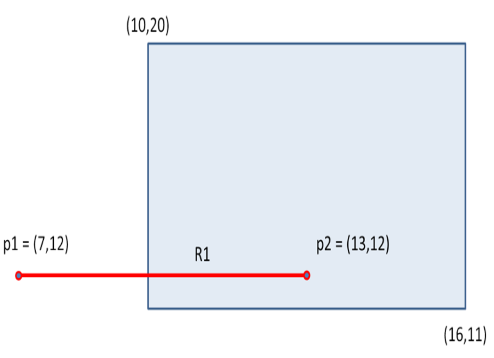

Considere o mundo 2D da figura acima, contendo um segmento de reta e uma Window com limites paralelos aos eixos de coordenadas, ambos representados em coordenadas de mundo.

Considere ainda que esta window será mapeada sobre uma viewport de tamanho 320x180 pixels e que a origem do sistema de coordenadas dessa viewport é (10, 10), e responda à pergunta abaixo.

Lembre-se que a orientação dos eixos de coordenadas de Viewport é peculiar a essa estrutura.

Após a clipagem, qual será o valor da coordenada Y do ponto p2 da reta clipada, quando representado no sistema de coordenadas de Viewport? Use apenas inteiros (positivos e negativos) para a sua resposta.

> [!success]- Resposta
> **170**
>
> Window (10,11)–(16,20), viewport 320×180 com origem em (10,10), e o y da viewport cresce para baixo. p2 = (13,12) já está dentro.
> yv = 10 + (1 − (12 − 11)/(20 − 11))·180 = 10 + (8/9)·180 = 170.

### Q03 · resposta numérica (inteiro) · apareceu 21×

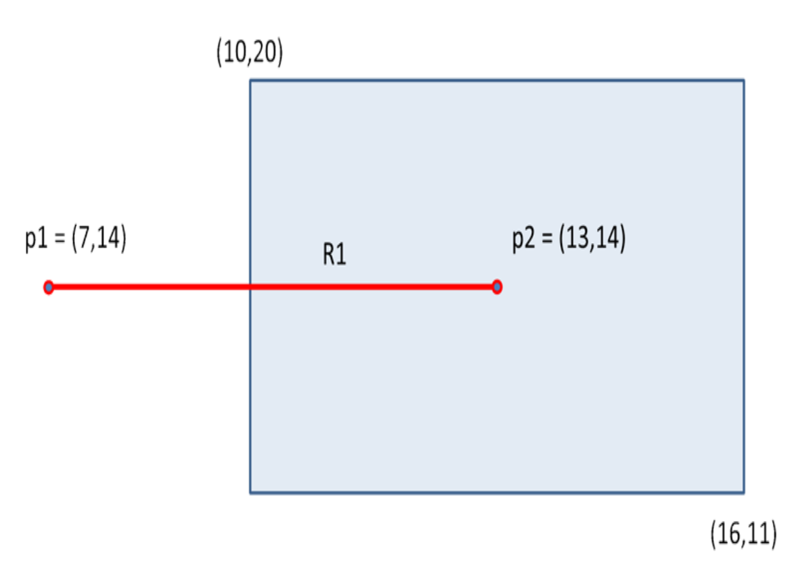

Considere o mundo 2D da figura acima, contendo um segmento de reta e uma Window com limites paralelos aos eixos de coordenadas, ambos representados em coordenadas de mundo, e responda à pergunta abaixo.

Considere também que para nossa implementação do sistema de coordenadas de Window estamos utilizando coordenadas normalizadas com origem no window center (WC) e com domínio = [-1, 1].

Após a clipagem, qual será o valor da coordenada Y do novo ponto p1' da reta clipada, quando representado no sistema de coordenadas de Window? Use apenas inteiros (positivos e negativos) para a sua resposta.

> [!success]- Resposta
> **0**
>
> p1 = (7,14) está à esquerda, então p1' = (10,14). O SCN tem origem no centro da window (13; 15,5) e meia-altura 4,5:
> y = (14 − 15,5)/4,5 = −0,33, que como inteiro dá 0.

### Q04 · escolha uma · apareceu 21×

O algoritmo de recorte de retas baseado em códigos de regiões é:

- a) Weiler-Atherton
- b) Gauss-Jacobi
- c) Liang-Barsky
- d) Sutherland-Hodgeman
- e) Cohen-Sutherland
- f) Gauss-Seidel
- g) Runge-Kutta
- h) Nicholl-Lee-Nicholl

> [!success]- Resposta
> - **e)** Cohen-Sutherland
>
> Cohen-Sutherland dá a cada extremo um código de 4 bits (acima, abaixo, direita, esquerda). Os dois 0000: desenha. AND ≠ 0000: os dois do mesmo lado de fora, descarta. Senão calcula interseção.

### Q05 · resposta numérica (inteiro) · apareceu 21×


Considere o mundo 2D da figura acima, contendo um segmento de reta e uma Window com limites paralelos aos eixos de coordenadas, ambos representados em coordenadas de mundo, e responda à pergunta abaixo.

Considere também que para nossa implementação do sistema de coordenadas de Window estamos utilizando coordenadas normalizadas com origem no window center (WC) e com domínio = [-1, 1].

Após a clipagem, qual será o valor da coordenada Y do ponto p2 da reta acima, quando representado no sistema de coordenadas de Window? Use apenas inteiros (positivos e negativos) para a sua resposta.

> [!success]- Resposta
> **0**
>
> Comentário do professor: A reta termina em WC, logo p2 = (0, 0)
>
> p2 = (13,14): y = (14 − 15,5)/4,5 = −0,33 → 0 como inteiro. O comentário do professor diz que p2 termina no centro da window (WC); em x isso é exato, em y dá −0,33.

### Q06 · resposta numérica (inteiro) · apareceu 21×


Considere o mundo 2D da figura acima, contendo um segmento de reta e uma Window com limites paralelos aos eixos de coordenadas, ambos representados em coordenadas de mundo.

Considere ainda que esta window será mapeada sobre uma viewport de tamanho 320x180 pixels e que a origem do sistema de coordenadas dessa viewport é (10, 10), e responda à pergunta abaixo.

Lembre-se que a orientação dos eixos de coordenadas de Viewport é peculiar a essa estrutura.

Após a clipagem, qual será o valor da coordenada Y do novo ponto p1' da reta clipada, quando representado no sistema de coordenadas de Viewport? Use apenas inteiros (positivos e negativos) para a sua resposta.

> [!success]- Resposta
> **170**
>
> p1 = (7,12) está à esquerda da window; a reta é horizontal, então o recorte em x = 10 dá p1' = (10,12).
> yv = 10 + (1 − (12 − 11)/9)·180 = 170 (mesmo y de p2).

### Q07 · resposta numérica (inteiro) · apareceu 20×


Considere o mundo 2D da figura acima, contendo um segmento de reta e uma Window com limites paralelos aos eixos de coordenadas, ambos representados em coordenadas de mundo, e responda à pergunta abaixo.

Considere também que para nossa implementação do sistema de coordenadas de Window estamos utilizando coordenadas normalizadas com origem no window center (WC) e com domínio = [-1, 1].

Após a clipagem, qual será o valor da coordenada X do novo ponto p1' da reta clipada, quando representado no sistema de coordenadas de Window? Use apenas inteiros (positivos e negativos) para a sua resposta.

> [!success]- Resposta
> **-1**
>
> p1' = (10,14) fica sobre a borda esquerda. Meia-largura 3: x = (10 − 13)/3 = −1.

### Q08 · escolha uma · apareceu 20×

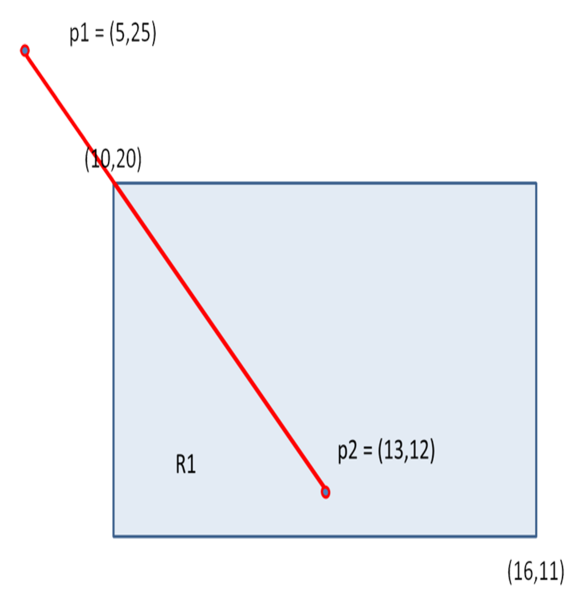

Considere a imagem acima, o algoritmo de recorte de Cohen Sutherland e a seguinte ordem de RCs: RC[1]: acima RC[2]: abaixo RC[3]: direita RC[4]: esquerda Se aplicarmos Cohen-Sutherland à reta acima, os RCs de p1 e p2 serão:

- a) p1= [0 0 1 0] e p2 = [0 0 0 1]
- b) p1= [1 0 0 0] e p2 = [0 0 0 1]
- c) p1= [1 0 1 0] e p2 = [1 1 1 1]
- d) p1= [0 1 1 0] e p2 = [1 1 1 1]
- e) p1= [1 0 0 1] e p2 = [1 1 1 1]
- f) p1= [0 1 1 0] e p2 = [0 0 0 0]
- g) p1= [1 0 0 0] e p2 = [0 0 0 0]
- h) p1= [1 0 0 1] e p2 = [0 0 0 0]

> [!success]- Resposta
> - **h)** p1= [1 0 0 1] e p2 = [0 0 0 0]
>
> Bits na ordem do enunciado: [acima, abaixo, direita, esquerda], com a window (10,11)–(16,20). Um bit vale 1 quando o ponto passa daquele limite; ponto dentro = 0000. Olhe x contra 10 e 16 e y contra 11 e 20, um ponto de cada vez.

### Q09 · resposta numérica (inteiro) · apareceu 20×


Considere o mundo 2D da figura acima, contendo um segmento de reta e uma Window com limites paralelos aos eixos de coordenadas, ambos representados em coordenadas de mundo, e responda à pergunta abaixo.

Considere também que para nossa implementação do sistema de coordenadas de Window estamos utilizando coordenadas normalizadas com origem no window center (WC) e com domínio = [-1, 1].

Após a clipagem, qual será o valor da coordenada X do ponto p2 da reta acima, quando representado no sistema de coordenadas de Window? Use apenas inteiros (positivos e negativos) para a sua resposta.

> [!success]- Resposta
> **0**
>
> Comentário do professor: A reta termina em WC, logo p2 = (0, 0)
>
> p2 = (13,14) tem o mesmo x do centro da window (13): x = (13 − 13)/3 = 0.

### Q10 · escolha uma · apareceu 19×

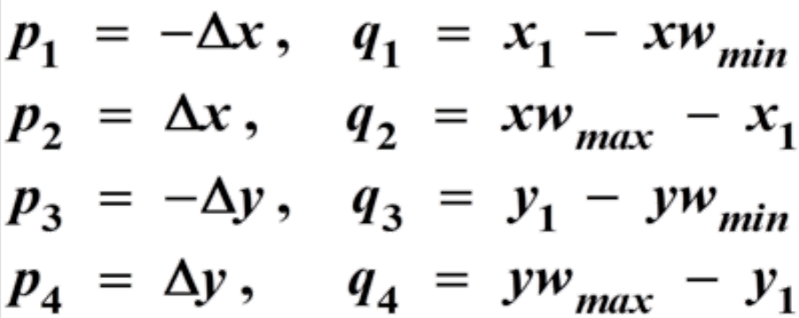

O algoritmo de recorte de retas baseado no cálculo e comparação de um conjunto de parâmetros pk e qk, definidos como na figura acima, é:

- a) Weiler-Atherton
- b) Nicholl-Lee-Nicholl
- c) Liang-Barsky
- d) Runge-Kutta
- e) Gauss-Seidel
- f) Sutherland-Hodgeman
- g) Gauss-Jacobi
- h) Cohen-Sutherland

> [!success]- Resposta
> - **c)** Liang-Barsky
>
> Liang-Barsky usa a reta paramétrica P = P1 + u·(Δx, Δy) e, para cada borda, p = (−Δx, Δx, −Δy, Δy) e q = distância de P1 até a borda. r = q/p diz em que u a reta cruza a borda; entra em max(0, r com p < 0) e sai em min(1, r com p > 0).

### Q11 · resposta numérica (inteiro) · apareceu 19×


Considere o mundo 2D da figura acima, contendo um segmento de reta e uma Window com limites paralelos aos eixos de coordenadas, ambos representados em coordenadas de mundo.

Considere ainda que esta window será mapeada sobre uma viewport de tamanho 320x180 pixels e que a origem do sistema de coordenadas dessa viewport é (10, 10), e responda à pergunta abaixo.

Lembre-se que a orientação dos eixos de coordenadas de Viewport é peculiar a essa estrutura.

Após a clipagem, qual será o valor da coordenada X do ponto p2 da reta clipada, quando representado no sistema de coordenadas de Viewport? Use apenas inteiros (positivos e negativos) para a sua resposta.

> [!success]- Resposta
> **170**
>
> O x da viewport não inverte, só o y.
> xv = 10 + (13 − 10)/(16 − 10)·320 = 10 + 160 = 170.

### Q12 · escolha uma · apareceu 19×


Considere a imagem acima, o algoritmo de recorte de Cohen Sutherland e a seguinte ordem de RCs: RC[1]: acima RC[2]: abaixo RC[3]: direita RC[4]: esquerda Se aplicarmos Cohen-Sutherland à reta acima, os RCs de p1 e p2 serão:

- a) p1= [0 0 0 1] e p2 = [1 1 1 1]
- b) p1= [1 0 0 0] e p2 = [0 0 0 1]
- c) p1= [0 0 1 0] e p2 = [0 0 0 1]
- d) p1= [0 0 1 0] e p2 = [1 1 1 1]
- e) p1= [1 0 0 0] e p2 = [0 0 0 0]
- f) p1= [0 0 1 0] e p2 = [0 0 0 0]
- g) p1= [1 0 1 0] e p2 = [1 1 1 1]
- h) p1= [0 0 0 1] e p2 = [0 0 0 0]

> [!success]- Resposta
> - **h)** p1= [0 0 0 1] e p2 = [0 0 0 0]
>
> Bits na ordem do enunciado: [acima, abaixo, direita, esquerda], com a window (10,11)–(16,20). Um bit vale 1 quando o ponto passa daquele limite; ponto dentro = 0000. Olhe x contra 10 e 16 e y contra 11 e 20, um ponto de cada vez.

### Q13 · escolha uma · apareceu 19×

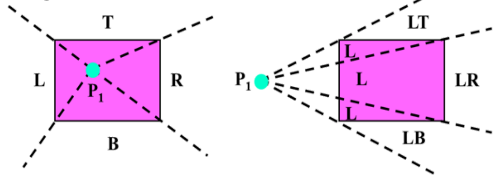

O algoritmo de recorte de retas baseado em comparação dos coeficientes angulares da reta a ser clipada com os coeficientes angulares de um conjunto de retas de referência é:

- a) Sutherland-Hodgeman
- b) Gauss-Seidel
- c) Nicholl-Lee-Nicholl
- d) Liang-Barsky
- e) Gauss-Jacobi
- f) Cohen-Sutherland
- g) Weiler-Atherton
- h) Runge-Kutta

> [!success]- Resposta
> - **c)** Nicholl-Lee-Nicholl
>
> Nicholl-Lee-Nicholl: traça retas de P1 até os cantos da window e compara a inclinação de P1P2 com as delas para saber quais bordas a reta corta. Só funciona em 2D e faz menos divisões que CS e LB.

### Q14 · escolha uma · apareceu 12×

[POSCOMP 2002] Considere uma cena representada no sistema de referência do universo (SRU), uma window definida pelo par de coordenadas (0,0)-(100,100) e uma viewport definida pelo par de coordenadas (20,30)-(300,100). Considere ainda que as coordenadas que definem window e viewport correspondem, respectivamente, aos limites inferior esquerdo e superior direito de ambas. Analise as afirmativas abaixo levando em consideração os conceitos clássicos de window e viewport e assinale a alternativa correta.

I – Window e viewport estão definidas no SRU.

II – No processo de mapeamento desta window para esta viewport haverá modificação na relação de aspecto.

III – O mapeamento da window redefinida pelo par de coordenadas (0,0) – (50,50) para a mesma viewport (20,30)-(300,100) corresponde a uma operação de zoom out sobre o mesmo universo.

- a) As afirmativas II e III são verdadeiras
- b) As alternativas I e III são falsas
- c) Apenas a afirmativa III é verdadeira
- d) As alternativas I e II são verdadeiras
- e) As alternativas I e II são falsas

> [!success]- Resposta
> - **b)** As alternativas I e III são falsas
>
> I é falsa: a window está no mundo (SRU), mas a viewport está no sistema do dispositivo. II é verdadeira: window 100×100 (1:1) e viewport 280×70 (4:1), a proporção muda e o desenho distorce. III é falsa: encolher a window para 50×50 mostra menos mundo na mesma viewport, o que é zoom IN (aproximar). Logo I e III são falsas.

### Q15 · escolha uma · apareceu 11×

Considerando as transformações entre sistemas de coordenadas 2D e o processo de recorte, analise as assertivas abaixo:

I. Denomina-se window a área do universo que será mapeada para a tela, e viewport a área de tela que será utilizada nesse processo.

II. Se as razões entre a largura e altura da window e a largura e a altura da viewport não forem as mesmas, ocorrerá uma mudança não uniforme de escala.

III. O recorte de linhas (clipping) pode ser feito tanto no sistema de coordenadas do universo como no da tela. Quais estão corretas?

- a) Apenas I e III
- b) Apenas III
- c) Apenas I
- d) I, II e III
- e) Apenas II

> [!success]- Resposta
> - **d)** I, II e III
>
> I é a definição. II: se a proporção largura/altura da window e da viewport é diferente, a escala em x fica diferente da escala em y. III: dá para recortar contra a window (mundo) ou contra a viewport (tela); o professor recorta em SCN, que é outra opção. Todas corretas.

### Q16 · escolha uma · apareceu 11×

[POSCOMP 2004] Considere: todas as etapas do processo de visualização de objetos 2D; uma window delimitada pelo par de coordenadas (0,0)-(60,60); uma viewport delimitada pelo par de coordenadas (0,0)-(100,80); e os seguintes parâmetros de instanciamento, aplicados nesta ordem: (1º) Escala em X: 1, Escala em Y: 2; (2º) Rotação: 0º; (3º) Translação X: 10, Translação Y: 0

Assumindo que, nas opções apresentadas abaixo, os retângulos pontilhados representam a viewport, qual dos desenhos a seguir mais se parece com o desenho do triângulo cuja definição no sistema de referência do universo é dada pelos pares de coordenadas (10,0)-(10,30)-(40,0)? Considere ainda que as coordenadas que definem window e viewport correspondem, respectivamente, aos limites inferior esquerdo e superior direito de ambas.

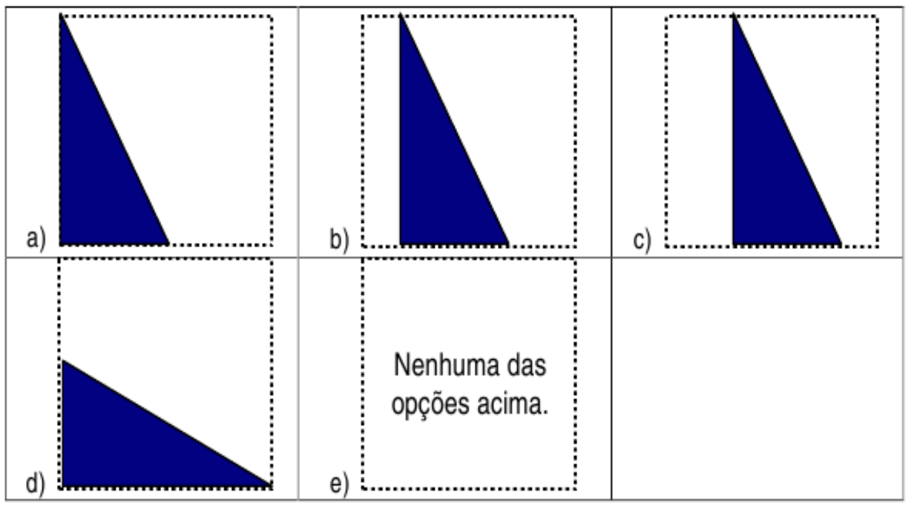

- a) Opção a
- b) Opção b
- c) Opção e
- d) Opção d
- e) Opção c

> [!success]- Resposta
> - **e)** Opção c
>
> Triângulo (10,0)-(10,30)-(40,0). Escala (1,2): (10,0), (10,60), (40,0). Translação (10,0): (20,0), (20,60), (50,0). Na window de 0 a 60, o lado vertical fica a 1/3 da largura e vai do chão ao topo, e o outro vértice fica a 5/6 da largura, embaixo: desenho c.

## Transformações, coordenadas homogêneas e geometria 3D

### Q17 · escolha uma · apareceu 22×

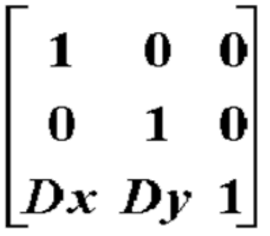

A matriz acima é:

- a) Uma matriz de Rotação para um Mundo 2D quando representado em Coordenadas Homogêneas.
- b) Uma matriz de Rotação 3D.
- c) Uma matriz de Translação 3D.
- d) Uma matriz de Translação para um Mundo 2D quando representado em Coordenadas Homogêneas.
- e) Uma matriz de Escalonamento para um Mundo 2D quando representado em Coordenadas Homogêneas.
- f) Uma matriz de Escalonamento 3D.

> [!success]- Resposta
> - **d)** Uma matriz de Translação para um Mundo 2D quando representado em Coordenadas Homogêneas.
>
> Reconheça pelo desenho da matriz: Dx, Dy na última linha = translação; Sx, Sy na diagonal = escala; cos e sen no bloco 2×2 = rotação. Se é 3×3, o mundo é 2D em homogêneas; se é 4×4, é 3D.

### Q18 · escolha uma · apareceu 21×

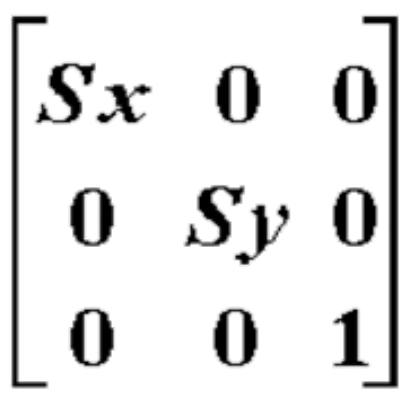

Acerca de Sx e Sy na matriz acima é possível afirmar que:

- a) Sx e Sy representam os fatores de deslocamento de uma translação 2D realizada em coordenadas homogêneas. Eles são obtidos das projeções em x e y dos resultados da equação básica do deslocamento S(t) = S0 + Vt e usados muito em games de corrida.
- b) É uma matriz de Rotação 2D representada em Coordenadas Homogêneas.
- c) É uma matriz de Rotação 3D.
- d) Sx e Sy representam os fatores de escala de um escalonamento 2D realizado em coordenadas homogêneas.
- e) Sx e Sy representam os fatores de escala de um escalonamento 3D quando o fator de escala em z é unitário, isto é, o objeto é distorcido em x e y e não se altera ao longo de z.
- f) Sx e Sy representam os fatores de deslocamento de uma translação 3D quando o deslocamento em z = 1. Eles são obtidos das projeções em x e y dos resultados da equação básica do deslocamento S(t) = S0 + Vt e usados muito em games de corrida.

> [!success]- Resposta
> - **d)** Sx e Sy representam os fatores de escala de um escalonamento 2D realizado em coordenadas homogêneas.
>
> Sx e Sy na diagonal de uma 3×3 com 1 no canto = escala 2D homogênea. As alternativas com S(t) = S0 + Vt e 'games de corrida' são distratores.

### Q19 · escolha uma · apareceu 21×

Inspirado em [Computer Graphics Trivial Quiz 1996-98 - University College London] Se desejarmos realizar uma translação 3D pelo vetor de deslocamento D = [1 2 3], a matriz de transformação, expressa em Coordenadas Homogêneas, será:

- a)  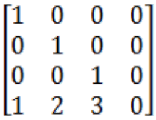
- b)  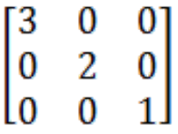
- c)  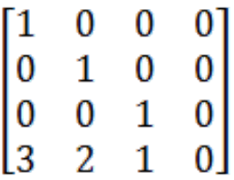
- d)  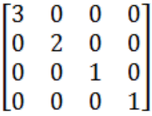
- e)  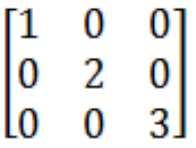
- f)  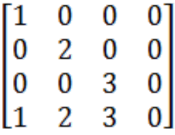
- g)  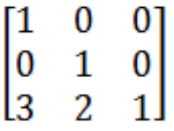
- h)  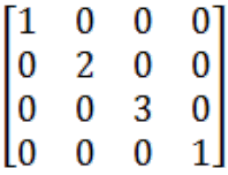
- i)  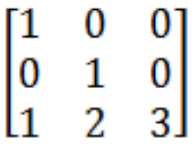

> [!success]- Resposta
> - **a)**  
>
> Translação 3D homogênea é 4×4 com (1, 2, 3) na última linha (vetor-linha). A matriz do gabarito tem 0 no canto inferior direito, o que está errado (devia ser 1), mas é a única 4×4 com [1 2 3] na última linha. A com [3 2 1] troca a ordem.

### Q20 · marque todas as verdadeiras · apareceu 21×

Considere a expressão abaixo:

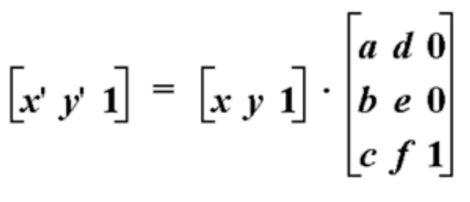

e assinale as alternativas verdadeiras:

- a) Usando uma representação em Coordenadas Homogêneas podemos representar apenas as operações geométricas de Rotação como uma multiplicação de matrizes (produto escalar), onde uma é um ponto do objeto ponto e a outra a matriz de transformação, conforme a expressão acima.
- b) Na expressão acima a constante W=1 em [x y W] e [x' y' W] está correta: o valor de W é chamado de fator de escala e deve ser um valor constante e diferente de 0, pois uma fator de escala = 0 levaria a divisões por zero e não deve ser usado.
- c) Usando uma representação em Coordenadas Homogêneas podemos realizar toda operação geométrica sobre um ponto como uma multiplicação de matrizes, onde uma é o ponto e a outra a matriz de transformação, conforme a expressão acima.
- d) Na expressão acima a constante W em [x y W] e [x' y' W] está incorreta: o valor de W deve ser sempre 0 pois a dimensão adicional das Coordenadas Homogêneas é ajustada à origem do sistema de coordenadas original do dado.
- e) Usando uma representação em Coordenadas Homogêneas podemos representar apenas as operações geométricas de Escalonamento como uma multiplicação de matrizes (produto escalar), onde uma é um ponto do objeto ponto e a outra a matriz de transformação, conforme a expressão acima.
- f) Na expressão acima a constante W=1 em [x y W] e [x' y' W] está correta: o valor de W é chamado de fator de escala e, para efeitos computacionais, um fator de escala de 1 é a melhor escolha pois não altera x e y.
- g) A expressão acima descreve uma transformação genérica usando uma representação em Coordenadas Homogêneas de um Mundo 2D.
- h) A expressão acima descreve uma transformação genérica usando uma representação em Coordenadas Homogêneas de um Mundo 3D.

> [!success]- Resposta
> - **b)** Na expressão acima a constante W=1 em [x y W] e [x' y' W] está correta: o valor de W é chamado de fator de escala e deve ser um valor constante e diferente de 0, pois uma fator de escala = 0 levaria a divisões por zero e não deve ser usado.
> - **c)** Usando uma representação em Coordenadas Homogêneas podemos realizar toda operação geométrica sobre um ponto como uma multiplicação de matrizes, onde uma é o ponto e a outra a matriz de transformação, conforme a expressão acima.
> - **f)** Na expressão acima a constante W=1 em [x y W] e [x' y' W] está correta: o valor de W é chamado de fator de escala e, para efeitos computacionais, um fator de escala de 1 é a melhor escolha pois não altera x e y.
> - **g)** A expressão acima descreve uma transformação genérica usando uma representação em Coordenadas Homogêneas de um Mundo 2D.
>
> [x y 1]·M com M 3×3 genérica é uma transformação 2D em homogêneas (a, b, d, e giram, escalam e cisalham; c, f transladam). W = 1 é o fator de escala: tem que ser constante e ≠ 0, e 1 não altera x e y. Com homogêneas TODA operação vira produto de matrizes, não só rotação ou só escala.

### Q21 · escolha uma · apareceu 20×

Inspirado em [Computer Graphics Trivial Quiz 1996-98 - University College London] Se desejarmos realizar um escalonamento 3D pelo vetor de escala S = [1 2 3], a matriz de transformação, expressa em Coordenadas Homogêneas, será:

- a)  
- b)  
- c)  
- d)  
- e)  
- f)  
- g)  
- h)  
- i)  

> [!success]- Resposta
> - **f)**  
>
> Escala 3D homogênea: 4×4 com diagonal 1, 2, 3, 1. As 3×3 com diagonal 1, 2, 3 seriam escala 3D sem homogêneas.

### Q22 · escolha uma · apareceu 20×

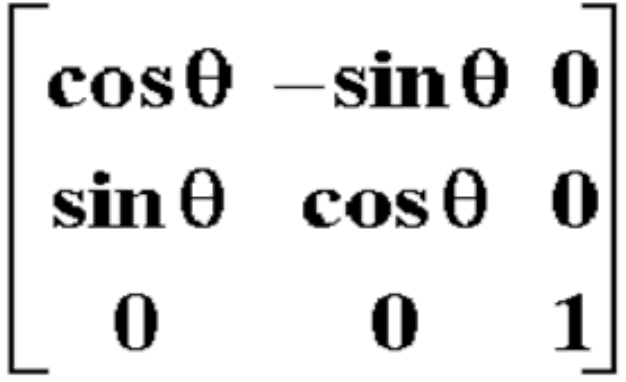

A matriz acima é:

- a) Uma matriz de Rotação para um Mundo 2D quando representado em Coordenadas Homogêneas.
- b) Uma matriz de Translação 3D.
- c) Uma matriz de Rotação 3D.
- d) Uma matriz de Escalonamento para um Mundo 2D quando representado em Coordenadas Homogêneas.
- e) Uma matriz de Escalonamento 3D.
- f) Uma matriz de Translação para um Mundo 2D quando representado em Coordenadas Homogêneas.

> [!success]- Resposta
> - **a)** Uma matriz de Rotação para um Mundo 2D quando representado em Coordenadas Homogêneas.
>
> Reconheça pelo desenho da matriz: Dx, Dy na última linha = translação; Sx, Sy na diagonal = escala; cos e sen no bloco 2×2 = rotação. Se é 3×3, o mundo é 2D em homogêneas; se é 4×4, é 3D.

### Q23 · escolha uma · apareceu 20×

Considere que: sen(90º) = 1 e cos(90º) = 0.

Qual a matriz de transformação, em Coordenadas Homogêneas, necessária para realizar uma rotação 3D de 90º de um objeto em torno do eixo Z?

- a)  
- b)  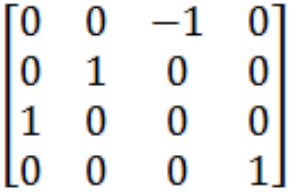
- c)  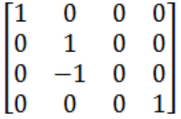
- d)  
- e)  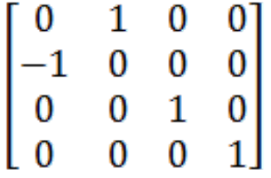
- f)  
- g)  
- h)  
- i)  

> [!success]- Resposta
> - **e)**  
>
> Rz(θ) em vetor-linha: [[cos, sen, 0, 0], [−sen, cos, 0, 0], [0, 0, 1, 0], [0, 0, 0, 1]]. Com cos = 0 e sen = 1: [[0, 1, 0, 0], [−1, 0, 0, 0], [0, 0, 1, 0], [0, 0, 0, 1]]. O z fica intacto.

### Q24 · escolha uma · apareceu 20×

Considere o método de mapeamento de coordenadas de um mundo 3D para um sistema de referência de Coordenadas Homogêneas comumente utilizado em Computação Gráfica. É verdade afirmar que:

- a) Sistema de Coordenadas Homogênas é um outro nome para Sistema de Coordenadas Normalizado
- b) Vamos adicionar apenas uma nova dimensão adicional às coordenadas, que passarão a ser representadas por pontos 4D: [X Y Z W], onde W só pode possuir um valor constante = 1 e nenhum outro valor.
- c) Vamos adicionar apenas uma nova dimensão adicional às coordenadas, que passarão a ser representadas por pontos 4D: [X Y Z W], mas isso só pode ser feito depois de normalizar as coordenadas do mundo para o intervalo [0, 1].
- d) Vamos adicionar apenas uma nova dimensão adicional às coordenadas, que passarão a ser representadas por pontos 4D: [X Y Z W], onde W deve possuir um valor constante diferente de 0. Por questões de simplicidade usamos W=1.
- e) Vamos adicionar apenas uma nova dimensão adicional às coordenadas, que passarão a ser representadas por pontos 4D: [X Y Z W], onde W tem um valor que é uma função da norma de [x y z].
- f) Vamos adicionar apenas uma nova dimensão adicional às coordenadas, que passarão a ser representadas por pontos 4D: [X Y Z W], onde W tem um valor constante = 0.
- g) Vamos sempre duplicar as dimensões das coordenadas x y z, que passarão a ser representadas por pontos 6D: [x y z X Y Z], onde X, Y e Z = 1.
- h) Vamos adicionar apenas uma nova dimensão adicional às coordenadas, que passarão a ser representadas por pontos 4D: [X Y Z W], onde W tem um valor constante = -1.

> [!success]- Resposta
> - **d)** Vamos adicionar apenas uma nova dimensão adicional às coordenadas, que passarão a ser representadas por pontos 4D: [X Y Z W], onde W deve possuir um valor constante diferente de 0. Por questões de simplicidade usamos W=1.
>
> Uma dimensão a mais (pontos 4D), W constante e ≠ 0, e por simplicidade W = 1. Não é outro nome do SCN, não depende de normalizar antes, e W não é 0, −1 nem função da norma.

### Q25 · escolha uma · apareceu 19×


A matriz acima é:

- a) Uma matriz de Escalonamento 3D.
- b) Uma matriz de Rotação para um Mundo 2D quando representado em Coordenadas Homogêneas.
- c) Uma matriz de Rotação 3D.
- d) Uma matriz de Translação para um Mundo 2D quando representado em Coordenadas Homogêneas.
- e) Uma matriz de Escalonamento para um Mundo 2D quando representado em Coordenadas Homogêneas.
- f) Uma matriz de Translação 3D.

> [!success]- Resposta
> - **e)** Uma matriz de Escalonamento para um Mundo 2D quando representado em Coordenadas Homogêneas.
>
> Reconheça pelo desenho da matriz: Dx, Dy na última linha = translação; Sx, Sy na diagonal = escala; cos e sen no bloco 2×2 = rotação. Se é 3×3, o mundo é 2D em homogêneas; se é 4×4, é 3D.

### Q26 · escolha uma · apareceu 19×

Considere que: sen(90º) = 1 e cos(90º) = 0.

Qual a matriz de transformação, em Coordenadas Homogênas, necessária para realizar uma rotação 3D de 90º de um objeto em torno do eixo X?

- a)  
- b)  
- c)  
- d)  
- e)  
- f)  
- g)  
- h)  
- i)  

> [!success]- Resposta
> - **f)**  
>
> 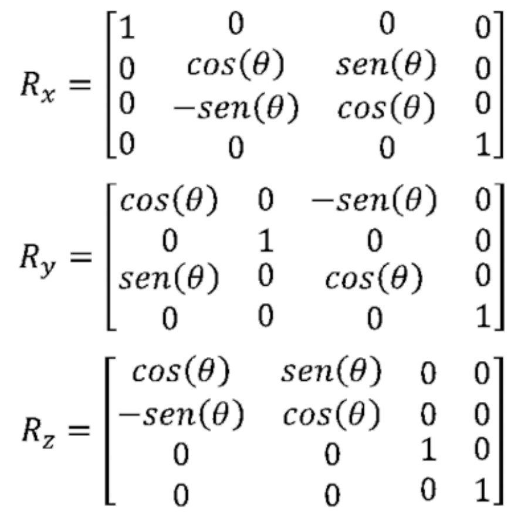
>
> Rx(θ) em vetor-linha: [[1, 0, 0, 0], [0, cos, sen, 0], [0, −sen, cos, 0], [0, 0, 0, 1]], que com 90° dá [[1,0,0,0], [0,0,1,0], [0,−1,0,0], [0,0,0,1]]. A imagem do gabarito mostra a 2ª linha como [0 1 0 0], erro de digitação do professor. Por eliminação é a única com o −1 no bloco y-z e o x intacto.

### Q27 · escolha uma · apareceu 19×

Inspirado em [Computer Graphics Trivial Quiz 1996-98 - University College London]

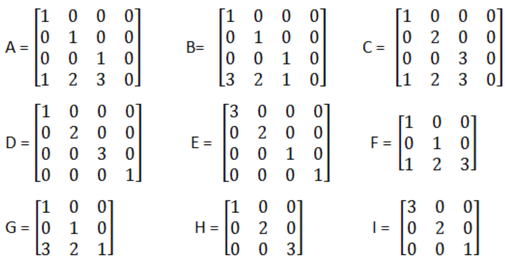

Considere as matrizes de transformação acima. Se desejarmos realizar uma translação pelo vetor de deslocamento D = [1 2 3], a matriz de transformação, expressa em Coordenadas Homogêneas, será:

- a) A
- b) H
- c) G
- d) D
- e) B
- f) E
- g) Tanto A quanto B estão corretas pois a ordem das dimensões não importa nesta transformação.
- h) C
- i) Tanto D quanto E estão corretas pois a ordem das dimensões não importa nesta transformação.
- j) F
- k) I

> [!success]- Resposta
> - **a)** A
>
> A é a identidade 4×4 com [1 2 3] na última linha: translação 3D em vetor-linha (o gabarito aceita mesmo com 0 no canto). B tem [3 2 1], e a ordem importa. D e E são escalas, G é translação 2D, F e H/I são 3×3.

### Q28 · escolha uma · apareceu 19×

Considere que: sen(90º) = 1 e cos(90º) = 0.

Qual a matriz de transformação, em Coordenadas Homogêneas, necessária para realizar uma rotação 3D de 90º de um objeto em torno do eixo Y?

- a)  
- b)  
- c)  
- d)  
- e)  
- f)  
- g)  
- h)  
- i)  

> [!success]- Resposta
> - **c)**  
>
> Ry(θ) em vetor-linha: [[cos, 0, −sen, 0], [0, 1, 0, 0], [sen, 0, cos, 0], [0, 0, 0, 1]] → com 90°: [[0, 0, −1, 0], [0, 1, 0, 0], [1, 0, 0, 0], [0, 0, 0, 1]]. Em Ry o sinal do seno fica ao contrário de Rx e Rz.

### Q29 · escolha uma · apareceu 13×

POSCOMP 2016 - QUESTÃO 57 – Considerando transformações geométricas em duas (2D) e três (3D) dimensões, analise as assertivas abaixo:

I. Coordenadas homogêneas são necessárias para representar a transformação de translação em uma matriz.

II. Se forem realizadas uma transformação de escala uniforme e uma de rotação em 2D, a ordem das transformações alterará o resultado final.

III. Se forem realizadas duas transformações de rotação em 3D: uma de 90 graus em torno do eixo X, e outra de 90 graus em torno do eixo Z, o resultado final não será afetado pela ordem das transformações. Quais estão corretas?

- a) Apenas I e III.
- b) Apenas III.
- c) Apenas II e III.
- d) Apenas II.
- e) Apenas I.

> [!success]- Resposta
> - **e)** Apenas I.
>
> I é verdadeira: translação não é linear em n dimensões, só vira matriz em n+1 (homogêneas). II é falsa: escala uniforme comuta com rotação. III é falsa: rotações em eixos diferentes não comutam (teste com o vetor (0,1,0)).

### Q30 · escolha uma · apareceu 13×

[POSCOMP 2010] Considere um objeto em 3D ancorado no seu centro de massa p = (xc, yc, zc). Qual a transformação necessária para rotacioná-lo em Θ graus, contra relógio, ao redor do eixo x, sem alterar a sua posição no espaço? Assuma que a matriz T realiza translações, a matriz R realiza rotações de Θ graus ao redor do eixo x, contra relógio.

- a) T(−p).Rx(Θ)
- b) T(p).Rx(Θ).T(−p)
- c) R(Θ).T(−p)
- d) T(−p).Rx(Θ).T(p)
- e) T(p).Rx(Θ).T(p)

> [!success]- Resposta
> - **b)** T(p).Rx(Θ).T(−p)
>
> Leva p à origem, gira e devolve. Com vetor-coluna (o padrão do POSCOMP) a primeira transformação fica à direita: T(p)·Rx(Θ)·T(−p). Com o vetor-linha do professor a ordem inverte e fica T(−p)·Rx·T(p), que é a alternativa d. Veja qual convenção o enunciado usa.

### Q31 · escolha uma · apareceu 12×

[POSCOMP 2014 - Questão 58] Considere as matrizes de transformações geométricas A e B e as coordenadas homogêneas a seguir.

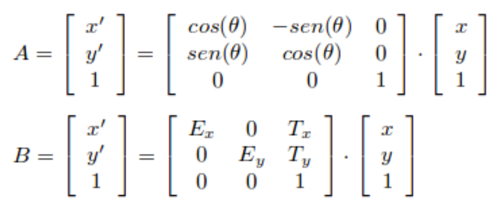

Considere que Ex e Ey são, respectivamente, fatores de escala em x e y, que Tx e Ty são, respectivamente, fatores de translação em x e y e que θ representa um ângulo de rotação. Em relação a essas matrizes, considere as afirmativas a seguir.

I. A matriz de rotação A rotaciona um objeto ao redor do seu centro de massa.

II. A matriz B primeiro translada e depois escala o ponto.

III. A matriz B primeiro escala e depois translada o ponto.

IV. A matriz mudança de base de coordenada em 2D pode ser construída a partir da composição das matrizes homogêneas de translação, rotação e escala.

- a) Somente as afirmativas I e IV são corretas.
- b) Somente as afirmativas I e II são corretas.
- c) Somente as afirmativas II, III e IV são corretas.
- d) Somente as afirmativas III e IV são corretas.
- e) Somente as afirmativas I, II e III são corretas.

> [!success]- Resposta
> - **d)** Somente as afirmativas III e IV são corretas.
>
> A gira em torno da origem, não do centro de massa (I falsa). Com vetor-coluna, B dá x' = Ex·x + Tx: primeiro escala, depois translada (III verdadeira, II falsa). IV é verdadeira: mudança de base 2D é composição de translação, rotação e escala.

### Q32 · escolha uma · apareceu 12×

[POSCOMP 2009] Considere a transformação T ilustrada abaixo, que mapeia a figura da esquerda na figura da direita.

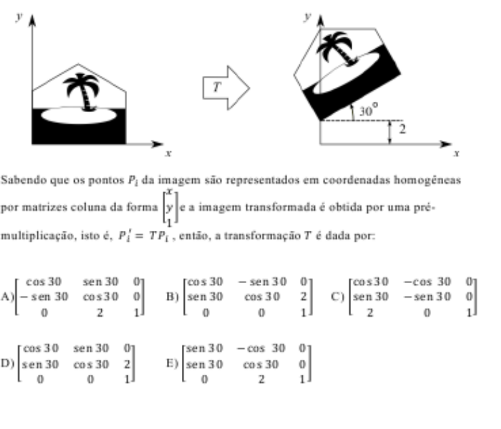

- a) Matriz D
- b) Matriz C
- c) Matriz A
- d) Matriz B
- e) Matriz E

> [!success]- Resposta
> - **d)** Matriz B
> - **e)** Matriz E
>
> A figura gira 30° no sentido anti-horário e sobe 2 em y. Com vetor-coluna e pré-multiplicação, T = T(0,2)·R(30°) = [[cos30, −sen30, 0], [sen30, cos30, 2], [0, 0, 1]], que é a B. O Moodle também marca E, que não confere (a 1ª coluna de E é (sen30, sen30), nem é rotação); deve ser erro de cadastro. Em vetor-linha a resposta seria A, a transposta de B.

### Q33 · escolha uma · apareceu 11×

[POSCOMP 2005, questão 4] Dada a matriz de transformação linear

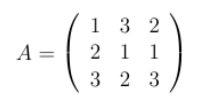

pode-se afirmar que:

- a) o vetor (0, 1, 0) é mapeado para (3, 1, 2).
- b) o vetor (0, 0, 1) é mapeado para (3, 2, 3).
- c) o vetor (1, 1, 0) é mapeado para (3, 2, 3).
- d) o vetor (1, 0, 0) é mapeado para (1, 3, 2).
- e) o vetor (1, 0, 1) é mapeado para (3, 0, 2).

> [!success]- Resposta
> - **a)** o vetor (0, 1, 0) é mapeado para (3, 1, 2).
>
> Com vetor-coluna, A·v pega colunas: A·(0,1,0) é a 2ª coluna = (3, 1, 2). Conferindo as outras: A·(1,0,0) = (1,2,3), A·(0,0,1) = (2,1,3), A·(1,1,0) = (4,3,5), A·(1,0,1) = (3,3,6). A alternativa com (1,3,2) leu a linha em vez da coluna.

### Q34 · escolha uma · apareceu 10×

[POSCOMP 2014 - Questão 57] Sobre a construção de objetos 3D em uma estrutura conhecida na computação gráfica como estrutura de arame, considere as afirmativas a seguir.

I. É necessário obter o conjunto dos vértices de todos os pontos do objeto.

II. É necessário obter o conjunto dos pontos de cada face do objeto.

III. O cálculo da normal de uma face é realizado utilizando 3 pontos da face e a operação de produto vetorial.

IV. O cálculo da normal de uma face é realizado utilizando 3 pontos da face e a operação de produto interno.

- a) Somente as afirmativas I e II são corretas.
- b) Somente as afirmativas I e IV são corretas.
- c) Somente as afirmativas III e IV são corretas.
- d) Somente as afirmativas II, III e IV são corretas.
- e) Somente as afirmativas I, II e III são corretas.

> [!success]- Resposta
> - **e)** Somente as afirmativas I, II e III são corretas.
>
> Para o modelo de arame você precisa dos vértices (I) e de quais pontos formam cada face (II). A normal de uma face sai do produto VETORIAL de duas arestas feitas com 3 pontos (III). O produto interno dá um número, não um vetor (IV falsa).

### Q35 · escolha uma · apareceu 10×

[POSCOMP 2019] Considerando um sistema de coordenadas no espaço, em uma orientação previamente definida, e sabendo que são conhecidos os vetores (ortogonais entre si) correspondentes aos eixos X e Y, qual é o nome da operação que é capaz de produzir o vetor correspondente ao eixo Z desse sistema – isto é, perpendicular aos outros dois?

- a) Projeção
- b) Produto escalar
- c) Normalização
- d) Translação
- e) Produto vetorial

> [!success]- Resposta
> - **e)** Produto vetorial
>
> O produto vetorial X × Y dá um vetor perpendicular aos dois, que é o Z. Produto escalar dá um número (o cosseno vezes os módulos).

## Projeções e pipeline de visualização 3D

### Q36 · marque todas as verdadeiras · apareceu 37×

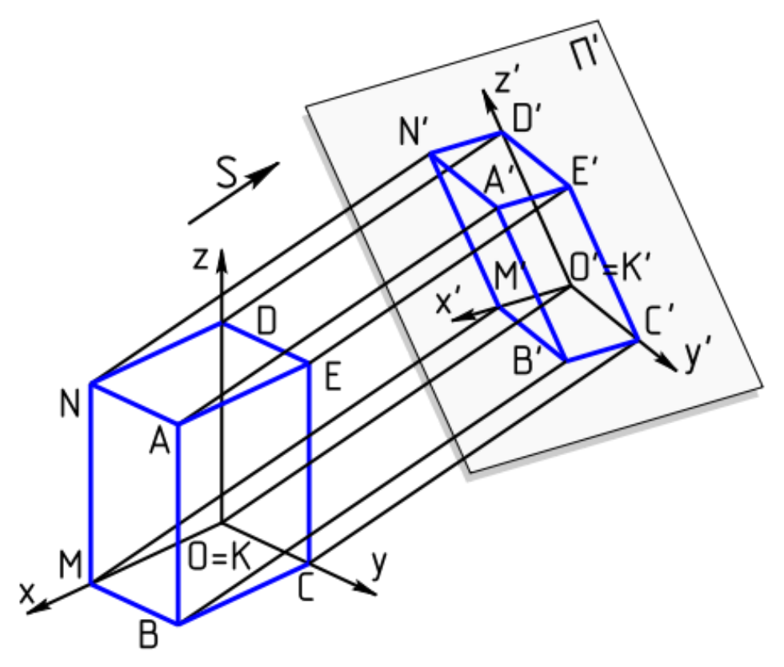

Sobre a projeção paralela é verdadeiro afirmar:

- a) Existem basicamente dois tipos: (a) Projeções Ortogonais e (b) Projeções em Perspectiva
- b) A técnica de Projeção Paralela comumente utilizada em Computação Gráfica é a Projeção Ortogonal.
- c) A projeção Isométrica é exemplo de Projeções em Perspectiva do tipo Axonométrica (que mantém as dimensões do objeto sobre os eixos)e por isso muito usada em Desenho Técnico e em Engenharia.
- d) Para realizar uma Projeção em Perspectiva, depois de normalizados os dados para o Sistema de Coordenadas da Window, basta ignorar a coordenada Z de cada ponto e você tem uma a projeção 2D dos objetos 3D.
- e) A projeção Isométrica é exemplo de Projeções Paralelas Oblíquas do tipo Axonométrica (que mantém as dimensões do objeto sobre os eixos) e por isso muito usada em Desenho Técnico e em Engenharia.
- f) As projeções Cavaleira e Cabinet são exemplos de Projeções Paralelas Oblíquas ou Pictóricas,
- g) Existem basicamente dois tipos: (a) Projeções Paralelas Ortogonais ou Ortográficas e (b) Projeções Paralelas Oblíquas ou Pictóricas
- h) Para realizar uma Projeção Paralela Ortogonal, depois de normalizados os dados para o Sistema de Coordenadas da Window, basta ignorar a coordenada Z de cada ponto e você tem uma a projeção 2D dos objetos 3D.
- i) Na projeção paralela usa-se raios de projeção paralelos e a amplitude do campo de visão não se modifica com a distância ao Plano de Projeção (à Window), é por isso que o tamanho aparente dos objetos não varia de acordo com a distância.
- j) Na projeção paralela usa-se raios de projeção formando uma pirâmide truncada e a amplitude do campo de visão, representada por cortes dessa pirâmide, se adapta com a distância ao Plano de Projeção (à Window), é por isso que o tamanho aparente dos objetos varia de acordo com a distância.
- k) Na projeção paralela o tamanho aparente dos objetos não varia de acordo com a distância do objeto ao Plano de Projeção (à Window), por isso objetos às vezes se paracem distorcidos neste tipo de representação.
- l) Na projeção paralela o tamanho aparente dos objetos é ajustado fielmente de acordo com a distância do objeto ao Plano de Projeção (à Window), por isso essa técnica de representação é muito usada em Engenharia.

> [!success]- Resposta
> - **b)** A técnica de Projeção Paralela comumente utilizada em Computação Gráfica é a Projeção Ortogonal.
> - **e)** A projeção Isométrica é exemplo de Projeções Paralelas Oblíquas do tipo Axonométrica (que mantém as dimensões do objeto sobre os eixos) e por isso muito usada em Desenho Técnico e em Engenharia.
> - **f)** As projeções Cavaleira e Cabinet são exemplos de Projeções Paralelas Oblíquas ou Pictóricas,
> - **g)** Existem basicamente dois tipos: (a) Projeções Paralelas Ortogonais ou Ortográficas e (b) Projeções Paralelas Oblíquas ou Pictóricas
> - **h)** Para realizar uma Projeção Paralela Ortogonal, depois de normalizados os dados para o Sistema de Coordenadas da Window, basta ignorar a coordenada Z de cada ponto e você tem uma a projeção 2D dos objetos 3D.
> - **i)** Na projeção paralela usa-se raios de projeção paralelos e a amplitude do campo de visão não se modifica com a distância ao Plano de Projeção (à Window), é por isso que o tamanho aparente dos objetos não varia de acordo com a distância.
> - **k)** Na projeção paralela o tamanho aparente dos objetos não varia de acordo com a distância do objeto ao Plano de Projeção (à Window), por isso objetos às vezes se paracem distorcidos neste tipo de representação.
>
> Na classificação do professor a paralela é ortogonal (a usada em CG) ou oblíqua/pictórica, e isométrica, cavaleira e cabinet ficam em oblíqua. Os raios são paralelos e o tamanho aparente não muda com a distância, por isso às vezes parece distorcido. Ignorar Z é a paralela ortogonal, nunca a perspectiva. Pirâmide truncada é perspectiva.

### Q37 · escolha uma · apareceu 12×

POSCOMP 2016 - QUESTÃO 58 – Assinale a alternativa que descreve corretamente uma característica de transformações de projeção.

- a) Em uma projeção paralela, considera-se que o centro de projeção está a uma distância determinada do plano de projeção.
- b) A projeção perspectiva preserva ângulos e medidas de objetos.
- c) O tamanho da projeção perspectiva de um objeto varia de forma diretamente proporcional a distância desse objeto ao centro de projeção.
- d) Projeções isométricas não são paralelas.
- e) Uma projeção perspectiva pode ser representada por uma matriz 4x4.

> [!success]- Resposta
> - **e)** Uma projeção perspectiva pode ser representada por uma matriz 4x4.
>
> A perspectiva em homogêneas é uma 4×4 (a linha com 1/d põe z/d em W, e a divisão por W faz a perspectiva). Na paralela o centro de projeção está no infinito, a perspectiva não preserva ângulos nem medidas, o tamanho projetado é INVERSAMENTE proporcional à distância, e isométrica é paralela.

### Q38 · escolha uma · apareceu 12×

[POSCOMP 2006] Considere o plano definido pelos pontos A(10, 0, 0), B(0, 10, 0) e C(2, 2, 20). A projeção do ponto D(20, 20, 10) sobre o plano dado. segundo a direção de projeção U=(-5, -10, -15) é:

- a) (150/13, 80/13, −200/13)
- b) (300/13, 40/13, −200/13)
- c) (300/13, 80/13, −100/13)
- d) (150/13, 40/13, −200/13)
- e) (300/13, 40/13, −100/13)

> [!success]- Resposta
> - **d)** (150/13, 40/13, −200/13)
>
> Normal do plano: (B − A) × (C − A) = (−10,10,0) × (−8,2,20) = (200, 200, 60) ∝ (10, 10, 3), e o plano é 10x + 10y + 3z = 100. A reta D + tU = (20 − 5t, 20 − 10t, 10 − 15t) cai no plano quando 430 − 195t = 100, ou seja t = 22/13. Ponto: (150/13, 40/13, −200/13).

### Q39 · associe as colunas · apareceu 12×

[POSCOMP 2011] Com relação ao processo tradicional de síntese de imagens em computação gráfica, relacione a coluna da esquerda com a coluna da direita.

| Coluna da esquerda | Coluna da direita (embaralhada) |
|---|---|
| (II) Volume de Visualização | (E) Encontra as coordenadas de pixel na tela |
| (I) Projeção Perspectiva | (B) Define a porção visível da cena |
| (V) Rasterização | (A) Responsável pela remoção das linhas e superfícies ocultas |
| (III) Modelo de Gouraud | (C) Mapeia coordenadas num espaço tridimensional para um espaço bidimensional |
| (IV) Algoritmo de Z-buffer | (D) Efetua interpolação linear das cores |

> [!success]- Resposta
> - (II) Volume de Visualização → **(B) Define a porção visível da cena**
> - (I) Projeção Perspectiva → **(C) Mapeia coordenadas num espaço tridimensional para um espaço bidimensional**
> - (V) Rasterização → **(E) Encontra as coordenadas de pixel na tela**
> - (III) Modelo de Gouraud → **(D) Efetua interpolação linear das cores**
> - (IV) Algoritmo de Z-buffer → **(A) Responsável pela remoção das linhas e superfícies ocultas**
>
> Volume de visualização define o que é visível, a projeção perspectiva leva 3D para 2D, rasterização acha os pixels, Gouraud interpola cores e z-buffer remove superfícies ocultas.

### Q40 · escolha uma · apareceu 11×

[POSCOMP 2003, questão 50] O pipeline de visualização de objetos tridimensionais reúne um conjunto de transformações e processos aplicados a primitivas geométricas. Sobre essas transformações e processos pode-se dizer que:

I Os objetos devem corresponder a sólidos.

II As coordenadas dos vértices sofrem transformação de acordo com a posição e orientação do observador.

III Um volume de visualização correspondente a um paralelepípedo é determinado pela adoção de projeção perspectiva.

IV A fase final do pipeline corresponde à rasterização dos polígonos.

- a) Apenas a afirmativa IV é falsa.
- b) Apenas as afirmativas I e III são falsas.
- c) Apenas a afirmativa IV está verdadeira.
- d) As afirmativas II e III são falsas.
- e) Todas as afirmativas são verdadeiras.

> [!success]- Resposta
> - **b)** Apenas as afirmativas I e III são falsas.
>
> I é falsa: o pipeline trabalha com primitivas (polígonos, linhas), não exige sólidos. II é verdadeira: é a transformação de câmera. III é falsa: o paralelepípedo é o volume da projeção PARALELA; a perspectiva dá um tronco de pirâmide. IV é verdadeira: rasterização é o fim.

### Q41 · escolha uma · apareceu 11×

[POSCOMP 2010] No processo de síntese da imagem de uma cena tridimensional, também denominado pipeline gráfico, diversas operações são executadas em sequência. O objetivo destas operações é converter as primitivas geométricas que descrevem os objetos da cena em alto-nível, junto com a especificação da câmera sintética, em uma coleção de pixels na tela. Assinale a alternativa que apresenta a sequência correta dessas operações.

- a) Recorte/Projeção/Visibilidade/Rasterização
- b) Projeção/Rasterização/Recorte/Visibilidade
- c) Projeção/Recorte/Visibilidade/Rasterização
- d) Projeção/Recorte/Rasterização/Visibilidade
- e) Recorte/Projeção/Rasterização/Visibilidade

> [!success]- Resposta
> - **e)** Recorte/Projeção/Rasterização/Visibilidade
>
> Recorte, projeção, rasterização e por último visibilidade (o z-buffer decide pixel a pixel, durante e depois da rasterização).

### Q42 · escolha uma · apareceu 11×

[POSCOMP 2003, questão 51] O processo de visualização de objetos 3D envolve uma série de passos desde a representação vetorial de um objeto até a exibição da imagem correspondente na tela do computador pipeline 3D). Selecione a alternativa abaixo que reflete a ordem correta em que esses passos devem ocorrer.

- a) Nenhuma das respostas acima está correta
- b) Projeção, transformação de câmera, recorte 3D, mapeamento para coordenadas de tela, rasterização.
- c) Transformação de câmera, recorte 3D, projeção, mapeamento para coordenadas de tela, rasterização.
- d) Transformação de câmera, mapeamento para coordenadas de tela, recorte 3D, rasterização, projeção.
- e) Recorte 3D, transformação de câmera, rasterização, projeção, mapeamento para coordenadas de tela

> [!success]- Resposta
> - **c)** Transformação de câmera, recorte 3D, projeção, mapeamento para coordenadas de tela, rasterização.
>
> Transformação de câmera → recorte 3D → projeção → mapeamento para a tela → rasterização.

### Q43 · escolha uma · apareceu 10×

NO PROCESSO DE VISUALIZAÇÃO TRIDIMENSIONAL, A REGIÃO DO UNIVERSO QUE SERÁ RECORTADA E PROJETADA SOBRE O PLANO É:

- a) PROJEÇÃO PERSPECTIVA
- b) SISTEMA DE REFERÊNCIA DE CÂMERA
- c) VOLUME DE VISÃO
- d) PLANO DE RECORTE FRONTAL
- e) OBSERVADOR

> [!success]- Resposta
> - **c)** VOLUME DE VISÃO
>
> A região do mundo que é recortada e projetada é o volume de visão: um tronco de pirâmide na perspectiva e um paralelepípedo na paralela.

### Q44 · escolha uma · apareceu 10×

AS ETAPAS ABAIXO FAZEM PARTE DO PROCESSO DE VISUALIZAÇÃO TRIDIMENSIONAL:

1 - TRANSFORMAÇÃO NORMALIZANTE E RECORTE

2 - TRANSFORMAÇÃO DE VISUALIZAÇÃO (CAMERA)

3 - TRANSFORMAÇÃO DE MODELAGEM

4 - TRANSFORMAÇÃO DE JANELA DE VISÃO (VIEWPORT)

5 - TRANSFORMAÇÃO E PROJEÇÃO

A ORDEM ESTÁ CORRETA QUANDO ELAS SÃO REALIZADAS NO PROCESSO É:

- a) 2 - 3 - 4 - 1 - 5
- b) 1 - 3 - 2 - 4 - 5
- c) 2 - 1 - 4 - 5 - 3
- d) 3 - 2 - 5 - 1 - 4
- e) 3 - 5 - 2 - 1 - 4

> [!success]- Resposta
> - **d)** 3 - 2 - 5 - 1 - 4
>
> Modelagem (3, objeto → mundo), câmera (2, mundo → observador), projeção (5), normalização e recorte (1), viewport (4): 3-2-5-1-4.

### Q45 · escolha uma · apareceu 10×

[POSCOMP 2004, questão 59] Considerando o pipeline de visualização 3D e o equacionamento da câmera sintética, indique qual das afirmações abaixo está correta:

- a) A transformação de câmera é a operação responsável pelo mapeamento de objetos 3D no espaço 2D
- b) Considerando w como sendo o vetor da base que determina a direção do eixo z da câmera, pode-se afirmar que w é sempre obtido a partir da posição da câmera e da origem do SRU
- c) A transformação de câmera pode ser representada como uma seqüência de transformações geométricas aplicadas ao conjunto de vértices que definem os objetos geométricos de uma cena
- d) As coordenadas dos objetos da cena, após a transformação de câmera, são relativas ao ponto indicado como posição do observador
- e) A transformação de câmera corresponde à última etapa do pipeline de visualização 3D

> [!success]- Resposta
> - **c)** A transformação de câmera pode ser representada como uma seqüência de transformações geométricas aplicadas ao conjunto de vértices que definem os objetos geométricos de uma cena
>
> A transformação de câmera é uma sequência de translações e rotações aplicada aos vértices (c). Ela não leva para 2D (isso é a projeção) e não é a última etapa. A d fica incompleta: depois dela as coordenadas estão no sistema da câmera (posição E orientação do observador).

## Curvas e superfícies

### Q46 · escolha uma · apareceu 13×

[POSCOMP 2015 - Questão 58] Considere a expressão a seguir

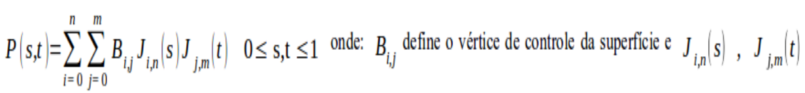

são as as funções de Bernstein, respectivamente, nas direções s e t. De qual superfície pode ser obtido um ponto qualquer pela expressão apresentada?

- a) Superfície B-Spline
- b) Superfície Racional
- c) Superfície de Hermite
- d) Superfície de Bézier
- e) Superfície Paramétrica Bicúbica

> [!success]- Resposta
> - **d)** Superfície de Bézier
>
> Soma dupla de pontos de controle B_ij pesados por funções de Bernstein em s e em t é a superfície de Bézier (com n = m = 3, a bicúbica de 16 pontos).

## Iluminação, shading, raytracing e radiosidade

### Q47 · marque todas as verdadeiras · apareceu 20×

O Modelo de Phong é:

- a) As componentes do modelo de Phong são: Luz Direta, Luz Transparente e Luz Especular
- b) As componentes do modelo de Phong são: Luz Direta (ou Difusa), Luz Especular e Luz Ambiente (ou Indireta)
- c) As componentes do modelo de Phong são: Luz Direta, Luz Difusa, Luz Especular (ou Transparente) e Luz Ambiente
- d) Um modelo de iluminação que trabalha com 3 componentes aditivas.
- e) Um modelo de iluminação que trabalha com 4 componentes multiplicativas.
- f) Um modelo de iluminação que trabalha com 4 componentes aditivas.
- g) Um modelo de iluminação que trabalha com 3 componentes multiplicativas.
- h) As componentes do modelo de Phong são: Luz Direta, Luz Difusa, Luz Indireta e Luz Ambiente

> [!success]- Resposta
> - **b)** As componentes do modelo de Phong são: Luz Direta (ou Difusa), Luz Especular e Luz Ambiente (ou Indireta)
> - **d)** Um modelo de iluminação que trabalha com 3 componentes aditivas.
>
> Phong tem 3 componentes que se SOMAM: difusa (direta), especular e ambiente (indireta). Qualquer alternativa com 'transparente', com 4 componentes ou com 'multiplicativas' está errada.

### Q48 · marque todas as verdadeiras · apareceu 20×

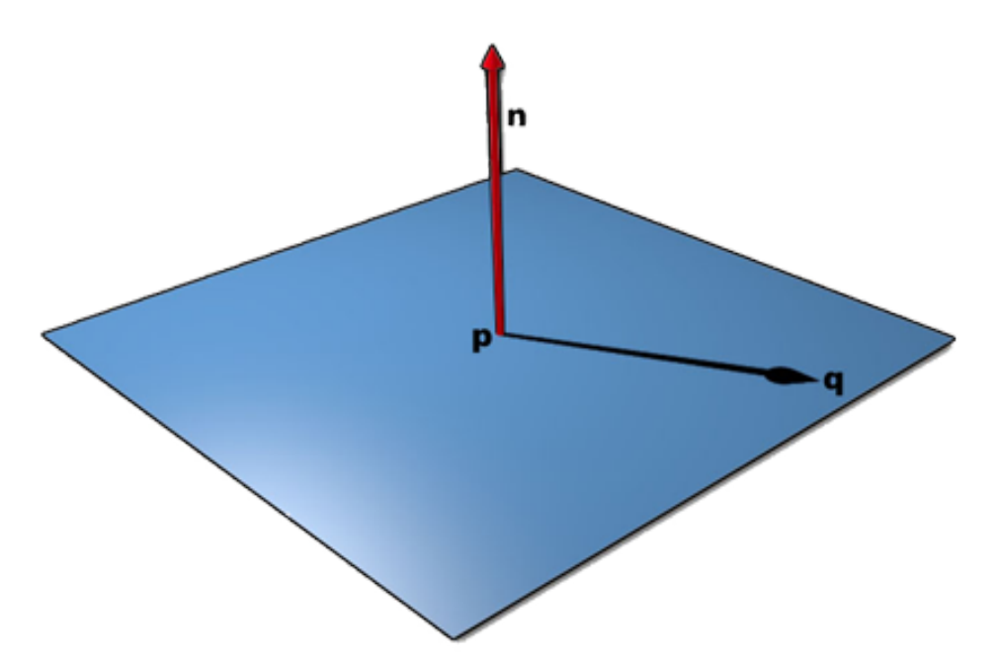

Calcular as normais às facetas que compõem a superfície de um objeto 3D é importante para renderizar a sua aparência porque:

- a) Permite identificar a orientação de uma faceta e assim saber se vai estar na sombra de outro objeto ou não.
- b) Permite calcular a diferença de orientação entre facetas e assim determinar a curvatura de um meshe.
- c) Permite a construção mais eficiente de octrees para determinação de colisões entre objetos em uma cena.
- d) Permite calcular a o ângulo de incidência da luz direta recebida por aquele ponto da superfície, e assim, calcular a sua transparência.
- e) Permite calcular a intensidade da iluminação difusa direta recebida por aquele ponto da superfície, e assim, calcular a sua iluminação.
- f) Permite calcular a o ângulo de incidência da luz direta recebida por aquele ponto da superfície, e assim, calcular a sua translucência.
- g) Permite calcular a intensidade do reflexo especular produzida por aquele ponto da superfície, e assim, calcular o quão brlhante ou espelhado ele será.
- h) Permite calcular a intensidade da luz ambiente indireta recebida por aquele ponto da superfície, e assim, calcular a sua iluminação.

> [!success]- Resposta
> - **e)** Permite calcular a intensidade da iluminação difusa direta recebida por aquele ponto da superfície, e assim, calcular a sua iluminação.
> - **g)** Permite calcular a intensidade do reflexo especular produzida por aquele ponto da superfície, e assim, calcular o quão brlhante ou espelhado ele será.
>
> A normal entra na difusa (N·L, lei de Lambert) e na especular (o vetor de reflexão R depende de N). Ela não serve para a luz ambiente (é constante), para saber se o ponto está na sombra (isso exige um raio até a luz), nem para transparência, curvatura ou octree.

### Q49 · escolha uma · apareceu 20×

Em Computação Gráfica os termos Radiância e Radiosidade dizem respeito a:

- a) São métodos de iluminação global realista de uma cena que modelam a inter-reflexão difusa entre os objetos da cena, representando interações luminosas e reflexos entre objetos.
- b) São métodos para calcular a luz própria emitida por um objeto utilizando-se o modelo da física da equação do corpo negro.
- c) São métodos para calcular a luz própria não puntual emitida por um objeto luminoso extenso utilizando-se o modelo da física da equação do corpo negro.
- d) São métodos de iluminação global realista de uma cena que modelam a Dispersão de Rayleigh e sua interação em toda a cena.
- e) São métodos de iluminação global realista de uma cena que modelam Raios Umbrais e sua interação em toda a cena.
- f) São métodos de iluminação global realista de uma cena que modelam Raios Crepusculares e sua interação em toda a cena.
- g) São métodos de iluminação global realista de uma cena que modelam a dispersão (scattering) da luz, como o efeito Tindall (fumaça) e névoa.
- h) São métodos para calcular a luz própria não puntual emitida por objetos luminosos extensos irradiando entre 2600ºK e 6000ºK.

> [!success]- Resposta
> - **a)** São métodos de iluminação global realista de uma cena que modelam a inter-reflexão difusa entre os objetos da cena, representando interações luminosas e reflexos entre objetos.
>
> São iluminação global por inter-reflexão difusa entre superfícies (a parede vermelha que tinge a branca ao lado). Corpo negro, dispersão de Rayleigh, raios umbrais e crepusculares e scattering são outra coisa.

### Q50 · escolha uma · apareceu 20×

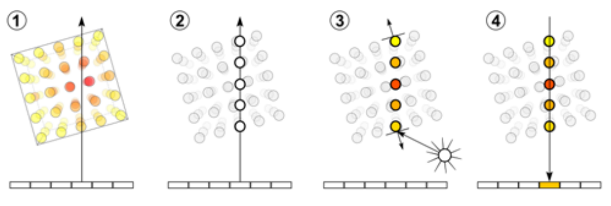

Um programa de computador/módulo usado para síntese (renderização) de imagens baseado na simulação do trajeto que raios de luz disparados para dentro de um volume de dados 3D percorreriam (dados densos), calculando visualizações 2D desses conjuntos de dados volumétricos 3D e colorindo-os com uma combinação das cores dos vóxeis por onde passam, permitindo visualizar, por exemplo, dados de radar, tomografias computadorizadas ou ressonâncias magnéticas. Estamos falando de um:

- a) Ray Tracer Volumétrico
- b) Processador de Anti-Aliasing Volumétrico
- c) Ray Shader Volumétrico
- d) Modelo de Phong Denso
- e) Ray Caster Volumétrico
- f) Iluminador Global ou Processador de Radiosidade Densa

> [!success]- Resposta
> - **e)** Ray Caster Volumétrico
>
> Raios atravessando um volume de voxels e acumulando cor são ray casting volumétrico (tomografia, ressonância, radar).

### Q51 · escolha uma · apareceu 19×

Um programa de computador/módulo usado para realizar a produção de níveis de cor e iluminação apropriadas para os píxeis de uma imagem ou produzir efeitos de reflexo e transparência. Tipicamente codificado para e executado na GPU. Estamos falando de um:

- a) Modelo de Phong
- b) Pixel Shader ou Ray Shader
- c) Processador de Anti-Aliasing
- d) Ray Tracer
- e) Iluminador Global ou Processador de Radiosidade
- f) Ray Caster

> [!success]- Resposta
> - **b)** Pixel Shader ou Ray Shader
>
> Programa que calcula cor e iluminação por pixel e roda na GPU: pixel shader (o professor chama também de ray shader).

### Q52 · escolha uma · apareceu 17×

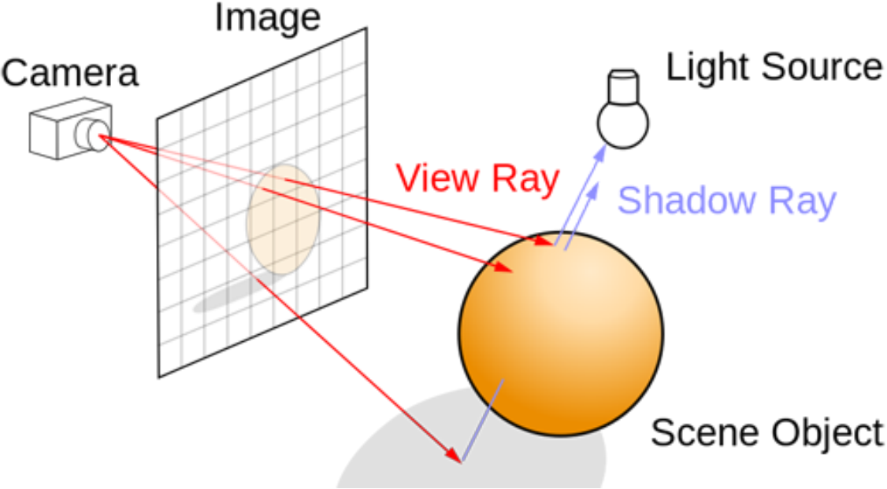

Um programa de computador/módulo usado para síntese (renderização) de imagens tridimensionais baseado na simulação do trajeto que os raios de luz percorreriam no mundo real, mas, neste caso, de trás para a frente. O algoritmo consiste em projetar, a partir do observador, um raio para cada um dos pixeis constituintes da viewport, vetor este que irá intersectar os objectos que formam a cena em análise. Estamos falando de um:

- a) Modelo de Phong
- b) Ray Tracer
- c) Ray Caster
- d) Processador de Anti-Aliasing
- e) Iluminador Global ou Processador de Radiosidade
- f) Pixel Shader ou Ray Shader

> [!success]- Resposta
> - **b)** Ray Tracer
>
> Ray tracing faz o caminho da luz ao contrário: sai do olho, um raio por pixel, e a cada acerto dispara raios de sombra, de reflexão e de refração. Ray caster para na primeira interseção.

### Q53 · escolha uma · apareceu 13×

[POSCOMP 2004, questão 60] A técnica de iluminação denominada ray-tracing

- a) apesar de possuir uma fase de pré-processamento custosa, onde é montada uma estrutura de árvore de iluminação, é bastante eficiente em situações em que a câmera se move e as fontes de luz e os objetos permanecem estáticos
- b) determina o grau de visibilidade de superfícies traçando raios de luz imaginários partindo de todos os vértices que definem as superfícies dos objetos da cena
- c) utiliza o modelo de iluminação local de Phong no cálculo parcial da iluminação
- d) se baseia no cálculo recursivo da iluminação transmitida e refletida por cada objeto, sendo que sua eficiência aumenta a medida em que aumenta o nível de transparência dos objetos envolvidos
- e) considera a interação entre os objetos da cena no cálculo da iluminação, mas só funciona com uma única fonte de luz

> [!success]- Resposta
> - **c)** utiliza o modelo de iluminação local de Phong no cálculo parcial da iluminação
>
> Em cada ponto atingido o ray tracing usa um modelo local (Phong) para a luz direta e soma recursivamente reflexão e refração. Não tem pré-processamento em árvore de iluminação, os raios saem do observador (não dos vértices), transparência deixa MAIS lento (mais raios) e funciona com várias luzes.

### Q54 · escolha uma · apareceu 13×

[POSCOMP 2010, questão 52] Considere as afirmativas a seguir:

1. O modelo de iluminação de Phong obtém as cores internas aos polígonos por interpolação das cores nos vértices.

2. A técnica de z-buffer utiliza ordenação de primitivas para determinação dos pixels visíveis.

3. O ponto (2,1,3,2), expresso em coordenadas homogêneas, equivale ao ponto (1.0, 0.5, 1.5) em coordenadas cartesianas tridimensionais.

4. Uma das principais vantagens da representação de objetos como malhas poligonais triangulares é a garantia de que todas as faces são planares.

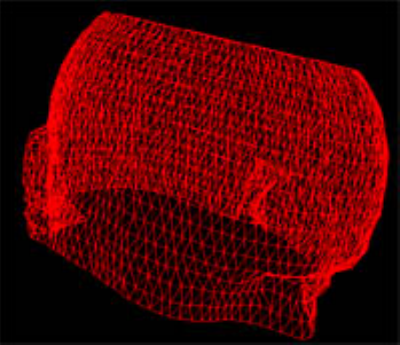

- a) Somente as afirmativas 3 e 4 são corretas.
- b) Somente as afirmativas 2,3 e 4 são corretas.
- c) Somente as afirmativas 1 e 4 são corretas.
- d) Somente as afirmativas 1,2 e 3 são corretas.
- e) Somente as afirmativas 1 e 2 são corretas.

> [!success]- Resposta
> - **a)** Somente as afirmativas 3 e 4 são corretas.
>
> 1 é falsa: Phong shading interpola NORMAIS; quem interpola cor é Gouraud. 2 é falsa: z-buffer não ordena, compara profundidade pixel a pixel. 3 é verdadeira: (2, 1, 3, 2) ÷ 2 = (1; 0,5; 1,5). 4 é verdadeira: três pontos sempre estão num plano, então triângulo é sempre planar.

### Q55 · escolha uma · apareceu 12×

[POSCOMP 2010] A correta tonalização de um poliedro requer que vetores normais à sua superfície sejam definidos em cada ponto de sua malha. Para tonalizar uma esfera definida parametricamente por p(u, v) = [cos(u)sin(v), cos(u)cos(v), sin(u)]ᵀ, onde u varia entre [−π/2, π/2] e v varia entre [−π, π], é preciso descobrir a forma implícita de sua normal n(u, v).

Como ela é definida?

- a) n(u, v) = 1/p(u, v)
- b) n(u, v) = 2p(u, v)
- c) n(u, v) = −cos(v)p(u, v)
- d) n(u, v) = cos(u)p(u, v) + cos(v)p(u, v)
- e) n(u, v) = cos(u)p(u, v)

> [!success]- Resposta
> - **e)** n(u, v) = cos(u)p(u, v)
>
> Na esfera unitária centrada na origem a normal tem a direção do próprio p. Fazendo ∂p/∂u × ∂p/∂v sai cos(u)·p(u, v), e cos(u) ≥ 0 no intervalo dado.

### Q56 · marque todas as verdadeiras · apareceu 12×

[POSCOMP 2011] Em cenas de computação gráfica, para aumentar o realismo visual, é comum aplicar-se um modelo de iluminação local que calcula as cores nos vértices dos triângulos a partir das propriedades de reflexão do objeto, propriedades geométricas do objeto e propriedades da(s) fonte(s) de luz. Sobre os modelos de iluminação locais, considere as afirmativas a seguir.

- a) A parcela de luz ambiente aproxima as múltiplas reflexões de luz das inúmeras superfícies presentes na cena.
- b) A parcela de reflexão difusa depende da posição do observador.
- c) A parcela difusa ideal de iluminação pode ser aproximada pela lei de Lambert, que estabelece que a reflexão difusa de uma superfície é proporcional ao ângulo entre o vetor normal à superfície e o vetor direção da fonte de luz.
- d) A parcela especular pode ser aproximada pelo modelo de Phong, que estabelece que a reflexão especular de uma superfície é proporcional ao cosseno do ângulo entre o vetor direção do observador e o vetor que estabelece a direção de reflexão especular ideal.

> [!success]- Resposta
> - **a)** A parcela de luz ambiente aproxima as múltiplas reflexões de luz das inúmeras superfícies presentes na cena.
> - **c)** A parcela difusa ideal de iluminação pode ser aproximada pela lei de Lambert, que estabelece que a reflexão difusa de uma superfície é proporcional ao ângulo entre o vetor normal à superfície e o vetor direção da fonte de luz.
> - **d)** A parcela especular pode ser aproximada pelo modelo de Phong, que estabelece que a reflexão especular de uma superfície é proporcional ao cosseno do ângulo entre o vetor direção do observador e o vetor que estabelece a direção de reflexão especular ideal.
>
> Ambiente aproxima as reflexões múltiplas da cena (V). Difusa NÃO depende do observador, só de N e L (F). Lambert: difusa proporcional ao cosseno do ângulo entre N e L (V). Especular: cosⁿ do ângulo entre a direção do observador e a de reflexão (V).

### Q57 · escolha uma · apareceu 12×

Como se denomina uma fonte de luz que esteja a uma distância infinita de uma cena, gerando uma iluminação similar à da luz do Sol?

- a) Ambiente.
- b) Pontual.
- c) Direcional.
- d) Difusa.
- e) Spot.

> [!success]- Resposta
> - **c)** Direcional.
>
> Luz no infinito tem raios paralelos e a mesma direção na cena toda, como o Sol: fonte direcional. Pontual irradia de um ponto, spot é pontual com cone, ambiente não tem direção.

### Q58 · escolha uma · apareceu 11×

[POSCOMP 2005, questão 46] No que diz respeito a geração de imagens por RayTracing, qual das afirmações a seguir não é verdadeira?

- a) O número de raios lançados independe do número de objetos da cena.
- b) O lançamento de raios é dependente da posição da câmera.
- c) A refração e a reflexão da luz precisam ser tratadas neste método.
- d) Em algumas variações do método, o cálculo das sombras é feito a parte.
- e) Este método pode ser facilmente paralelizado.

> [!success]- Resposta
> - **a)** O número de raios lançados independe do número de objetos da cena.
>
> A falsa é dizer que o número de raios não depende da cena: cada objeto refletor ou transparente e cada luz geram raios secundários e de sombra. O resto é verdade: depende da câmera, trata reflexão e refração, a sombra pode ser calculada à parte, e paraleliza fácil porque os pixels são independentes.

### Q59 · escolha uma · apareceu 11×

[POSCOMP 2015 - Questão 57] Simular a propagação da luz no ambiente, avaliando a sua interação com os objetos que o compõem e considerando a interação da luz com as suas superfícies, é o objetivo da técnica do algoritmo.

- a) Ray Tracing
- b) Bresenham
- c) Sutherland Hodgman
- d) Boundary-Fill
- e) Cohen-Sutherland

> [!success]- Resposta
> - **a)** Ray Tracing
>
> Simular a luz interagindo com as superfícies é ray tracing. Bresenham traça retas, Sutherland-Hodgman e Cohen-Sutherland recortam, Boundary-Fill preenche região.

## Rasterização, z-buffer, aliasing e texturas

### Q60 · escolha uma · apareceu 13×

[POSCOMP 2012 - Questão 58] Em relação à técnica de antisserrilhado (anti-aliasing) conhecida por Multi Sampling Anti-Aliasing (MSAA) e considerando o pipeline gráfico de rasterização, assinale a alternativa correta.

- a) A técnica exige dois passos de rasterização, um para marcar o mapa de profundidade e outro para a definição das cores dos píxeis.
- b) A técnica não é capaz de reduzir o serrilhado proveniente das cores das texturas mapeadas sobre malha de triângulos.
- c) A distribuição de amostras deve ser regular, por exemplo, deve seguir uma distribuição com formato matricial.
- d) As primitivas geométricas devem ser rasterizadas de forma ordenada, começando pela mais distante até a mais próxima da câmera virtual.
- e) Uma das características da técnica é reutilizar informações capturadas da cena por uma amostra na computação de outras amostras, por exemplo, iluminação.

> [!success]- Resposta
> - **e)** Uma das características da técnica é reutilizar informações capturadas da cena por uma amostra na computação de outras amostras, por exemplo, iluminação.
>
> O MSAA testa cobertura e profundidade em várias amostras por pixel, mas calcula o shading (cor, iluminação) uma vez por pixel e reaproveita nas amostras: é a alternativa do gabarito. Ele rasteriza uma vez, não exige ordem de desenho e não precisa de grade regular. A b descreve um limite real do MSAA (não suaviza o serrilhado de dentro das texturas), mas o gabarito oficial é a do reaproveitamento.

### Q61 · escolha uma · apareceu 13×

[POSCOMP 2003, questão 49] Sobre a técnica conhecida como Z-buffer é correto afirmar que:

- a) As primitivas geométricas precisam estar ordenadas de acordo com a distância em relação ao observador.
- b) É possível realizar o cômputo das variáveis envolvidas de forma incremental.
- c) É uma técnica muito comum de detecção de colisão.
- d) As dimensões do Z-buffer são independentes das dimensões do frame buffer.
- e) Nenhuma das alternativas acima está correta.

> [!success]- Resposta
> - **b)** É possível realizar o cômputo das variáveis envolvidas de forma incremental.
>
> O z de cada pixel sai de forma incremental durante a varredura (z += zinc). Não precisa ordenar primitivas, não é detecção de colisão e tem o mesmo tamanho do frame buffer (um z por pixel).

### Q62 · escolha uma · apareceu 13×

[POSCOMP 2013 - Questão 56] Em relação à Computação Gráfica, considere as afirmativas a seguir.

1. Dada uma malha de triângulos que aproxima uma esfera, a suavidade da iluminação gerada pelo algoritmo de Gouraud depende da resolução da malha.

2. Na projeção paralela, o volume de visualização é retangular.

3. O algoritmo de Bresenham é um algoritmo de rasterização de linhas.

4. O efeito de serrilhado (aliasing) não ocorre na rasterização de malhas de triângulos bidimensionais. Assinale a alternativa correta (POSCOMP 2013 - Questão 56).

- a) Somente as afirmativas I, II e III são corretas.
- b) Somente as afirmativas I e II são corretas.
- c) Somente as afirmativas II, III e IV são corretas.
- d) Somente as afirmativas I e IV são corretas.
- e) Somente as afirmativas III e IV são corretas.

> [!success]- Resposta
> - **a)** Somente as afirmativas I, II e III são corretas.
>
> 1 é verdadeira: Gouraud interpola a cor dos vértices, então malha mais fina fica mais suave. 2 é verdadeira: o volume da paralela é um paralelepípedo. 3 é verdadeira: Bresenham rasteriza linhas. 4 é falsa: serrilhado aparece em qualquer rasterização.

### Q63 · escolha uma · apareceu 12×

A TÉCNICA DE MAPEAMENTO DE TEXTURA BASEADA NA APLICAÇÃO DE UMA FUNÇÃO DE PERTURBAÇÃO NO VETOR NORMAL DA SUPERFÍCIE, DE FORMA QUE A ILUMINAÇÃO DESSA SEJA AFETADA, É DENOMINADA:

- a) BUMP MAPPING
- b) TEXTURA PROCEDURAL
- c) TEXTURA SÓLIDA
- d) ENVIRONMENT MAPPING
- e) FRAME MAPPING

> [!success]- Resposta
> - **a)** BUMP MAPPING
>
> Bump mapping perturba a normal sem mexer na geometria, então só a iluminação muda. Environment mapping reflete o ambiente; textura procedural e textura sólida geram a cor por uma função.

### Q64 · escolha uma · apareceu 12×

[POSCOMP 2012] Suponha uma cena tridimensional composta apenas por duas esferas contidas no volume de visualização. Uma dessas esferas está completamente encoberta pela outra em relação à visão da câmera virtual que utiliza projeção paralela. Com base no enunciado e nos conhecimentos sobre o tema, assinale a alternativa correta (POSCOMP 2012 - Questão 55).

- a) O modelo de iluminação de Gouraud descreve a sombra vinda de uma das esferas sobre a outra.
- b) A esfera encoberta pode ser maior que a esfera visível, basta que uma esteja na frente, em relação à visão da câmera, e suficientemente distantes entre si.
- c) Utilizando o algoritmo de Z-Buffer, a imagem resultante, após a rasterização de ambas as esferas, é a mesma, independentemente de qual esfera é rasterizada primeiro.
- d) Os algoritmos de remoção de superfícies ocultas não são úteis na situação descrita, pois ambas as esferas estão dentro do volume de visualização.
- e) No modelo de iluminação de Phong, a iluminação de uma das esferas depende da cor da segunda esfera.

> [!success]- Resposta
> - **c)** Utilizando o algoritmo de Z-Buffer, a imagem resultante, após a rasterização de ambas as esferas, é a mesma, independentemente de qual esfera é rasterizada primeiro.
>
> Z-buffer compara profundidade pixel a pixel, então a ordem de desenho não muda o resultado. Na paralela o tamanho não diminui com a distância, então a esfera escondida não pode ser maior que a da frente. Gouraud e Phong são modelos locais: não calculam sombra nem dependem da cor do outro objeto.

### Q65 · escolha uma · apareceu 12×

[POSCOMP 2015 - Questão 70] MeshSmooth, Bump Map, Flat Shading são, respectivamente, tipos de:

- a) Textura, Método de Renderização, Modificador
- b) Modificador, Textura, Método de Renderização.
- c) Método de Renderização, Textura, Modificador.
- d) Modificador, Método de Renderização, Textura
- e) Textura, Modificador, Método de Renderização.

> [!success]- Resposta
> - **b)** Modificador, Textura, Método de Renderização.
>
> MeshSmooth (3ds Max) é um modificador de malha, bump map é um tipo de textura e flat shading é um método de renderização (sombreamento).

### Q66 · escolha uma · apareceu 11×

[POSCOMP 2008] Dada a seguinte função escrita na linguagem de programação C:

```c
void _________(int xi, int yi, int xf, int yf, int cor) {
    int x, y;
    float a;
    a = (yf - yi) / (xf - xi);
    for (x = xi; x <= xf; x++) {
        y = (yi + a * (x - xi));
        putpixel(x, y, cor);
    }
}
```

Considere que a função putpixel plota um pixel de cada vez na tela em modo gráfico, na posição (x, y) com a cor especificada. Essa função plota na tela do computador:

- a) um retângulo.
- b) uma linha.
- c) um triângulo.
- d) uma elipse.
- e) um círculo.

> [!success]- Resposta
> - **b)** uma linha.
>
> y = yi + a·(x − xi) com a = (yf − yi)/(xf − xi) é a equação da reta. Para cada x calcula y e acende o pixel: desenha uma linha (é o algoritmo ingênuo, antes do DDA e do Bresenham).

### Q67 · resposta numérica (inteiro) · apareceu 11×

[POSCOMP 2013 - Questão 60] Em Computação Gráfica, a técnica mipmap objetiva reduzir o custo computacional e o efeito de serrilhado (aliasing) durante a rasterização de superfícies com mapeamento de textura. Isso é feito com base em um pré-processamento, por textura, que resulta em um acréscimo no consumo de memória.

Indique, através de um número inteiro de 0 a 400 (significando de 0% a 400%), indicando, em termos percentuais, qual o consumo adicional de memória causado pelo mipmap além memória já ocupada pela textura original.

> [!success]- Resposta
> **33**
>
> Cada nível tem 1/4 dos pixels do anterior: 1/4 + 1/16 + 1/64 + ... = 1/3, cerca de 33% a mais.

### Q68 · escolha uma · apareceu 10×

[POSCOMP 2006, questão 49] Considere as afirmações abaixo:

I. Um terminal raster apresentará o efeito "pisca-pisca" quando a cena for muito complexa.

II. Uma célula de vizinhança 4 no algoritmo de boundary-fill sempre preenche a região interior completamente quando a borda da região de preenchimento tiver largura de 2 pixels.

III. No algoritmo do ponto médio para traçado de círculos, se f(xM,yM) = r2 - x2 - y2 < 0, o ponto (xM,yM) é interior à circunferência

IV. Em uma cena composta apenas de objetos convexos, a eliminação de superfícies ocultas restringe-se à remoção das faces posteriores (back faces).

V. No mapeamento janela-viewport, mantendo-se a viewport fixa e aumentando-se o tamanho da janela provoca-se o efeito de zoom-in.

- a) Apenas II - IV - V são verdadeiras
- b) Apenas I - II - III são verdadeiras
- c) Todas são falsas
- d) Todas são verdadeiras
- e) Apenas I - II são verdadeiras.

> [!success]- Resposta
> - **c)** Todas são falsas
>
> I: piscar com cena complexa é problema do display vetorial (random scan), que redesenha a lista de objetos; o raster varre a tela a uma taxa fixa. II: com vizinhança 4 o preenchimento não passa por ligações diagonais, então não há garantia. III: f = r² − x² − y² < 0 quer dizer x² + y² > r², ponto FORA. IV: com vários objetos convexos um pode esconder o outro, só backface não basta (basta para UM objeto convexo). V: aumentar a janela com a viewport fixa é zoom OUT. Todas falsas.

## APIs, engines e outros

### Q69 · escolha uma · apareceu 21×

O conceito de Entity Component System (ECS) diz respeito à:

- a) O modelo de herança utilizado em APIs gráficas como OpenGL e WebGL.
- b) A técnica de usar grafos em editores de programação visual de Game Engines para a representação da arquitetura de dados e funções.
- c) O modelo de polimorfismo utilizado em APIs gráficas como OpenGL e WebGL.
- d) Padrão de arquitetura de modelagem de dados utilizado por Game Engines onde se dá preferência a herança e polimorfismo em detrimento de agregação e objetos compostos.
- e) Padrão de arquitetura de modelagem de dados utilizado por Game Engines onde se dá preferência a agregados em detrimento de herança e polimorfismo.

> [!success]- Resposta
> - **e)** Padrão de arquitetura de modelagem de dados utilizado por Game Engines onde se dá preferência a agregados em detrimento de herança e polimorfismo.
>
> Em ECS a entidade é só um ID, os componentes guardam dados e os sistemas processam quem tem certos componentes. Troca herança e polimorfismo por composição (agregação).

### Q70 · escolha uma · apareceu 20×

Um pacote de software que tipicamente inclui: um motor gráfico para renderizar gráficos 2D e/ou 3D, um motor de física para simular a física ou simplesmente para fazer detecção de colisão, suporte a animação, sons, inteligência artificial, networking, gerência de memória, gerência de arquivos, gerência de linha de execução, suporte a grafos de cena e entidades e suporte a uma linguagem de script é um:

- a) Pacote de Modelagem Tridimensional
- b) APK do OpenGL
- c) API gráfica de última geração
- d) Game Engine ou Motor de Jogo
- e) APK do WebGL

> [!success]- Resposta
> - **d)** Game Engine ou Motor de Jogo
>
> Motor gráfico + física/colisão + animação + som + IA + rede + memória/arquivos/threads + grafo de cena + linguagem de script = game engine (Unity, Unreal, Godot).

### Q71 · escolha uma · apareceu 18×

Uma Biblioteca ou API Gráfica é uma biblioteca de programas projetada para auxiliar na renderização de conteúdo gráfico para apresentação em um monitor. Tipicamente envolve o provimento de funções altamente otimizadas paraa realização de tarefas de desenho comuns, servindo também para gerar código executável em GPUs. São exemplos de APIs gráficas utilizadas na atualidade:

- a) Blender, Moray e POVRay
- b) OpenGL, WebGL e DirectX
- c) OpenGL, WebGL e Direct3D
- d) OpenGL, Direct3D e DirectX
- e) Blender, Unity e OpenGL

> [!success]- Resposta
> - **c)** OpenGL, WebGL e Direct3D
>
> OpenGL, WebGL e Direct3D são APIs gráficas. DirectX é a coleção inteira (som, entrada, rede...), e o pedaço gráfico dela é o Direct3D. Blender e Moray são modeladores, POV-Ray é raytracer, Unity é engine.

### Q72 · escolha uma · apareceu 14×

[POSCOMP 2007] Dado o seguinte trecho de um programa escrito em C:

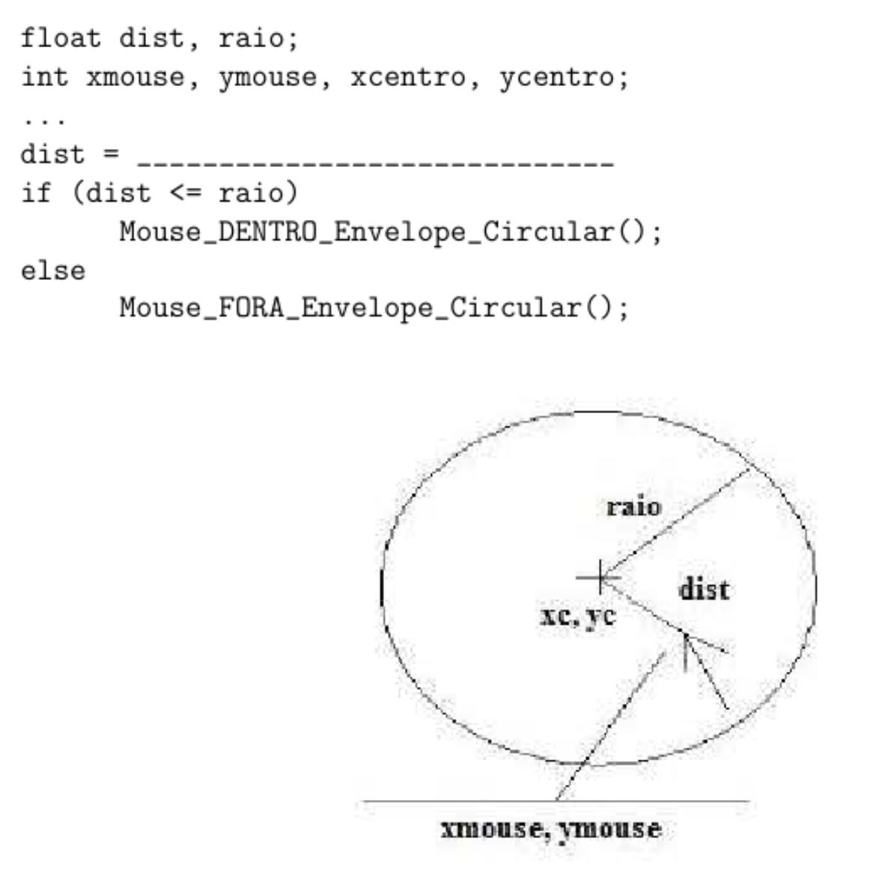

Considere que um sistema gráfico utiliza envelope circular para localizar objetos em sua interface gráfica. O programador está utilizando o trecho de programa descrito acima para verificar se o usuário está apontando o mouse para um dos objetos. Para tanto, ele utiliza o cálculo da distância entre dois pontos. Assinale a alternativa que indica corretamente como á calculada a distância (dist) entre dois pontos.

- a) sqrt((xmouse-xcentro)-(ymouse-ycentro))
- b) sqrt((xmouse-xcentro)+(ymouse-ycentro))
- c) sqrt((xcentro-xmouse)+(ycentro-ymouse))/2
- d) sqrt(pow(xmouse-xcentro,2)+pow(ymouse-ycentro,2))
- e) sqrt(pow(xmouse-xcentro,2)-pow(ymouse-ycentro,2))

> [!success]- Resposta
> - **d)** sqrt(pow(xmouse-xcentro,2)+pow(ymouse-ycentro,2))
>
> Distância euclidiana: sqrt((xm − xc)² + (ym − yc)²). Se for ≤ raio, o mouse está dentro do envelope circular.

### Q73 · associe as colunas · apareceu 12×

[POSCOMP 2013 - Questão 58] Relacione as técnicas de Computação Gráfica, na coluna da esquerda, com as suas funções, na coluna da direita.

| Coluna da esquerda | Coluna da direita (embaralhada) |
|---|---|
| BSP | Remoção de superfícies ocultas |
| Cohen-Sutherland | Iluminação |
| Bézier | Aproximação de curvas |
| Algoritmo do pintor | Recorte |
| Phong | Subdivisão espacial |

> [!success]- Resposta
> - BSP → **Subdivisão espacial**
> - Cohen-Sutherland → **Recorte**
> - Bézier → **Aproximação de curvas**
> - Algoritmo do pintor → **Remoção de superfícies ocultas**
> - Phong → **Iluminação**
>
> BSP é árvore de partição binária do espaço, Cohen-Sutherland recorta, Bézier aproxima curvas, o algoritmo do pintor remove superfícies ocultas pintando do fundo para a frente, e Phong é iluminação.

## Processamento de imagens (POSCOMP)

### Q74 · escolha uma · apareceu 12×

[POSCOMP 2004] Considerando as declarações abaixo, é incorreto afirmar:

- a) Os filtros Gaussiano e Laplaciano são exemplos de filtro passa-baixas
- b) O filtro da mediana pode ser utilizado para redução de ruído em uma imagem
- c) Filtros passa-altas são utilizados para detecção de bordas em imagens
- d) A transformada discreta de Fourier nos permite obter uma representação de uma imagem no domínio freqüência
- e) Filtragem no domínio espacial é realizada por meio de uma operação chamada “convolução”

> [!success]- Resposta
> - **a)** Os filtros Gaussiano e Laplaciano são exemplos de filtro passa-baixas
>
> Gaussiano é passa-baixas (suaviza), mas o Laplaciano é passa-altas: é a segunda derivada e realça bordas. As outras são verdadeiras: mediana tira ruído (sal e pimenta), passa-altas detecta borda, a DFT leva a imagem para o domínio da frequência e filtragem espacial é convolução com uma máscara.

### Q75 · escolha uma · apareceu 12×

[POSCOMP 2004] Identifique a declaração incorreta:

- a) A transformação necessária para calcular o negativo de uma imagem pode ser aplicada simultaneamente (i.e., em paralelo) a todos pixels da imagem original
- b) A equalização de histograma pode ser obtida a partir de um histograma cumulativo da imagem original
- c) A equalização de histograma é uma transformação não-linear e específica para cada imagem
- d) As operações de ajuste de brilho e contraste são operações lineares
- e) O objetivo da equalização de histograma é reduzir o constrastre nas regiões da imagem que correspondem à porção do histograma com maior concentração de pixels

> [!success]- Resposta
> - **e)** O objetivo da equalização de histograma é reduzir o constrastre nas regiões da imagem que correspondem à porção do histograma com maior concentração de pixels
>
> Equalizar o histograma espalha os níveis de cinza usando o histograma cumulativo, o que AUMENTA o contraste nas faixas com mais pixels. Negativo é operação ponto a ponto (dá para fazer em paralelo), equalização é não linear e depende da imagem, brilho e contraste são lineares (g = a·f + b).

### Q76 · escolha uma · apareceu 10×

[POSCOMP 2009] Sobre o conceito de segmentação de imagens, é CORRETO afirmar:

- a) Nenhuma das opções acima.
- b) Operação que objetiva particionar uma imagem em um conjunto de regiões de mesmo tamanho.
- c) Processo que objetiva identificar objetos na imagem de acordo com uma descrição prévia com base em uma ou mais características (brilho, tons de cinza, cor, textura)
- d) É a mesma coisa que detecção de bordas de imagens.
- e) Processo que agrupa partes de uma imagem em regiões homogêneas com respeito a uma ou mais características (brilho, tons de cinza, cor, textura).

> [!success]- Resposta
> - **e)** Processo que agrupa partes de uma imagem em regiões homogêneas com respeito a uma ou mais características (brilho, tons de cinza, cor, textura).
>
> Segmentar é agrupar pixels em regiões homogêneas por alguma característica (cor, brilho, textura). As regiões não precisam ter o mesmo tamanho, detecção de borda é só uma das técnicas, e identificar objetos a partir de uma descrição prévia é reconhecimento.

### Q77 · escolha uma · apareceu 10×

[POSCOMP 2006] Quando se aplica um filtro passa-baixas (low-pass filter) a uma imagem com dimensões 100x100 em tons de cinza (grayscale) com todos os pixels na cor preta, a imagem resultante:

- a) Nenhuma das afirmações acima é correta
- b) Fica reduzida à metade das dimensões da imagem original
- c) Tem as mesmas dimensões da imagem original, com todos os pixels na cor branca
- d) Tem as mesmas dimensões da imagem original, com todos os pixels na cor preta
- e) Fica ampliada ao dobro das dimensões da imagem original

> [!success]- Resposta
> - **d)** Tem as mesmas dimensões da imagem original, com todos os pixels na cor preta
>
> Passa-baixas faz uma média ponderada da vizinhança. A média de pixels todos pretos continua preta, e filtrar não muda o tamanho da imagem.

